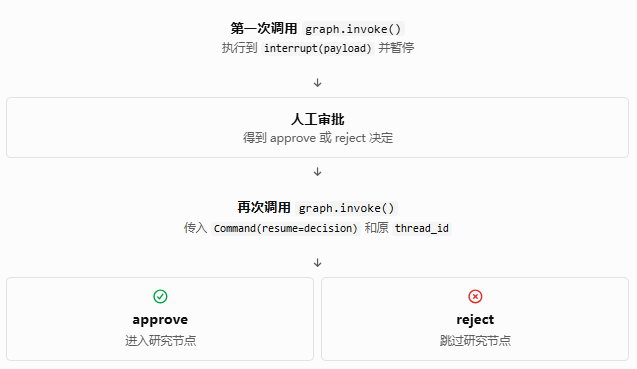
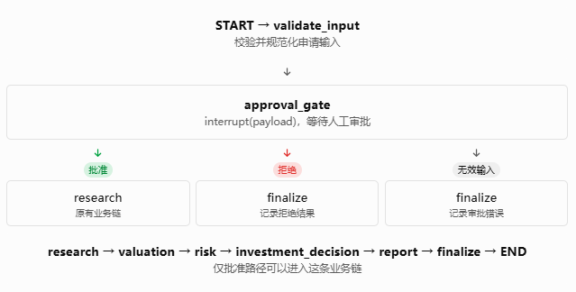

# Phase 10: HITL (Human-in-the-loop)

## Lesson 1：Persistence 与 HITL 集成前置审查

本课先不编写 `interrupt()`，也不急于修改业务 Graph。我们先确认 Phase 9 的持久化基础设施是否真正可用，并确定 Phase 10 应该从哪里接入。

这一步非常重要：我们的目标不是完成一个只能演示的 HITL 示例，而是将人工审批可靠地集成进现有的 Investment Research Decision Agent，同时保留此前各阶段已经实现的功能。

### 一、本课学习目标

完成 Lesson 1 后，你应该能够回答以下问题：

1. 项目中究竟有几个 Graph 构建入口？哪个才是实际的 Application Graph？
2. `Checkpointer` 在哪里创建，又在哪里传给 Graph？
3. `thread_id` 如何从调用入口传递到 LangGraph？
4. 当前测试究竟证明了什么，又有哪些能力尚未被证明？
5. 在不破坏现有架构的前提下，Phase 10 应该在哪个位置引入 HITL？

本课分成四步：

 - Step 1：确认源码事实

找出 Graph 构建入口、Checkpointer 工厂、配置辅助函数和相关测试。

 - Step 2：还原实际调用链

判断生产 Graph 是否真正使用持久化，而不只是项目里存在一个 Checkpointer 工厂。

 - Step 3：核验测试与持久化

检查 SQLite 数据库路径、Thread 隔离以及测试是否验证了真实持久化行为。

 - Step 4：确定最小修复和验收条件

只修复阻塞 Phase 10 的问题，不提前实现后续 Lesson 的功能。

### 二、Step 1：确认源码事实

我已经解压并检查了当前 Phase 9 源码，以及交接文档中的 Lesson 1 计划。

先看一个核心概念。

#### 2.1 Checkpointer 不等于 Graph 已经开启持久化

项目使用的接口是：

```
return builder.compile(checkpointer=checkpointer)
```

这里有两个独立的动作：

- `create_checkpointer()`：创建 SQLite Checkpointer。
- `builder.compile(checkpointer=checkpointer)`：将 Checkpointer 绑定到编译后的 Graph。

只有创建了 Checkpointer，却没有将其传给实际运行的 Graph，持久化就没有真正接入该执行流程。

在本项目中，相关代码分布在三个位置：

| 文件                          | 职责                                                    |
| --------------------------- | ----------------------------------------------------- |
| `app/graph/checkpointer.py` | 创建 SQLite Checkpointer                                |
| `app/application/graph.py`  | 构建生产 Application Graph                                |
| `app/graph/runtime.py`      | 组合 Checkpointer 和 Application Graph，并提供 Thread 配置辅助函数 |

这三层的职责划分本身是合理的。我们暂时不需要重构它们。

#### 2.2 当前存在两个不同的 Graph

**Graph A：原有基础 Graph**

文件：`app/graph/graph.py`

```python
def build_graph(checkpointer=None):
    # ... 构建 StateGraph
    return builder.compile(
        checkpointer=checkpointer
    )

graph = build_graph()
```

这里默认没有传入 Checkpointer。它是原有的基础 Graph，不应该与后续生产 Application Graph 混为一谈。

**Graph B：生产 Application Graph**

文件：`app/application/graph.py`

```python
def build_application_graph(*, checkpointer=None):
    # ... 构建 Application StateGraph
    return builder.compile(
        checkpointer=checkpointer
    )

application_graph = build_application_graph()
```

同样，模块末尾的默认对象没有显式传入 Checkpointer。

这不代表 `build_application_graph()` 不能使用持久化；它支持接收 Checkpointer。问题在于默认导出的 `application_graph` 没有绑定该组件。

**运行时工厂：`app/graph/runtime.py`**

```python
def create_application_graph(*, checkpointer=None):
    if checkpointer is None:
        checkpointer = create_checkpointer()

    return build_application_graph(
        checkpointer=checkpointer
    )
```

这个工厂会在未传入 Checkpointer 时创建 SQLite Checkpointer，再将其传入生产 Application Graph 的构建函数。

这是目前最明确的生产 Graph 持久化构建路径。

这里需要区分两个判断：

- 源码能力： 项目已经具备通过运行时工厂构建持久化 Application Graph 的能力。
- 实际使用情况： 当前源码没有找到实际业务入口调用 `create_application_graph()` 并运行该 Graph 的代码。因此，仅凭现有源码，还不能证明生产调用链已经统一使用这条路径。

这也是 Lesson 1 必须确认的架构边界。

#### 2.3 Thread ID 的传递方式

在 `app/graph/runtime.py` 中，项目提供了：

```python
def build_thread_config(thread_id: str):
    if not isinstance(thread_id, str) or not thread_id.strip():
        raise ValueError(
            "thread_id must be a non-empty string"
        )

    return {
        "configurable": {
            "thread_id": thread_id,
        }
    }
```

这段代码做了两件事：

1. 拒绝空字符串和不合法类型的 Thread ID。
2. 构造 LangGraph 使用的 `configurable.thread_id` 配置。

但是，辅助函数的存在并不意味着所有 Graph 调用都使用了它。

后续执行和恢复时，调用方必须为同一条暂停的执行提供相同的 Thread ID。Thread ID 应当标识一次可恢复的工作流上下文，而不是每次调用都重新随机生成。

例如，概念上：

```python
config = build_thread_config("research-AAPL-001")

result = graph.invoke(
    initial_input,
    config=config,
)
```

这里的 `initial_input` 仅表示业务输入，并非要求你现在修改源码或直接运行此代码。

本步骤结论： Thread 配置辅助函数已经存在，但实际业务调用链尚未得到证明。我们应当复用它，并在后续集成时确保初次执行和恢复执行使用同一个 Thread ID。

### 三、Step 2：还原真实业务 Graph 与 State

#### 3.1 当前 Application Graph 的业务拓扑

根据 `app/application/graph.py` 中的节点和边，当前生产 Application Graph 的主流程是：


这个拓扑有一个重要特点：顶层 `research` 节点会调用独立的 `research_supervisor_graph`。因此，研究规划与实际研究工作并非全部直接暴露在顶层 Application Graph 中。

这影响了 HITL 插入点的选择。

#### 3.2 State 已经有什么？缺少什么？

文件：`app/application/state.py`

当前 `ApplicationState` 已经包含：

- 研究请求：`ticker`、`user_query`
- 研究结果：公司、财务、市场和行业宏观研究结果
- 估值结果与错误
- 风险分析结果与错误
- 投资决策结果与错误
- 报告结果及各类报告错误
- 工作流状态：`current_stage`、`stage_errors`、`application_error`

但目前没有专门用于 HITL 的字段，例如：

- `approval_status`：审批状态
- `approval_decision`：人工提交的决定
- `approval_reason`：决定的理由

这不意味着现在必须立即增加这些字段。本课的任务是确定业务契约，具体修改留到实现相应 Lesson 时再做。

需要特别注意，`ApplicationOutputState` 和 `finalize_application()` 也定义了对外输出契约。因此，如果后续增加审批状态，只修改内部 State 不够，还要决定最终输出是否需要公开该状态。

#### 3.3 选择 HITL 插入点

交接文档建议在高成本研究任务前增加审批。这与当前 Graph 的结构相符。

我建议的第一版设计是：

- 将审批放在 `validate_input` 成功之后。
- 在开始调用 `research_supervisor_graph` 之前暂停。
- 审批通过后，沿用原来的 Research → Valuation → Risk → Investment Decision → Report 主流程。
- 审批拒绝后，生成明确的拒绝终态，不调用研究节点。

这样可以保护现有研究流程，不必先修改 Research Supervisor 的内部实现。

不过，必须明确一个业务区别：

审批研究请求，不等于审批研究计划。

如果审批人需要先查看系统生成的具体研究计划，再决定是否执行，那么现有的 `research` 阶段需要进一步拆分为“生成研究计划”和“执行研究计划”。这会扩大本次改动范围。

为了严格控制 Phase 10 的范围，我建议第一版先审批经过校验的研究请求。待这一版本通过验收后，再根据实际需要评估是否支持计划级审批。

#### 3.4 新增 HITL 后的目标拓扑


这个设计有一个工程上的优点：人工审批成为研究流程的明确前置条件，而不是散落在研究 Agent 内部的隐式判断。

另外，`interrupt()` 不必对应一个单独的、只负责等待的节点。它可以放在审批节点函数中；恢复后，节点根据恢复值进行校验，再由条件边选择批准或拒绝分支。

这样可以减少不必要的节点数量，并保持审批逻辑集中。

### 四、Step 3：审查当前持久化测试

这一部分是本课的重点。我们不根据测试名称推断测试能力，而是逐行检查实际执行了什么。

#### 4.1 `tests/test_checkpoint.py` 中的三个问题

---

**问题 A：测试对象与名称不一致**

当前测试：

```python
def test_main_application_graph_has_checkpointer():
    assert graph.checkpointer is not None
```

这里导入的 `graph` 来自 `app.graph.graph`，不是 `app.application.graph` 中的生产 Application Graph。

而且，基础 Graph 的默认构建方式是 `graph = build_graph()`，其默认参数 `checkpointer=None`。

因此，这个测试既没有检查生产 Application Graph，也与基础 Graph 的默认构建配置存在直接矛盾。按照当前编译方式，预期应当是 Checkpointer 未绑定；需要在项目实际依赖版本中运行确认具体测试结果。

---

**问题 B：临时数据库路径没有真正用于被测对象**

当前测试先创建：

```python
database_path = (
    tmp_path / "checkpoints.sqlite"
)

connection = sqlite3.connect(
    database_path,
    check_same_thread=False,
)
```

但随后实际调用：

```python
checkpointer = create_checkpointer()
```

这会使用 `create_checkpointer()` 的默认路径，而不是前面创建的临时数据库连接。

这段测试因此不能证明数据写入了 `tmp_path` 下的数据库。它还留下了一个没有被用于 Checkpointer 的数据库连接。

正确方向是：让被测 Checkpointer 明确使用临时数据库路径，并在测试结束时正确关闭资源。

---

**问题 C：已有恢复测试没有覆盖 HITL 恢复**

`test_sqlite_checkpoint_survives_graph_recreation()` 已经做了一件有价值的事：

1. 用第一个 SQLite 连接创建 Graph。
2. 执行 Graph 并写入 State。
3. 关闭第一个连接。
4. 使用同一数据库创建第二个 Checkpointer 和 Graph。
5. 查询原 Thread 的 State。

这能够验证已完成执行的状态在 Graph 重建后仍可读取，是值得保留的基础测试。

但它没有触发 `interrupt()`，也没有恢复一个暂停的执行。因此，它不能证明 HITL 的中断与恢复生命周期已经通过验收。

#### 4.2 Thread 隔离测试的价值

当前的 `test_sqlite_threads_are_isolated()` 使用两个不同的 `thread_id`，分别运行并查询 State。

这是正确的测试方向，应该保留。

后续需要确保测试确实使用临时 SQLite 数据库，并验证两个 Thread 的 State 互不污染。对于 HITL，还应增加更有针对性的测试：一个 Thread 处于等待审批状态时，另一个 Thread 的执行不应意外恢复或修改它。

### 五、Step 4：确定最小修复方案与最终设计

Lesson 1 的目标不是立即修改所有问题，而是明确哪些问题会阻塞后续 HITL 实现，以及如何以最小代价解决它们。

#### 5.1 建议的修复顺序

| 顺序 | 工作                                                                    | 是否必须修改源码         |
|------|-------------------------------------------------------------------------|--------------------------|
| 1    | 明确 `create_application_graph()` 是 Phase 10 的 Graph 构建入口         | 先确认架构，不必立即修改 |
| 2    | 修正 Checkpoint 测试，确保使用真实临时 SQLite 数据库                    | 是                       |
| 3    | 修正 Checkpointer 测试对象，分别验证基础 Graph 与生产 Application Graph | 是                       |
| 4    | 在项目原有 Python 环境中运行相关测试                                    | 执行验证                 |
| 5    | 确认 Thread ID 的创建、保存与传递约定                                   | 先形成设计约定           |
| 6    | 确认审批请求的业务语义与 Graph 插入点                                   | 形成设计约定             |

我建议本课只做必要的测试修复，不修改业务节点、不增加 `interrupt()`，也不提前加入审批 State 字段。

另外，当前 `create_checkpointer()` 使用 SQLite 文件路径创建连接，但没有提供显式的资源管理接口。后续需要结合实际 LangGraph SQLite Saver 版本，确认连接的关闭责任。这个问题可以先记录，不必在 Lesson 1 为此引入复杂的资源管理重构。

#### 5.2 批准和拒绝的业务语义

为了避免后续每个 Lesson 都重新讨论审批的定义，我建议先采用以下约定：


#### 5.3 Lesson 1 验收清单

设计审查进度

```text
 - 已确认 Checkpointer 的创建与绑定方式

create_checkpointer() → create_application_graph() → build_application_graph()

 - 已确认 Thread ID 的配置约定

使用 configurable.thread_id，恢复时复用原 ID

 - 已确定 HITL 的插入点

validate_input 成功之后、research 执行之前

 - 已确定新增 HITL 前后的 Graph topology

批准进入研究，拒绝进入明确终态

 - 已明确批准、拒绝与非法输入的业务语义

三种情况具有不同的处理规则

 - 已明确现有持久化测试的缺口

测试对象不一致、临时数据库未被使用、尚未验证 HITL 恢复

 - 已确认不需要大规模重构

保留现有 Graph、State 和研究节点，先修复必要的测试问题
```

这份清单中的设计结论已经可以确定，但涉及实际运行的部分仍然需要测试证据。

## Lesson 2：理解并实现最小 `interrupt()` 流程

本课先不修改正式的 `app/application/graph.py`，而是用一个独立的最小 Graph 验证 LangGraph 的中断机制。这样可以先理解运行语义，再把经过验证的设计集成到真正的投资研究流程中。

本课只验证“暂停并等待审批”，暂不实现恢复、批准和拒绝路由。 恢复由 Lesson 3 负责，避免一次引入太多新概念。

### 一、先理解 `interrupt()` 的运行机制


这里有三个需要准确理解的概念：

- `interrupt(payload)`：请求暂停当前 Graph，并向调用方提供需要人工处理的数据。
- `checkpointer`：保存 Graph 的执行状态，让后续调用能够找到被暂停的执行。
- `thread_id`：标识这次执行所属的线程，后续恢复必须使用同一个线程标识。

注意： `interrupt()` 并不等同于普通的 `return`。它会触发 LangGraph 的中断机制。后续 Lesson 3 会专门解释恢复时节点如何重新执行，以及为什么节点内不能随意放置有副作用的操作。

### 二、设计最小审批 payload

对于当前投资研究项目，我们先采用以下数据结构：

```json
{
    "type": "research_approval",
    "ticker": "AAPL",
    "research_task": "分析公司的财务状况和行业竞争力",
    "reason_for_approval": "研究任务需要人工确认",
    "requested_action": "run_research",
    "approval_required": True,
}
```

这些字段分别表达：

| 字段                  | 作用                         |
|-----------------------|------------------------------|
| `type`                | 让调用方识别这是哪类中断     |
| `ticker`              | 明确审批针对哪家上市公司     |
| `research_task`       | 展示具体研究任务             |
| `reason_for_approval` | 说明为什么需要审批           |
| `requested_action`    | 明确审批通过后准备执行的操作 |
| `approval_required`   | 明确当前需要人工介入         |

这只是本课的审批请求，不代表投资建议，也不代表买入或卖出指令。

### 三、建立独立的最小测试 Graph

在项目的 `tests/` 目录中新建 `test_hitl_interrupt.py`。

我们使用 `MemorySaver` 作为本课的测试 Checkpointer，避免测试操作真实项目的 SQLite 数据库。它适合验证当前进程内的中断行为；跨 Graph 重建、跨进程恢复和正式持久化验证不在本课的验收范围内。

将以下代码完整放入新文件：

```python
from typing import TypedDict

from langgraph.checkpoint.memory import MemorySaver
from langgraph.graph import END, START, StateGraph
from langgraph.types import interrupt


class ApprovalTestState(TypedDict, total=False):
    ticker: str
    research_task: str
    approval_gate_passed: bool
    research_executed: bool


def approval_gate(state: ApprovalTestState) -> dict:
    """Pause execution and request human approval."""

    interrupt(
        {
            "type": "research_approval",
            "ticker": state["ticker"],
            "research_task": state["research_task"],
            "reason_for_approval": "The research task requires human approval.",
            "requested_action": "run_research",
            "approval_required": True,
        }
    )

    # This line is reached only after the interrupt is resumed.
    return {"approval_gate_passed": True}


def run_research(state: ApprovalTestState) -> dict:
    """Represent a downstream research node without real external calls."""

    return {"research_executed": True}


def build_hitl_test_graph():
    builder = StateGraph(ApprovalTestState)

    builder.add_node("approval_gate", approval_gate)
    builder.add_node("research", run_research)

    builder.add_edge(START, "approval_gate")
    builder.add_edge("approval_gate", "research")
    builder.add_edge("research", END)

    return builder.compile(checkpointer=MemorySaver())


def test_interrupt_pauses_before_research():
    graph = build_hitl_test_graph()

    config = {
        "configurable": {
            "thread_id": "hitl-lesson-2-test"
        }
    }

    result = graph.invoke(
        {
            "ticker": "AAPL",
            "research_task": "Analyze financial condition and competition.",
            "approval_gate_passed": False,
            "research_executed": False,
        },
        config,
    )

    snapshot = graph.get_state(config)

    # The graph must have a pending interrupt.
    pending_interrupts = [
        item
        for task in snapshot.tasks
        for item in task.interrupts
    ]
    assert pending_interrupts

    # The caller must be able to inspect the approval request.
    payload = pending_interrupts[0].value
    assert payload["type"] == "research_approval"
    assert payload["ticker"] == "AAPL"
    assert payload["requested_action"] == "run_research"
    assert payload["approval_required"] is True

    # The graph must not have executed the research node.
    assert result.get("research_executed") is False
    assert snapshot.values.get("research_executed") is False
    assert snapshot.values.get("approval_gate_passed") is False
```

#### 为什么要这样设计？

1. `approval_gate` 只负责提出审批请求，不负责研究业务。
2. `run_research` 用一个简单的状态更新代表后续研究，避免调用真实 LLM、数据源或外部 API。
3. `MemorySaver()` 为测试 Graph 提供 Checkpointer。
4. `thread_id` 让我们可以查询这次执行的状态。
5. `snapshot.tasks` 用于检查暂停的任务及其中断信息，而不是仅凭普通返回值猜测 Graph 是否已经暂停。

尤其需要注意：Graph 返回了一个字典，并不意味着它已经完整执行到 `END`。 中断状态应当通过 Graph 的执行快照及其待处理的中断信息来判断。

### 四、Lesson 2 验收条件

验收进度

```text
 - Graph 正常运行至审批节点

审批节点确实被调度执行。

 - interrupt() 触发中断

执行快照中存在待处理的 interrupt。

 - 调用方能读取审批 payload

至少能够读取 ticker、任务类型及请求操作。

 - 人工输入前研究节点未执行

research_executed 仍然为 False。

 - 基础 Graph 结构完整

存在审批节点到研究节点的连接，但本次执行在审批处暂停。

 - 没有修改正式业务路径

本课仅新增隔离的测试 Graph，不改变正式 Application Graph。
```

## Lesson 3：使用 `Command(resume=...)` 恢复 Graph，并处理审批结果

Lesson 2 已经验证了最小 Graph 可以通过 `interrupt()` 暂停。本课继续在独立测试 Graph 中实现恢复流程，暂时不修改正式的 `app/application/graph.py`。

本课的目标不是简单地让程序“继续运行”，而是让审批结果真正决定后续业务路径：

- 批准（approve）：恢复 Graph，进入研究节点。
- 拒绝（reject）：恢复 Graph，但跳过研究节点，进入终止路径。
- 无效输入：不能被误判为批准，也不能执行研究。

### 一、先理解恢复机制

在 LangGraph 中，`interrupt()` 暂停后，调用方使用同一个 `thread_id` 和 `Command(resume=...)` 传入恢复值。



有一个容易忽略的细节：恢复时，LangGraph 会重新进入被中断的节点，并从该节点中的 `interrupt()` 调用处接收恢复值。 因此，`interrupt()` 前面的代码可能再次执行。正式项目中，审批节点应尽量保持纯粹，不要在中断前执行扣款、提交订单、发送交易指令等不可重复的副作用。

### 二、设计审批结果的数据契约

我们不直接把恢复值当作可信的业务决定，而是约定一个明确的数据格式。

批准时：

```python
{
    "decision": "approve",
    "reason": "Research request reviewed and approved.",
}
```

拒绝时：

```
{
    "decision": "reject",
    "reason": "Research request requires revision.",
}
```

本课约定 `decision` 只允许两个有效值：`approve` 和 `reject`。其他值、错误的数据类型或缺失字段一律视为无效审批结果。

这并不意味着真实系统只要校验一个字典就足够安全。生产环境还需要验证审批人的身份、授权范围、审批记录以及请求与审批决定之间的关联。本课先建立正确的 Graph 控制流。

### 三、修改独立测试 Graph

打开上一课创建的 `tests/test_hitl_interrupt.py`，将文件内容替换为下面的版本。它保留中断机制，同时增加批准、拒绝和无效输入三条路径。

```python
from typing import TypedDict

from langgraph.checkpoint.memory import MemorySaver
from langgraph.graph import END, START, StateGraph
from langgraph.types import Command, interrupt


class ApprovalTestState(TypedDict, total=False):
    ticker: str
    research_task: str
    approval_status: str
    approval_reason: str
    research_executed: bool


def approval_gate(state: ApprovalTestState) -> dict:
    """Pause and validate the resumed approval decision."""

    decision = interrupt(
        {
            "type": "research_approval",
            "ticker": state["ticker"],
            "research_task": state["research_task"],
            "reason_for_approval": "The research task requires human approval.",
            "requested_action": "run_research",
            "approval_required": True,
        }
    )

    # Do not trust the resumed value without validation.
    if not isinstance(decision, dict):
        return {
            "approval_status": "invalid",
            "approval_reason": "Approval response must be a dictionary.",
        }

    action = decision.get("decision")
    reason = decision.get("reason", "")

    if action not in {"approve", "reject"}:
        return {
            "approval_status": "invalid",
            "approval_reason": "Decision must be 'approve' or 'reject'.",
        }

    if not isinstance(reason, str):
        return {
            "approval_status": "invalid",
            "approval_reason": "Approval reason must be a string.",
        }

    return {
        "approval_status": action,
        "approval_reason": reason,
    }


def run_research(state: ApprovalTestState) -> dict:
    """Represent research without calling external services."""
    return {"research_executed": True}


def record_rejection(state: ApprovalTestState) -> dict:
    """Record that the request was rejected."""
    return {"research_executed": False}


def record_invalid_decision(state: ApprovalTestState) -> dict:
    """Record that the approval response was invalid."""
    return {"research_executed": False}


def route_after_approval(state: ApprovalTestState) -> str:
    status = state.get("approval_status")

    if status == "approve":
        return "research"
    if status == "reject":
        return "rejected"
    return "invalid"


def build_hitl_test_graph():
    builder = StateGraph(ApprovalTestState)

    builder.add_node("approval_gate", approval_gate)
    builder.add_node("research", run_research)
    builder.add_node("rejected", record_rejection)
    builder.add_node("invalid", record_invalid_decision)

    builder.add_edge(START, "approval_gate")

    builder.add_conditional_edges(
        "approval_gate",
        route_after_approval,
        {
            "research": "research",
            "rejected": "rejected",
            "invalid": "invalid",
        },
    )

    builder.add_edge("research", END)
    builder.add_edge("rejected", END)
    builder.add_edge("invalid", END)

    return builder.compile(checkpointer=MemorySaver())


def start_paused_graph():
    graph = build_hitl_test_graph()
    config = {
        "configurable": {
            "thread_id": "hitl-lesson-3-test"
        }
    }

    graph.invoke(
        {
            "ticker": "AAPL",
            "research_task": "Analyze financial condition and competition.",
            "approval_status": "pending",
            "research_executed": False,
        },
        config,
    )

    return graph, config


def test_approve_resumes_and_executes_research():
    graph, config = start_paused_graph()

    result = graph.invoke(
        Command(
            resume={
                "decision": "approve",
                "reason": "Research request approved.",
            }
        ),
        config,
    )

    assert result["approval_status"] == "approve"
    assert result["approval_reason"] == "Research request approved."
    assert result["research_executed"] is True


def test_reject_resumes_without_executing_research():
    graph, config = start_paused_graph()

    result = graph.invoke(
        Command(
            resume={
                "decision": "reject",
                "reason": "Research request needs revision.",
            }
        ),
        config,
    )

    assert result["approval_status"] == "reject"
    assert result["research_executed"] is False


def test_invalid_decision_does_not_execute_research():
    graph, config = start_paused_graph()

    result = graph.invoke(
        Command(
            resume={
                "decision": "maybe",
                "reason": "Unclear decision.",
            }
        ),
        config,
    )

    assert result["approval_status"] == "invalid"
    assert result["research_executed"] is False


def test_non_dictionary_resume_does_not_execute_research():
    graph, config = start_paused_graph()

    result = graph.invoke(
        Command(resume="approve"),
        config,
    )

    assert result["approval_status"] == "invalid"
    assert result["research_executed"] is False
```

#### 关键代码解读

1. 恢复操作

```python
graph.invoke(
    Command(resume={"decision": "approve", "reason": "..."}),
    config,
)
```

这里的 `config` 与第一次调用完全相同，因此恢复的是同一个 `thread_id` 对应的暂停执行，而不是启动一个新的研究请求。

2. 校验发生在 `interrupt()` 之后

```python
decision = interrupt(payload)
```

首次执行时，Graph 在这里暂停。恢复时，传入的值成为 `decision`，随后才执行类型和业务值校验。

3. 业务路由与输入校验分离

`approval_gate` 负责校验和写入审批状态；`route_after_approval` 只负责根据已经校验过的状态选择下一节点。这种职责分离有助于后续增加审计、超时、撤销和人工复核逻辑。

4. 拒绝不等于执行研究后再终止

拒绝路径直接进入 `rejected` 节点，然后结束。它不会经过 `research` 节点。无效输入也有独立终止路径，不能默认为批准。

### 四、Lesson 3 验收条件

| 验收项       | 通过标准                                         |
|--------------|--------------------------------------------------|
| 恢复机制     | 使用 `Command(resume=...)` 和原 `thread_id` 恢复 |
| 批准路径     | `approval_status == "approve"`，研究节点执行     |
| 拒绝路径     | `approval_status == "reject"`，研究节点不执行    |
| 无效决定     | 非法决定被标记为 `invalid`，不执行研究           |
| 错误类型输入 | 例如直接传入字符串 `"approve"`，不会绕过校验     |
| 路由设计     | 审批、研究、拒绝和无效输入的职责清晰分离         |

这些测试全部通过后，Lesson 3 才算完成。

本课暂不修改正式 Application Graph，也不连接真实研究服务。 下一步才会将这套已验证的控制流集成到正式项目，并结合现有 `ApplicationState`、`ApplicationOutputState` 和 `finalize_application()` 设计完整的审批生命周期。

## Lesson 4：将 HITL 审批流程集成到正式 Application Graph

Lesson 3 的独立测试已经通过。现在进入正式项目集成阶段。

本课与前两课有一个关键区别：我们不再只验证 `interrupt()` 和 `Command(resume=...)` 的 API，而是要把它们放进真正的投资研究工作流，同时保留 Phase 9 已经完成的业务阶段与错误处理逻辑。

本课原则：先检查现有状态结构和正式 Graph，再做最小必要修改；不重写整个工作流，不调用真实研究服务来代替审批验证。

### 一、本课的目标与边界

本课计划完成：

1. 在正式 Application Graph 中确定并加入审批节点。
2. 在 `ApplicationState` 中明确表达审批状态。
3. 将审批节点放在输入校验之后、研究阶段之前。
4. 让批准路径继续执行原有研究流程。
5. 让拒绝路径跳过研究、估值、风险评估和投资决策阶段，并安全结束当前申请。
6. 让审批结果能够通过正式的输出结构体现出来。

本课暂不实现：

- Web 前端、人工审批 UI 或 HTTP 审批 API。
- 审批人身份认证与授权。
- 审批超时、撤销、通知和多级审批。
- 跨进程重启恢复的完整集成测试。
- 真实研究服务的额外重构。

这些能力不能仅靠在 Graph 中插入一个 `interrupt()` 就算完成；后续需要结合运行时、持久化和调用方逐步落实。

### 二、正式 Graph 的目标拓扑

当前项目的正式业务路径是：

```text
START
  ↓
validate_input
  ↓
research
  ↓
valuation
  ↓
risk
  ↓
investment_decision
  ↓
report
  ↓
finalize
  ↓
END
```

本课在输入校验和研究阶段之间增加 `approval_gate`，并为拒绝和无效审批设置终止路径。



这里有一个重要的业务边界：这次审批是“是否允许启动研究”，不是“是否批准最终投资决策”。 投资决策仍由原有 `investment_decision` 阶段生成，不与人工研究审批混为一谈。

### 三、State Design：明确审批生命周期

我检查了 Phase 9 源码中的 `app/application/state.py`。它已经区分 `ApplicationInputState`、`ApplicationState` 和 `ApplicationOutputState`，因此本课沿用这个设计，不把内部审批字段全部暴露给调用方。

#### 1. 修改 `app/application/state.py`

在 `ApplicationState` 的 `# Workflow control and normalized error collection` 部分，增加以下字段：

```python
# Human-in-the-loop approval
approval_status: str
approval_reason: str
```

在 `ApplicationOutputState` 中也增加：

```python
# Public approval result
approval_status: str
approval_reason: str
```

本课采用以下状态约定：

| `approval_status` | 含义                           |
|-------------------|--------------------------------|
| `pending`         | 已通过输入校验，等待人工审批   |
| `approved`        | 已批准，允许执行研究           |
| `rejected`        | 已拒绝，不执行研究             |
| `invalid`         | 恢复值格式错误或审批决定不合法 |

为什么使用 `approved`，而不是直接将状态设为 `approve`？因为前者表示已经确认的状态，后者更适合表达传入的动作。区分两者可以让后续 API、审计记录和持久化结构更清晰。

`approval_reason` 用于保存审批理由；它不是错误消息字段。拒绝属于合法的业务结果，不应被误记为系统异常。

### 四、实现审批节点并接入正式 Graph

打开 `app/application/graph.py`，按照以下四处修改。由于这个文件包含大量已经通过验收的业务逻辑，本课只修改审批相关位置，保留其他阶段的实现。

#### 修改 1：导入 `interrupt`

在现有 LangGraph 导入部分增加：

```python
from langgraph.types import interrupt
```

#### 修改 2：让输入校验进入审批阶段

在 `validate_application_input()` 的成功返回字典中，将原有的：

```text
"current_stage": "research",
```

改为：

```text
"current_stage": "approval",
"approval_status": "pending",
"approval_reason": "",
```

其余字段保持不变。

这样，输入校验通过后，State 明确记录了审批状态；输入校验失败则仍然沿用原有错误路径，不会进入审批节点。

#### 修改 3：增加审批节点和路由函数

将下面两个函数放在 `validate_application_input()` 后面、`run_research_stage()` 前面。

```python
def approval_gate(state: ApplicationState) -> dict[str, Any]:
    """Pause the Application Graph until the research request is reviewed."""

    decision = interrupt(
        {
            "type": "research_approval",
            "ticker": state["ticker"],
            "research_task": state["user_query"],
            "reason_for_approval": (
                "Human approval is required before investment research starts."
            ),
            "requested_action": "run_research",
            "approval_required": True,
        }
    )

    # A resume value is untrusted input and must be validated.
    if not isinstance(decision, dict):
        return {
            "approval_status": "invalid",
            "approval_reason": "Approval response must be a dictionary.",
            "current_stage": "approval",
            "stage_errors": _stage_errors(
                state, "approval", "Approval response must be a dictionary."
            ),
            "application_error": (
                "Approval failed: response must be a dictionary."
            ),
        }

    action = decision.get("decision")
    reason = decision.get("reason", "")

    if not isinstance(action, str) or action not in {"approve", "reject"}:
        message = "Decision must be 'approve' or 'reject'."
        return {
            "approval_status": "invalid",
            "approval_reason": message,
            "current_stage": "approval",
            "stage_errors": _stage_errors(state, "approval", message),
            "application_error": f"Approval failed: {message}",
        }

    if not isinstance(reason, str):
        message = "Approval reason must be a string."
        return {
            "approval_status": "invalid",
            "approval_reason": message,
            "current_stage": "approval",
            "stage_errors": _stage_errors(state, "approval", message),
            "application_error": f"Approval failed: {message}",
        }

    if action == "reject":
        return {
            "approval_status": "rejected",
            "approval_reason": reason.strip(),
            "current_stage": "rejected",
            "stage_errors": dict(state.get("stage_errors") or {}),
            "application_error": "",
        }

    return {
        "approval_status": "approved",
        "approval_reason": reason.strip(),
        "current_stage": "research",
        "stage_errors": dict(state.get("stage_errors") or {}),
        "application_error": "",
    }


def route_after_approval(state: ApplicationState) -> str:
    """Only a valid approval may enter the research stage."""
    if state.get("approval_status") == "approved":
        return "continue"
    return "end"
```

这里有两项有意的设计：

- 对无效审批输入，记录明确的 `application_error` 和 `stage_errors["approval"]`。
- 对拒绝结果，保留 `approval_status="rejected"`，但不设置系统错误。这是一个合法的业务终态。

#### 修改 4：更新 `finalize_application()`

在现有 `finalize_application()` 的返回字典中加入：

```python
"approval_status": state.get("approval_status", ""),
"approval_reason": state.get("approval_reason", ""),
```

这样调用方即使拿到的是拒绝结果，也能从正式输出中判断审批状态，而不需要通过解析错误字符串来猜测。

同时，请在 `build_application_graph()` 中注册审批节点，并将输入校验后的连接改为审批节点。

找到：

```text
builder.add_node("validate_input", validate_application_input)
builder.add_node("research", run_research_stage)
```

改为：

```text
builder.add_node("validate_input", validate_application_input)
builder.add_node("approval_gate", approval_gate)
builder.add_node("research", run_research_stage)
```

然后将原来的输入校验条件边：

```python
builder.add_conditional_edges(
    "validate_input",
    lambda state: "continue" if not state.get("application_error") else "end",
    {"continue": "research", "end": "finalize"},
)
```

替换为：

```python
builder.add_conditional_edges(
    "validate_input",
    lambda state: "continue" if not state.get("application_error") else "end",
    {"continue": "approval_gate", "end": "finalize"},
)

builder.add_conditional_edges(
    "approval_gate",
    route_after_approval,
    {"continue": "research", "end": "finalize"},
)
```

其他阶段的条件边、节点和 `finalize → END` 保持不变。

### 五、增加正式 Graph 的集成测试

前两课验证的是独立的最小 Graph。本课必须增加正式 Application Graph 的测试，防止出现“独立测试通过，但正式业务图没有正确接入审批”的问题。

新建 `tests/test_application_hitl.py`。

下面的测试会 mock 研究阶段，不会调用真实研究 Agent、LLM 或外部 Provider。

```python
import app.application.graph as application_graph_module
from langgraph.checkpoint.memory import MemorySaver

from app.application.graph import build_application_graph


def build_paused_application(monkeypatch):
    research_calls = []

    def fake_research(state):
        research_calls.append(state["ticker"])
        # Stop at the research boundary so downstream business stages
        # are not part of this HITL integration test.
        return {
            "current_stage": "research",
            "stage_errors": {
                **dict(state.get("stage_errors") or {}),
                "research": "Stopped by test double.",
            },
            "application_error": "research failed: Stopped by test double.",
        }

    monkeypatch.setattr(
        application_graph_module,
        "run_research_stage",
        fake_research,
    )

    graph = build_application_graph(checkpointer=MemorySaver())
    config = {
        "configurable": {
            "thread_id": "application-hitl-test"
        }
    }

    graph.invoke(
        {
            "ticker": "AAPL",
            "user_query": "Analyze the company's financial condition.",
        },
        config,
    )

    return graph, config, research_calls


def test_application_graph_pauses_before_research(monkeypatch):
    graph, config, research_calls = build_paused_application(monkeypatch)

    snapshot = graph.get_state(config)
    pending_interrupts = [
        interrupt
        for task in snapshot.tasks
        for interrupt in task.interrupts
    ]

    assert pending_interrupts
    payload = pending_interrupts[0].value

    assert payload["type"] == "research_approval"
    assert payload["ticker"] == "AAPL"
    assert payload["requested_action"] == "run_research"
    assert snapshot.values["approval_status"] == "pending"
    assert research_calls == []


def test_application_graph_approval_enters_research(monkeypatch):
    graph, config, research_calls = build_paused_application(monkeypatch)

    result = graph.invoke(
        {
            "__resume_not_used__": True
        },
        config,
    ) if False else graph.invoke(
        __import__("langgraph.types", fromlist=["Command"]).Command(
            resume={
                "decision": "approve",
                "reason": "Research approved for execution.",
            }
        ),
        config,
    )

    assert result["approval_status"] == "approved"
    assert result["approval_reason"] == "Research approved for execution."
    assert research_calls == ["AAPL"]


def test_application_graph_rejection_skips_research(monkeypatch):
    graph, config, research_calls = build_paused_application(monkeypatch)

    from langgraph.types import Command

    result = graph.invoke(
        Command(
            resume={
                "decision": "reject",
                "reason": "Request needs clarification.",
            }
        ),
        config,
    )

    assert result["approval_status"] == "rejected"
    assert result["approval_reason"] == "Request needs clarification."
    assert result["application_error"] == ""
    assert research_calls == []


def test_application_graph_invalid_decision_skips_research(monkeypatch):
    graph, config, research_calls = build_paused_application(monkeypatch)

    from langgraph.types import Command

    result = graph.invoke(
        Command(
            resume={
                "decision": "maybe",
                "reason": "Unclear decision.",
            }
        ),
        config,
    )

    assert result["approval_status"] == "invalid"
    assert "Approval failed" in result["application_error"]
    assert research_calls == []
```

在运行前，请将第二个测试中的恢复调用简化为普通导入。为了避免使用不必要的动态导入，请在文件顶部增加：

```python
from langgraph.types import Command
```

然后将 `test_application_graph_approval_enters_research()` 的恢复部分替换为：

```python
result = graph.invoke(
    Command(
        resume={
            "decision": "approve",
            "reason": "Research approved for execution.",
        }
    ),
    config,
)
```

这是最终推荐版本。

#### 为什么要 mock 研究阶段？

本课只验收审批控制流。假如测试调用真实研究阶段，失败可能来自 LLM、数据源、研究计划生成或其他业务依赖，就无法准确判断 HITL 本身是否正确。

测试中的 mock 会记录研究节点是否被调用，因此我们可以直接验证：

- 批准：研究节点调用一次。
- 拒绝：研究节点调用零次。
- 无效审批：研究节点调用零次。

这比仅仅断言 `approval_status` 更有价值，因为它验证的是实际的执行路径。

为方便直接复制，下面是整理后的 `tests/test_application_hitl.py` 完整版本。请以这个版本为准，避免保留上面示例中用于说明的临时写法。

```python
import app.application.graph as application_graph_module
from langgraph.checkpoint.memory import MemorySaver
from langgraph.types import Command

from app.application.graph import build_application_graph


def build_paused_application(monkeypatch):
    research_calls = []

    def fake_research(state):
        research_calls.append(state["ticker"])
        return {
            "current_stage": "research",
            "stage_errors": {
                **dict(state.get("stage_errors") or {}),
                "research": "Stopped by test double.",
            },
            "application_error": "research failed: Stopped by test double.",
        }

    monkeypatch.setattr(
        application_graph_module,
        "run_research_stage",
        fake_research,
    )

    graph = build_application_graph(checkpointer=MemorySaver())
    config = {
        "configurable": {
            "thread_id": "application-hitl-test"
        }
    }

    graph.invoke(
        {
            "ticker": "AAPL",
            "user_query": "Analyze the company's financial condition.",
        },
        config,
    )

    return graph, config, research_calls


def test_application_graph_pauses_before_research(monkeypatch):
    graph, config, research_calls = build_paused_application(monkeypatch)

    snapshot = graph.get_state(config)
    pending_interrupts = [
        item
        for task in snapshot.tasks
        for item in task.interrupts
    ]

    assert pending_interrupts
    payload = pending_interrupts[0].value

    assert payload["type"] == "research_approval"
    assert payload["ticker"] == "AAPL"
    assert payload["requested_action"] == "run_research"
    assert snapshot.values["approval_status"] == "pending"
    assert research_calls == []


def test_application_graph_approval_enters_research(monkeypatch):
    graph, config, research_calls = build_paused_application(monkeypatch)

    result = graph.invoke(
        Command(
            resume={
                "decision": "approve",
                "reason": "Research approved for execution.",
            }
        ),
        config,
    )

    assert result["approval_status"] == "approved"
    assert result["approval_reason"] == "Research approved for execution."
    assert research_calls == ["AAPL"]


def test_application_graph_rejection_skips_research(monkeypatch):
    graph, config, research_calls = build_paused_application(monkeypatch)

    result = graph.invoke(
        Command(
            resume={
                "decision": "reject",
                "reason": "Request needs clarification.",
            }
        ),
        config,
    )

    assert result["approval_status"] == "rejected"
    assert result["approval_reason"] == "Request needs clarification."
    assert result["application_error"] == ""
    assert research_calls == []


def test_application_graph_invalid_decision_skips_research(monkeypatch):
    graph, config, research_calls = build_paused_application(monkeypatch)

    result = graph.invoke(
        Command(
            resume={
                "decision": "maybe",
                "reason": "Unclear decision.",
            }
        ),
        config,
    )

    assert result["approval_status"] == "invalid"
    assert "Approval failed" in result["application_error"]
    assert research_calls == []
```

### 七、Lesson 4 验收标准

| 验收项          | 通过条件                                               |
|-----------------|--------------------------------------------------------|
| 正式 Graph 接入 | `approval_gate` 位于输入校验与研究阶段之间             |
| State 完整性    | 内部状态包含审批状态和审批理由                         |
| 输出契约        | `ApplicationOutputState` 能返回审批结果                |
| 中断行为        | 首次调用暂停在审批节点                                 |
| 批准路径        | 研究节点被调用一次                                     |
| 拒绝路径        | 研究节点不被调用，输出 `rejected`                      |
| 无效输入        | 输出 `invalid`，并记录明确错误                         |
| 原有业务链      | 未审批通过时，估值、风险、投资决策和报告阶段均不会执行 |
| 回归测试        | 新增 HITL 测试及 Report Graph 集成测试全部通过         |

现在先完成代码修改并运行上面的命令。 把测试结果发给我；如果失败，请提供完整 traceback。我们会先修复正式 Graph 的集成问题，再决定是否完成 Lesson 4，不提前进入下一课。

## Lesson 5：验证 HITL 的 Checkpoint 持久化与恢复

Lesson 4 的正式 Application Graph 集成测试已全部通过。现在继续验证一个更接近生产环境的关键能力：Graph 在人工审批处暂停后，能否通过持久化 Checkpoint 找回执行状态，并在恢复后继续正确的业务路径。

上一课使用 `MemorySaver` 验证了审批控制流，但它不能证明 SQLite 持久化和 Graph 重建后的恢复能力。本课将使用项目现有的 SQLite Checkpointer，重点验证：

1. 审批暂停状态被保存。
2. 使用相同数据库和 `thread_id` 重建 Graph 后，仍能读取待审批状态。
3. 使用 `Command(resume=...)` 恢复后，批准与拒绝仍遵循正确的业务语义。
4. 不同 `thread_id` 的审批请求相互隔离。

本课仍然使用 mock 研究节点，不会调用真实 LLM 或外部数据源，也不会重构现有 Checkpointer 模块。

### 一、Graph Topology

本课的核心是：暂停状态不能只存在于某个 Python Graph 对象的内存中，而要能够从 SQLite Checkpoint 中恢复。

```
第一次运行
    │
    ▼
正式 Application Graph
    │
    ▼
validate_input
    │
    ▼
approval_gate
    │
    ▼
interrupt(payload)
    │
    ├── SQLite 保存执行检查点
    │
    └── Graph 暂停
             │
             ▼
      关闭当前 SQLite 连接
             │
             ▼
      重新建立 Checkpointer
             │
             ▼
      重新编译 Application Graph
             │
             ▼
      使用原 thread_id 读取状态
             │
             ▼
      Command(resume=decision)
             │
       ┌─────┴─────┐
       ▼           ▼
    批准          拒绝
       │           │
       ▼           ▼
    research    finalize
       │           │
       ▼           ▼
    原业务流程    END
```

这里需要区分三个概念：

- Graph 重建：创建一个新的编译后 Graph 对象。
- Checkpoint 恢复：新 Graph 通过同一持久化存储和 `thread_id` 找回之前的执行状态。
- 业务恢复：使用 `Command(resume=...)` 将审批决定传回暂停的节点，继续执行。

仅仅重新编译 Graph，不会自动恢复某个暂停任务。持久化存储和正确的 `thread_id` 都不可缺少。

### 二、为什么本课不直接使用默认数据库？

项目的 `create_checkpointer()` 默认使用 `data/checkpoints.sqlite`。在本课测试中，我们使用 pytest 提供的 `tmp_path` 创建临时数据库，避免测试数据污染真实开发数据。

测试中会直接创建 `SqliteSaver`，因为我们需要在暂停后关闭第一条 SQLite 连接，再创建第二条连接来模拟 Graph 重建。这样可以更明确地验证持久化边界，而不是只验证同一个对象还能读取内存中的状态。

### 三、新增测试文件

新建 `tests/test_application_hitl_checkpoint.py`。

这个测试文件不修改生产代码，直接复用正式 `build_application_graph()`、现有 SQLite Checkpointer 实现方式，以及测试用 mock 研究节点。

```python
import sqlite3

import pytest
import app.application.graph as application_graph_module
from langgraph.checkpoint.sqlite import SqliteSaver
from langgraph.types import Command

from app.application.graph import build_application_graph


def build_test_graph(database_path, monkeypatch, research_calls):
    """Build the production Application Graph with SQLite persistence."""

    def fake_research(state):
        research_calls.append(state["ticker"])
        return {
            "current_stage": "research",
            "stage_errors": {
                **dict(state.get("stage_errors") or {}),
                "research": "Stopped by checkpoint test double.",
            },
            "application_error": (
                "research failed: Stopped by checkpoint test double."
            ),
        }

    monkeypatch.setattr(
        application_graph_module,
        "run_research_stage",
        fake_research,
    )

    connection = sqlite3.connect(
        database_path,
        check_same_thread=False,
    )
    checkpointer = SqliteSaver(connection)
    checkpointer.setup()

    graph = build_application_graph(checkpointer=checkpointer)
    return graph, connection


@pytest.mark.parametrize(
    ("decision", "expected_status", "should_run_research"),
    [
        ("approve", "approved", True),
        ("reject", "rejected", False),
    ],
)
def test_hitl_checkpoint_survives_graph_recreation(
    tmp_path,
    monkeypatch,
    decision,
    expected_status,
    should_run_research,
):
    database_path = tmp_path / "hitl-checkpoints.sqlite"
    thread_id = f"checkpoint-{decision}"
    config = {"configurable": {"thread_id": thread_id}}
    research_calls = []

    # First Graph instance: execute until the approval interrupt.
    graph_1, connection_1 = build_test_graph(
        database_path,
        monkeypatch,
        research_calls,
    )

    try:
        graph_1.invoke(
            {
                "ticker": "AAPL",
                "user_query": "Analyze financial condition and competition.",
            },
            config,
        )

        snapshot_1 = graph_1.get_state(config)
        assert snapshot_1.values["approval_status"] == "pending"
        assert snapshot_1.tasks
        assert research_calls == []
    finally:
        connection_1.close()

    # Second Graph instance: reopen the same SQLite database.
    graph_2, connection_2 = build_test_graph(
        database_path,
        monkeypatch,
        research_calls,
    )

    try:
        # The pending approval must survive connection and Graph recreation.
        snapshot_2 = graph_2.get_state(config)

        assert snapshot_2.values["ticker"] == "AAPL"
        assert snapshot_2.values["approval_status"] == "pending"

        pending_interrupts = [
            item
            for task in snapshot_2.tasks
            for item in task.interrupts
        ]
        assert pending_interrupts
        assert pending_interrupts[0].value["type"] == "research_approval"

        # Resume the existing thread, not a new execution.
        result = graph_2.invoke(
            Command(
                resume={
                    "decision": decision,
                    "reason": "Decision submitted after graph recreation.",
                }
            ),
            config,
        )

        assert result["approval_status"] == expected_status

        if should_run_research:
            assert research_calls == ["AAPL"]
        else:
            assert research_calls == []

    finally:
        connection_2.close()


def test_hitl_checkpoint_threads_are_isolated(
    tmp_path,
    monkeypatch,
):
    database_path = tmp_path / "hitl-thread-isolation.sqlite"
    research_calls = []

    graph, connection = build_test_graph(
        database_path,
        monkeypatch,
        research_calls,
    )

    config_a = {"configurable": {"thread_id": "approval-thread-a"}}
    config_b = {"configurable": {"thread_id": "approval-thread-b"}}

    try:
        graph.invoke(
            {
                "ticker": "AAPL",
                "user_query": "Research Apple.",
            },
            config_a,
        )
        graph.invoke(
            {
                "ticker": "MSFT",
                "user_query": "Research Microsoft.",
            },
            config_b,
        )

        snapshot_a = graph.get_state(config_a)
        snapshot_b = graph.get_state(config_b)

        assert snapshot_a.values["ticker"] == "AAPL"
        assert snapshot_b.values["ticker"] == "MSFT"
        assert snapshot_a.values["approval_status"] == "pending"
        assert snapshot_b.values["approval_status"] == "pending"

        result_a = graph.invoke(
            Command(
                resume={
                    "decision": "approve",
                    "reason": "Approved AAPL.",
                }
            ),
            config_a,
        )

        assert result_a["approval_status"] == "approved"
        assert research_calls == ["AAPL"]

        # Resuming thread A must not resume thread B.
        snapshot_b_after = graph.get_state(config_b)
        assert snapshot_b_after.values["ticker"] == "MSFT"
        assert snapshot_b_after.values["approval_status"] == "pending"

        result_b = graph.invoke(
            Command(
                resume={
                    "decision": "reject",
                    "reason": "Rejected MSFT.",
                }
            ),
            config_b,
        )

        assert result_b["approval_status"] == "rejected"
        assert research_calls == ["AAPL"]

    finally:
        connection.close()
```

#### 测试中的两个重要细节

1\. 为什么关闭第一条连接？

第一阶段结束后关闭 `connection_1`，再用同一个数据库路径建立 `connection_2`。这比始终复用同一个连接更接近运行时重建的场景。

2\. 为什么同时测试线程隔离？

Checkpoint 通常按 `thread_id` 区分执行。若两个审批任务错误地共享执行状态，可能发生一个请求的审批恢复了另一个请求的流程。测试分别使用 AAPL 和 MSFT，确保它们的状态与审批决定不会串线。

需要准确限定：这模拟的是同一测试进程内的 SQLite 连接关闭、重建与 Graph 重建，不是杀死 Python 进程后再启动新进程的完整恢复测试。后者留待更完整的运行时验收。

### 四、Lesson 5 验收标准

| 验收项            | 通过标准                                             |
|-------------------|------------------------------------------------------|
| SQLite Checkpoint | 使用临时 SQLite 数据库存储执行状态                   |
| 中断状态持久化    | Graph 重建后仍可读取 `pending` 审批状态              |
| 恢复机制          | 同一个 `thread_id` 可通过 `Command(resume=...)` 恢复 |
| 批准路径          | 恢复后进入研究节点                                   |
| 拒绝路径          | 恢复后跳过研究节点                                   |
| 线程隔离          | 一个线程的审批不会恢复另一个线程                     |
| 资源管理          | 测试结束后关闭 SQLite 连接                           |
| 回归安全          | 前两课的审批控制流及原有 Report 集成测试继续通过     |

## 五、这一课的架构意义

完成本课后，HITL 的能力将从：

```
interrupt()
    ↓
暂停当前 Graph
    ↓
Command(resume=...)
    ↓
继续执行
```

提升为：

```
正式 Application Graph
    ↓
SQLite Checkpoint
    ↓
审批暂停状态持久化
    ↓
重建 Checkpointer 和 Graph
    ↓
恢复同一个 thread_id
    ↓
人工审批决定
    ↓
批准或拒绝的业务路径
```

但这还不是完整的生产级审批系统。审批身份认证、权限检查、审批记录的独立审计存储、重复提交处理、超时策略，以及真正跨进程重启的验收，仍然需要后续阶段完成。