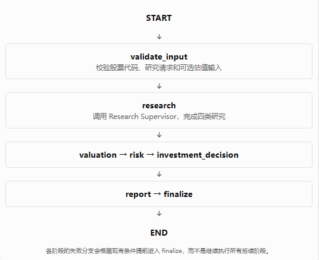
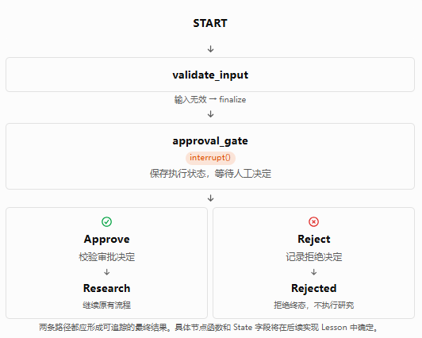
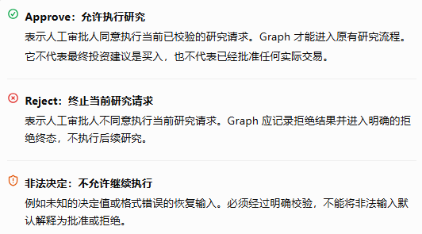
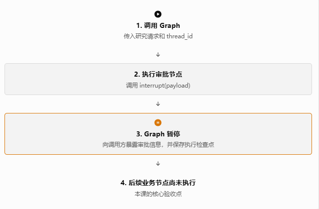

# Phase 10: HITL (Human-in-the-loop)

## Lesson 1：Persistence 与 HITL 集成前置审查

本课先不编写 `interrupt()`，也不急于修改业务 Graph。我们先确认 Phase 9 的持久化基础设施是否真正可用，并确定 Phase 10 应该从哪里接入。

这一步非常重要：我们的目标不是完成一个只能演示的 HITL 示例，而是将人工审批可靠地集成进现有的 Investment Research Decision Agent，同时保留此前各阶段已经实现的功能。

### 一、本课学习目标

完成 Lesson 1 后，你应该能够回答以下问题：

1. 项目中究竟有几个 Graph 构建入口？哪个才是实际的 Application Graph？
2. `Checkpointer` 在哪里创建，又在哪里传给 Graph？
3. `thread_id` 如何从调用入口传递到 LangGraph？
4. 当前测试究竟证明了什么，又有哪些能力尚未被证明？
5. 在不破坏现有架构的前提下，Phase 10 应该在哪个位置引入 HITL？

本课分成四步：

 - Step 1：确认源码事实

找出 Graph 构建入口、Checkpointer 工厂、配置辅助函数和相关测试。

 - Step 2：还原实际调用链

判断生产 Graph 是否真正使用持久化，而不只是项目里存在一个 Checkpointer 工厂。

 - Step 3：核验测试与持久化

检查 SQLite 数据库路径、Thread 隔离以及测试是否验证了真实持久化行为。

 - Step 4：确定最小修复和验收条件

只修复阻塞 Phase 10 的问题，不提前实现后续 Lesson 的功能。

### 二、Step 1：确认源码事实

我已经解压并检查了当前 Phase 9 源码，以及交接文档中的 Lesson 1 计划。

先看一个核心概念。

#### 2.1 Checkpointer 不等于 Graph 已经开启持久化

项目使用的接口是：

```
return builder.compile(checkpointer=checkpointer)
```

这里有两个独立的动作：

- `create_checkpointer()`：创建 SQLite Checkpointer。
- `builder.compile(checkpointer=checkpointer)`：将 Checkpointer 绑定到编译后的 Graph。

只有创建了 Checkpointer，却没有将其传给实际运行的 Graph，持久化就没有真正接入该执行流程。

在本项目中，相关代码分布在三个位置：

| 文件                          | 职责                                                    |
| --------------------------- | ----------------------------------------------------- |
| `app/graph/checkpointer.py` | 创建 SQLite Checkpointer                                |
| `app/application/graph.py`  | 构建生产 Application Graph                                |
| `app/graph/runtime.py`      | 组合 Checkpointer 和 Application Graph，并提供 Thread 配置辅助函数 |

这三层的职责划分本身是合理的。我们暂时不需要重构它们。

#### 2.2 当前存在两个不同的 Graph

**Graph A：原有基础 Graph**

文件：`app/graph/graph.py`

```python
def build_graph(checkpointer=None):
    # ... 构建 StateGraph
    return builder.compile(
        checkpointer=checkpointer
    )

graph = build_graph()
```

这里默认没有传入 Checkpointer。它是原有的基础 Graph，不应该与后续生产 Application Graph 混为一谈。

**Graph B：生产 Application Graph**

文件：`app/application/graph.py`

```python
def build_application_graph(*, checkpointer=None):
    # ... 构建 Application StateGraph
    return builder.compile(
        checkpointer=checkpointer
    )

application_graph = build_application_graph()
```

同样，模块末尾的默认对象没有显式传入 Checkpointer。

这不代表 `build_application_graph()` 不能使用持久化；它支持接收 Checkpointer。问题在于默认导出的 `application_graph` 没有绑定该组件。

**运行时工厂：`app/graph/runtime.py`**

```python
def create_application_graph(*, checkpointer=None):
    if checkpointer is None:
        checkpointer = create_checkpointer()

    return build_application_graph(
        checkpointer=checkpointer
    )
```

这个工厂会在未传入 Checkpointer 时创建 SQLite Checkpointer，再将其传入生产 Application Graph 的构建函数。

这是目前最明确的生产 Graph 持久化构建路径。

这里需要区分两个判断：

- 源码能力： 项目已经具备通过运行时工厂构建持久化 Application Graph 的能力。
- 实际使用情况： 当前源码没有找到实际业务入口调用 `create_application_graph()` 并运行该 Graph 的代码。因此，仅凭现有源码，还不能证明生产调用链已经统一使用这条路径。

这也是 Lesson 1 必须确认的架构边界。

#### 2.3 Thread ID 的传递方式

在 `app/graph/runtime.py` 中，项目提供了：

```python
def build_thread_config(thread_id: str):
    if not isinstance(thread_id, str) or not thread_id.strip():
        raise ValueError(
            "thread_id must be a non-empty string"
        )

    return {
        "configurable": {
            "thread_id": thread_id,
        }
    }
```

这段代码做了两件事：

1. 拒绝空字符串和不合法类型的 Thread ID。
2. 构造 LangGraph 使用的 `configurable.thread_id` 配置。

但是，辅助函数的存在并不意味着所有 Graph 调用都使用了它。

后续执行和恢复时，调用方必须为同一条暂停的执行提供相同的 Thread ID。Thread ID 应当标识一次可恢复的工作流上下文，而不是每次调用都重新随机生成。

例如，概念上：

```python
config = build_thread_config("research-AAPL-001")

result = graph.invoke(
    initial_input,
    config=config,
)
```

这里的 `initial_input` 仅表示业务输入，并非要求你现在修改源码或直接运行此代码。

本步骤结论： Thread 配置辅助函数已经存在，但实际业务调用链尚未得到证明。我们应当复用它，并在后续集成时确保初次执行和恢复执行使用同一个 Thread ID。

### 三、Step 2：还原真实业务 Graph 与 State

#### 3.1 当前 Application Graph 的业务拓扑

根据 `app/application/graph.py` 中的节点和边，当前生产 Application Graph 的主流程是：



这个拓扑有一个重要特点：顶层 `research` 节点会调用独立的 `research_supervisor_graph`。因此，研究规划与实际研究工作并非全部直接暴露在顶层 Application Graph 中。

这影响了 HITL 插入点的选择。

#### 3.2 State 已经有什么？缺少什么？

文件：`app/application/state.py`

当前 `ApplicationState` 已经包含：

- 研究请求：`ticker`、`user_query`
- 研究结果：公司、财务、市场和行业宏观研究结果
- 估值结果与错误
- 风险分析结果与错误
- 投资决策结果与错误
- 报告结果及各类报告错误
- 工作流状态：`current_stage`、`stage_errors`、`application_error`

但目前没有专门用于 HITL 的字段，例如：

- `approval_status`：审批状态
- `approval_decision`：人工提交的决定
- `approval_reason`：决定的理由

这不意味着现在必须立即增加这些字段。本课的任务是确定业务契约，具体修改留到实现相应 Lesson 时再做。

需要特别注意，`ApplicationOutputState` 和 `finalize_application()` 也定义了对外输出契约。因此，如果后续增加审批状态，只修改内部 State 不够，还要决定最终输出是否需要公开该状态。

#### 3.3 选择 HITL 插入点

交接文档建议在高成本研究任务前增加审批。这与当前 Graph 的结构相符。

我建议的第一版设计是：

- 将审批放在 `validate_input` 成功之后。
- 在开始调用 `research_supervisor_graph` 之前暂停。
- 审批通过后，沿用原来的 Research → Valuation → Risk → Investment Decision → Report 主流程。
- 审批拒绝后，生成明确的拒绝终态，不调用研究节点。

这样可以保护现有研究流程，不必先修改 Research Supervisor 的内部实现。

不过，必须明确一个业务区别：

审批研究请求，不等于审批研究计划。

如果审批人需要先查看系统生成的具体研究计划，再决定是否执行，那么现有的 `research` 阶段需要进一步拆分为“生成研究计划”和“执行研究计划”。这会扩大本次改动范围。

为了严格控制 Phase 10 的范围，我建议第一版先审批经过校验的研究请求。待这一版本通过验收后，再根据实际需要评估是否支持计划级审批。

#### 3.4 新增 HITL 后的目标拓扑



这个设计有一个工程上的优点：人工审批成为研究流程的明确前置条件，而不是散落在研究 Agent 内部的隐式判断。

另外，`interrupt()` 不必对应一个单独的、只负责等待的节点。它可以放在审批节点函数中；恢复后，节点根据恢复值进行校验，再由条件边选择批准或拒绝分支。

这样可以减少不必要的节点数量，并保持审批逻辑集中。

### 四、Step 3：审查当前持久化测试

这一部分是本课的重点。我们不根据测试名称推断测试能力，而是逐行检查实际执行了什么。

#### 4.1 `tests/test_checkpoint.py` 中的三个问题

---

**问题 A：测试对象与名称不一致**

当前测试：

```python
def test_main_application_graph_has_checkpointer():
    assert graph.checkpointer is not None
```

这里导入的 `graph` 来自 `app.graph.graph`，不是 `app.application.graph` 中的生产 Application Graph。

而且，基础 Graph 的默认构建方式是 `graph = build_graph()`，其默认参数 `checkpointer=None`。

因此，这个测试既没有检查生产 Application Graph，也与基础 Graph 的默认构建配置存在直接矛盾。按照当前编译方式，预期应当是 Checkpointer 未绑定；需要在项目实际依赖版本中运行确认具体测试结果。

---

**问题 B：临时数据库路径没有真正用于被测对象**

当前测试先创建：

```python
database_path = (
    tmp_path / "checkpoints.sqlite"
)

connection = sqlite3.connect(
    database_path,
    check_same_thread=False,
)
```

但随后实际调用：

```python
checkpointer = create_checkpointer()
```

这会使用 `create_checkpointer()` 的默认路径，而不是前面创建的临时数据库连接。

这段测试因此不能证明数据写入了 `tmp_path` 下的数据库。它还留下了一个没有被用于 Checkpointer 的数据库连接。

正确方向是：让被测 Checkpointer 明确使用临时数据库路径，并在测试结束时正确关闭资源。

---

**问题 C：已有恢复测试没有覆盖 HITL 恢复**

`test_sqlite_checkpoint_survives_graph_recreation()` 已经做了一件有价值的事：

1. 用第一个 SQLite 连接创建 Graph。
2. 执行 Graph 并写入 State。
3. 关闭第一个连接。
4. 使用同一数据库创建第二个 Checkpointer 和 Graph。
5. 查询原 Thread 的 State。

这能够验证已完成执行的状态在 Graph 重建后仍可读取，是值得保留的基础测试。

但它没有触发 `interrupt()`，也没有恢复一个暂停的执行。因此，它不能证明 HITL 的中断与恢复生命周期已经通过验收。

#### 4.2 Thread 隔离测试的价值

当前的 `test_sqlite_threads_are_isolated()` 使用两个不同的 `thread_id`，分别运行并查询 State。

这是正确的测试方向，应该保留。

后续需要确保测试确实使用临时 SQLite 数据库，并验证两个 Thread 的 State 互不污染。对于 HITL，还应增加更有针对性的测试：一个 Thread 处于等待审批状态时，另一个 Thread 的执行不应意外恢复或修改它。

### 五、Step 4：确定最小修复方案与最终设计

Lesson 1 的目标不是立即修改所有问题，而是明确哪些问题会阻塞后续 HITL 实现，以及如何以最小代价解决它们。

#### 5.1 建议的修复顺序

| 顺序 | 工作                                                                    | 是否必须修改源码         |
|------|-------------------------------------------------------------------------|--------------------------|
| 1    | 明确 `create_application_graph()` 是 Phase 10 的 Graph 构建入口         | 先确认架构，不必立即修改 |
| 2    | 修正 Checkpoint 测试，确保使用真实临时 SQLite 数据库                    | 是                       |
| 3    | 修正 Checkpointer 测试对象，分别验证基础 Graph 与生产 Application Graph | 是                       |
| 4    | 在项目原有 Python 环境中运行相关测试                                    | 执行验证                 |
| 5    | 确认 Thread ID 的创建、保存与传递约定                                   | 先形成设计约定           |
| 6    | 确认审批请求的业务语义与 Graph 插入点                                   | 形成设计约定             |

我建议本课只做必要的测试修复，不修改业务节点、不增加 `interrupt()`，也不提前加入审批 State 字段。

另外，当前 `create_checkpointer()` 使用 SQLite 文件路径创建连接，但没有提供显式的资源管理接口。后续需要结合实际 LangGraph SQLite Saver 版本，确认连接的关闭责任。这个问题可以先记录，不必在 Lesson 1 为此引入复杂的资源管理重构。

#### 5.2 批准和拒绝的业务语义

为了避免后续每个 Lesson 都重新讨论审批的定义，我建议先采用以下约定：



#### 5.3 Lesson 1 验收清单

设计审查进度

```text
 - 已确认 Checkpointer 的创建与绑定方式

create_checkpointer() → create_application_graph() → build_application_graph()

 - 已确认 Thread ID 的配置约定

使用 configurable.thread_id，恢复时复用原 ID

 - 已确定 HITL 的插入点

validate_input 成功之后、research 执行之前

 - 已确定新增 HITL 前后的 Graph topology

批准进入研究，拒绝进入明确终态

 - 已明确批准、拒绝与非法输入的业务语义

三种情况具有不同的处理规则

 - 已明确现有持久化测试的缺口

测试对象不一致、临时数据库未被使用、尚未验证 HITL 恢复

 - 已确认不需要大规模重构

保留现有 Graph、State 和研究节点，先修复必要的测试问题
```

这份清单中的设计结论已经可以确定，但涉及实际运行的部分仍然需要测试证据。

## Lesson 2：理解并实现最小 `interrupt()` 流程

本课先不修改正式的 `app/application/graph.py`，而是用一个独立的最小 Graph 验证 LangGraph 的中断机制。这样可以先理解运行语义，再把经过验证的设计集成到真正的投资研究流程中。

本课只验证“暂停并等待审批”，暂不实现恢复、批准和拒绝路由。 恢复由 Lesson 3 负责，避免一次引入太多新概念。

### 一、先理解 `interrupt()` 的运行机制



这里有三个需要准确理解的概念：

- `interrupt(payload)`：请求暂停当前 Graph，并向调用方提供需要人工处理的数据。
- `checkpointer`：保存 Graph 的执行状态，让后续调用能够找到被暂停的执行。
- `thread_id`：标识这次执行所属的线程，后续恢复必须使用同一个线程标识。

注意： `interrupt()` 并不等同于普通的 `return`。它会触发 LangGraph 的中断机制。后续 Lesson 3 会专门解释恢复时节点如何重新执行，以及为什么节点内不能随意放置有副作用的操作。

### 二、设计最小审批 payload

对于当前投资研究项目，我们先采用以下数据结构：

```json
{
    "type": "research_approval",
    "ticker": "AAPL",
    "research_task": "分析公司的财务状况和行业竞争力",
    "reason_for_approval": "研究任务需要人工确认",
    "requested_action": "run_research",
    "approval_required": True,
}
```

这些字段分别表达：

| 字段                  | 作用                         |
|-----------------------|------------------------------|
| `type`                | 让调用方识别这是哪类中断     |
| `ticker`              | 明确审批针对哪家上市公司     |
| `research_task`       | 展示具体研究任务             |
| `reason_for_approval` | 说明为什么需要审批           |
| `requested_action`    | 明确审批通过后准备执行的操作 |
| `approval_required`   | 明确当前需要人工介入         |

这只是本课的审批请求，不代表投资建议，也不代表买入或卖出指令。

### 三、建立独立的最小测试 Graph

在项目的 `tests/` 目录中新建 `test_hitl_interrupt.py`。

我们使用 `MemorySaver` 作为本课的测试 Checkpointer，避免测试操作真实项目的 SQLite 数据库。它适合验证当前进程内的中断行为；跨 Graph 重建、跨进程恢复和正式持久化验证不在本课的验收范围内。

将以下代码完整放入新文件：

```python
from typing import TypedDict

from langgraph.checkpoint.memory import MemorySaver
from langgraph.graph import END, START, StateGraph
from langgraph.types import interrupt


class ApprovalTestState(TypedDict, total=False):
    ticker: str
    research_task: str
    approval_gate_passed: bool
    research_executed: bool


def approval_gate(state: ApprovalTestState) -> dict:
    """Pause execution and request human approval."""

    interrupt(
        {
            "type": "research_approval",
            "ticker": state["ticker"],
            "research_task": state["research_task"],
            "reason_for_approval": "The research task requires human approval.",
            "requested_action": "run_research",
            "approval_required": True,
        }
    )

    # This line is reached only after the interrupt is resumed.
    return {"approval_gate_passed": True}


def run_research(state: ApprovalTestState) -> dict:
    """Represent a downstream research node without real external calls."""

    return {"research_executed": True}


def build_hitl_test_graph():
    builder = StateGraph(ApprovalTestState)

    builder.add_node("approval_gate", approval_gate)
    builder.add_node("research", run_research)

    builder.add_edge(START, "approval_gate")
    builder.add_edge("approval_gate", "research")
    builder.add_edge("research", END)

    return builder.compile(checkpointer=MemorySaver())


def test_interrupt_pauses_before_research():
    graph = build_hitl_test_graph()

    config = {
        "configurable": {
            "thread_id": "hitl-lesson-2-test"
        }
    }

    result = graph.invoke(
        {
            "ticker": "AAPL",
            "research_task": "Analyze financial condition and competition.",
            "approval_gate_passed": False,
            "research_executed": False,
        },
        config,
    )

    snapshot = graph.get_state(config)

    # The graph must have a pending interrupt.
    pending_interrupts = [
        item
        for task in snapshot.tasks
        for item in task.interrupts
    ]
    assert pending_interrupts

    # The caller must be able to inspect the approval request.
    payload = pending_interrupts[0].value
    assert payload["type"] == "research_approval"
    assert payload["ticker"] == "AAPL"
    assert payload["requested_action"] == "run_research"
    assert payload["approval_required"] is True

    # The graph must not have executed the research node.
    assert result.get("research_executed") is False
    assert snapshot.values.get("research_executed") is False
    assert snapshot.values.get("approval_gate_passed") is False
```

#### 为什么要这样设计？

1. `approval_gate` 只负责提出审批请求，不负责研究业务。
2. `run_research` 用一个简单的状态更新代表后续研究，避免调用真实 LLM、数据源或外部 API。
3. `MemorySaver()` 为测试 Graph 提供 Checkpointer。
4. `thread_id` 让我们可以查询这次执行的状态。
5. `snapshot.tasks` 用于检查暂停的任务及其中断信息，而不是仅凭普通返回值猜测 Graph 是否已经暂停。

尤其需要注意：Graph 返回了一个字典，并不意味着它已经完整执行到 `END`。 中断状态应当通过 Graph 的执行快照及其待处理的中断信息来判断。

### 四、Lesson 2 验收条件

验收进度

```text
 - Graph 正常运行至审批节点

审批节点确实被调度执行。

 - interrupt() 触发中断

执行快照中存在待处理的 interrupt。

 - 调用方能读取审批 payload

至少能够读取 ticker、任务类型及请求操作。

 - 人工输入前研究节点未执行

research_executed 仍然为 False。

 - 基础 Graph 结构完整

存在审批节点到研究节点的连接，但本次执行在审批处暂停。

 - 没有修改正式业务路径

本课仅新增隔离的测试 Graph，不改变正式 Application Graph。
```