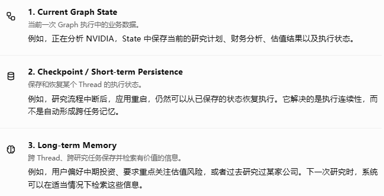
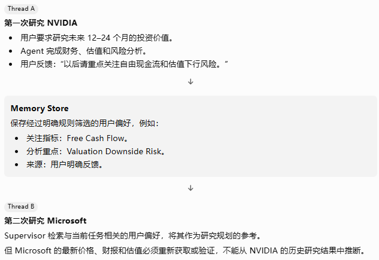
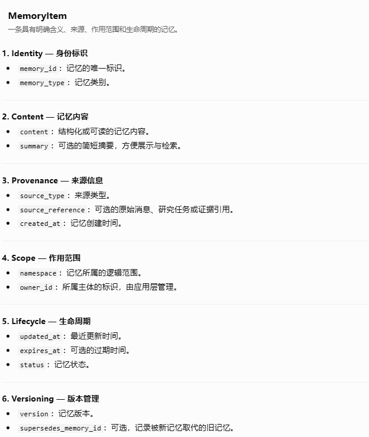
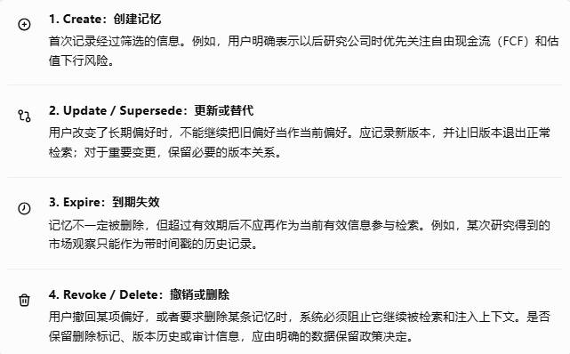
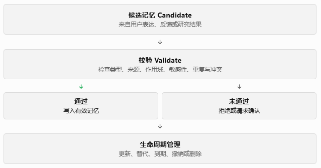
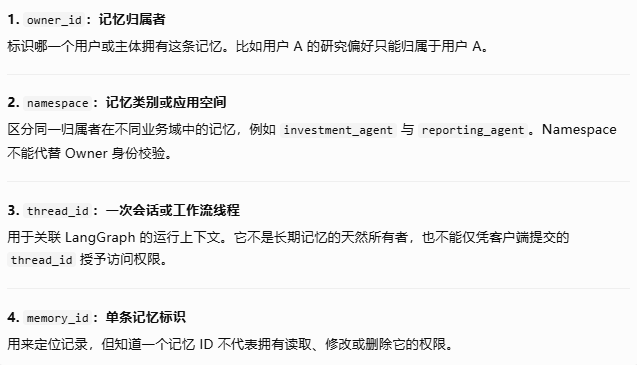
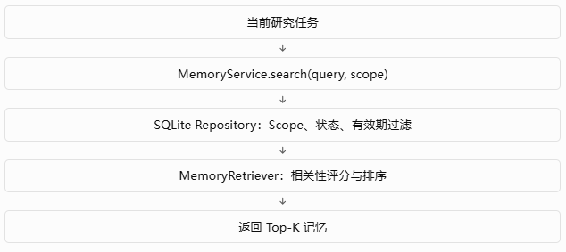
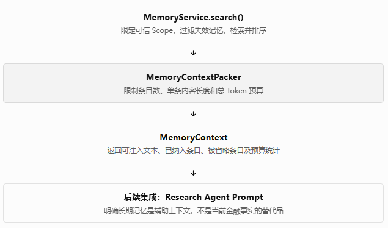
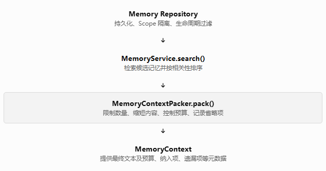

# Phase 11 — Long-term Memory

## Lesson 1：短期状态、对话历史与长期记忆的区别

本阶段正式开始。我们继续沿用之前的教学节奏：先理解原理，再进行最小实验，随后修改正式项目、编写测试，最后按照验收条件推进。

Phase 11 的目标不是简单地给 Agent 增加一个 Memory 接口，而是让 Investment Research & Decision Agent 能够在不同研究任务之间，安全、可控地保留和使用有价值的信息。

本课先解决一个基础问题：

> LangGraph 已经有 State 和 Checkpoint，为什么还需要 Long-term Memory？



这三者可以协同工作，但不能互相替代。

### 一、从投资研究场景理解 Memory

假设用户先后发起两个独立任务。



这个例子体现了投资 Agent 中非常重要的边界：

- 用户偏好可以跨任务复用。
- 历史研究结论可以作为历史背景，但必须标记时间和来源。
- 市场价格、财务数据等时效性事实不能仅凭 Memory 当作当前事实。
- Memory 影响研究的侧重点，不应绕过证据和估值逻辑，直接决定 Buy 或 Sell。

### 二、四种信息必须区分

在真正写代码之前，我们先建立一个分类规则。后续的 Memory Schema、写入策略、检索策略和测试都将以它为基础。

| 信息类型     | 示例                       | 适合放入长期记忆吗？                       |
|--------------|----------------------------|--------------------------------------------|
| 用户偏好     | 偏好中长期投资分析         | 是                                         |
| 研究历史     | 2026 年 10 月曾分析 NVIDIA | 可以，作为历史记录                         |
| 历史研究结论 | 当时估值模型得出的目标价格 | 可以，但必须保留时间、来源及适用条件       |
| 当前市场事实 | NVIDIA 当前股价            | 不能直接作为当前事实复用，应重新获取或验证 |

还需要区分一个容易忽略的情况：用户在某次任务中要求“只分析 NVIDIA 的短期走势”，并不意味着用户永久偏好短期投资。

因此，我们需要区分：

- Persistent preference：用户明确表达的长期偏好。
- Task-specific instruction：只适用于当前研究任务的要求。
- Historical observation：过去发生或过去研究得到的信息。
- Current fact：需要依据当前可信数据源确定的事实。

这些是本项目建议采用的业务分类，并不是 LangGraph 内置的四种 Memory 类型。

### 三、LangGraph 中的 State 与 Store

LangGraph 提供了两种不同的持久化机制，需要从概念上分清。

 - **Checkpointer**

    与 Thread 关联的执行状态持久化。

    主要用于保存 Graph 执行过程中的 State、恢复中断的执行，以及支持后续继续运行。

 - **Store**

    面向跨 Thread 访问的长期数据存储抽象。

    可以存储、组织和检索跨研究任务的信息。数据通常通过 namespace 和 key 组织，并可根据具体 Store 实现提供检索能力。

注意两个关键点：

1. Checkpointer 和 Store 是不同的抽象。即使底层采用同一种数据库，也不意味着两者承担相同的职责。
2. Store 不会自动判断哪些信息值得记住。什么时候写入、写入什么、什么时候检索，以及如何防止错误记忆污染投资决策，都属于我们需要设计的 Application 逻辑。

本项目不会把 Memory 设计成一个无限增长的对话历史集合，也不会在当前阶段立即引入向量数据库或复杂的分布式记忆基础设施。

### 四、本课的教学与工程决策表

| 类型     | Lesson 11.1 的安排                                                          |
|----------|-----------------------------------------------------------------------------|
| 学习     | 理解 State、Checkpoint、对话历史与 Long-term Memory 的区别                  |
| 实验     | 用两个独立研究任务验证信息是否需要跨 Thread 保留                            |
| 当前实现 | 暂不修改正式项目，先确定记忆分类与边界                                      |
| 后续实现 | 11.2 定义 Memory Schema；11.3 实现写入、更新、删除与生命周期；11.5 实现检索 |

这样安排是为了避免在还没有明确数据边界时，就先写一个无法验证正确性的 Memory 类。

### 五、本课验收条件

Lesson 11.1 完成的标准不是代码运行成功，而是你能够明确回答以下问题：

- 为什么 Checkpoint 不能完全替代 Long-term Memory？
- 为什么跨 Thread 的历史研究结论不能直接当作当前事实？
- 为什么当前任务指令不应自动变成永久用户偏好？
- 为什么 Memory 的写入和检索必须由明确的规则控制？

## Lesson 2：Memory Schema 设计

本课开始设计 Investment Research & Decision Agent 的正式长期记忆数据结构。

上一课已经明确：Checkpoint 负责保存和恢复执行状态，Long-term Memory 负责跨任务保留和检索有价值的信息。本课要进一步回答：

> 一条 Memory 应该保存哪些字段，才能被可靠地检索、更新、追溯和验证，而不是成为一段无法管理的文本？

本课以设计和实验为主，暂不修改正式项目代码。我们先定义数据契约，再通过实验确定它是否满足后续工程需求。

### 一、教学与工程决策表

| 类型     | 本课安排                                                           |
|----------|--------------------------------------------------------------------|
| 学习     | Memory Item、Metadata、数据来源、版本和生命周期                    |
| 实验     | 比较不同 Memory Schema 对检索、冲突处理和事实追溯的支持程度        |
| 当前实现 | 确定正式项目的 Memory Schema 设计规范                              |
| 后续实现 | Lesson 11.3 实现写入、更新、删除和生命周期；后续课程实现检索与集成 |

### 二、为什么不能只保存一段文本？

假设我们只保存：

```
memory = "用户关注 NVIDIA，喜欢自由现金流，认为 NVIDIA 很有投资价值。"
```

这段文本存在多个问题：

1. 无法区分哪些是用户明确表达的偏好，哪些是 Agent 自己生成的判断。
2. 无法确定信息是在什么时候获得的。
3. 无法判断“很有投资价值”是历史观点还是当前结论。
4. 无法单独更新“关注自由现金流”这一项。
5. 无法区分不同用户、不同研究任务的数据。
6. 无法判断这条信息是否仍然有效。

对于投资研究系统，这些缺陷会直接影响研究结果的可靠性。

因此，我们需要使用结构化的 **Memory Item**。

### 三、设计正式的 Memory Item

我建议第一版采用以下概念结构。



这是我们为项目设计的业务 Schema，不是 LangGraph Store 自带的固定字段定义。后续会根据实际检索与持久化实现进一步细化。

### 四、Memory 的类型分类

为了避免不同性质的信息被混在一起，第一版建议采用以下枚举。

| `memory_type`         | 含义                           | 示例                           |
|-----------------------|--------------------------------|--------------------------------|
| `user_preference`     | 用户长期偏好                   | 偏好关注自由现金流             |
| `research_history`    | 过去执行过的研究任务           | 曾研究 NVIDIA                  |
| `historical_finding`  | 历史研究发现                   | 某次报告记录的利润率变化       |
| `workflow_preference` | 用户对研究流程的偏好           | 希望先进行财务分析，再讨论估值 |
| `contextual_note`     | 经筛选、值得保留的其他背景信息 | 某项研究的历史背景             |

注意，`historical_finding` 并不等于经过验证的客观事实。它仍然需要保存来源、时间和适用条件。

另外，当前股价、最新财报等时效性数据，不应因为能够被保存就自动成为长期记忆。正式的当前数据仍应来自相应的 Data Provider，并通过时间戳和数据质量规则验证。

### 五、Metadata 为什么重要？

Metadata 是描述记忆本身的属性，而不是记忆的主体内容。

例如：

```python
{
    "memory_type": "user_preference",
    "content": {
        "preferred_metrics": ["free_cash_flow"],
        "risk_focus": ["valuation_downside"]
    },
    "source_type": "explicit_user_statement",
    "created_at": "2026-10-14T10:00:00+08:00",
    "namespace": ["user", "user_123"],
    "status": "active",
    "version": 1
}
```

这里有几个值得注意的设计决策：

- `content` 保存偏好本身。
- `source_type` 说明信息从何而来。
- `created_at` 说明系统何时记录该信息。
- `namespace` 用于组织和隔离不同作用范围的数据。
- `status` 控制这条记忆是否仍参与检索。
- `version` 用于区分不同版本。

示例中的 `user_123` 只是虚构标识，不是实际用户信息。

还有一个重要区别：

- `created_at`：记忆进入系统的时间。
- `observed_at`：系统观察到相关信息的时间。
- `valid_from` / `valid_until`：信息在业务上适用的时间范围。

这几个时间不应混为一谈。对于历史研究发现，记录业务有效时间尤其有价值。

### 六、来源与可信度必须分开

我建议至少支持以下来源类别：

| `source_type`             | 说明                 |
|---------------------------|----------------------|
| `explicit_user_statement` | 用户明确表达         |
| `user_feedback`           | 用户对已有结果的反馈 |
| `agent_inference`         | Agent 推断           |
| `research_result`         | 某次研究流程的输出   |
| `external_source`         | 外部数据源或文档     |

但是，**来源类型不等于可信度评分**。

例如，用户明确表示“我偏好长期投资”，足以支持记录其偏好；但用户在对话中提到的某个财务数字，并不因此自动成为经过验证的财务事实。

因此：

- 用户偏好可以根据明确表达建立。
- Agent 推断不应自动升级为用户明确偏好。
- 历史研究结果需要保留研究时间和来源。
- 外部金融事实需要保留数据源、数据时间以及必要的验证信息。

如果后续需要可信度评分，应单独定义评分语义，而不是简单地用一个 `confidence` 字段替代所有质量判断。

### 七、版本管理与记忆冲突

假设用户先表示：

> 我主要关注长期投资。

后来又表示：

> 对周期性行业，我希望增加中期投资机会分析。

这不一定是冲突。后一条可能是对特定研究范围的补充。

我们需要区分三种情况：

1. 更新：用户明确改变原有偏好。
2. 补充：新增偏好与旧偏好可以同时成立。
3. 冲突：新旧信息在同一作用范围内不能同时成立，需要进一步判断或确认。

建议的第一版规则：

- 更新时保留旧版本的追溯能力。
- 补充时尽量独立记录，不覆盖无关记忆。
- 无法判断的冲突不应由 Agent 随意选择一个作为事实。
- 被替代或撤销的记忆不应继续作为有效偏好注入 Prompt。

这也是为什么 Schema 需要 `version`、`status` 和可选的 `supersedes_memory_id`。

### 八、Lesson 11.2 验收条件

正式项目的 Memory Schema 设计应满足：

- 每条记忆具有稳定身份和明确类型。
- 内容与来源元数据分离。
- 具备创建时间、更新时间以及必要的业务有效时间。
- 可以区分用户偏好、Agent 推断和历史研究发现。
- 支持用户与研究任务等作用范围的隔离。
- 能表达记忆的有效、过期、撤销或被替代状态。
- 能追踪版本变化及必要的替代关系。
- 历史金融数据不会自动被当作当前事实使用。

工程状态： 本课完成 Schema 的概念设计与规则定义，尚未实现正式的 Pydantic Model、Store 或持久化操作。

## Lesson 3：记忆写入、更新、删除与生命周期

本课开始把上一课的 Memory Schema 从“数据应该长什么样”推进到“系统何时写入、怎样更新、何时失效，以及如何删除”。

核心原则是：长期记忆不是对话记录的自动归档，而是一种经过规则筛选、具有来源和生命周期管理的可控数据资产。

对于 Investment Research & Decision Agent，这一点尤其重要：系统可以记住用户长期偏好的研究方式，但不能把一条过期的股价、一次未经验证的推断，或者某次任务的临时要求，永久当作事实。

### 一、教学与工程决策表

| 标记     | 本课内容                                         | 目标                     |
|----------|--------------------------------------------------|--------------------------|
| 学习     | 记忆写入、更新、撤销、过期的语义                 | 明确生命周期规则         |
| 实验     | 记忆写入策略与场景测试                           | 验证哪些内容可以写入     |
| 当前实现 | 建立可测试的写入策略边界                         | 避免模型随意保存信息     |
| 后续实现 | 接入正式 Memory Store、版本持久化和 Graph 工作流 | 基于项目现有代码逐步集成 |

本课先做规则和独立实验，不假定你当前项目已经具备 Memory Store，也不把实验脚本当成正式实现。

### 二、先区分四种操作



注意：`superseded`、`expired`、`revoked` 和 `deleted` 不应被当作同义词。它们分别表示被替代、到期、撤销和删除，后续检索与数据清理的处理方式可能不同。

### 三、哪些信息允许进入长期记忆？

我们先建立一个明确的写入策略。不要让 LLM 单独决定“这句话值得记住”，然后直接写入数据库。

建议采用两层机制：

- 候选生成层： LLM 或业务节点提出可能有价值的记忆。
- 策略校验层： 由确定性的程序规则校验类型、来源、作用域、敏感性和有效性，再决定是否允许写入。

#### 写入决策规则

| 候选信息                           | 建议处理               | 原因                                   |
|------------------------------------|------------------------|----------------------------------------|
| 用户明确要求长期记住的研究偏好     | 允许写入               | 有明确意图且可能跨任务复用             |
| 用户对报告格式的稳定偏好           | 允许写入               | 能改善后续任务                         |
| 仅适用于当前任务的临时要求         | 不写入长期记忆         | 属于当前 Graph State 或任务上下文      |
| 模型推断用户可能偏好某种策略       | 暂不直接写入           | 推断不等于用户确认                     |
| 带有可靠来源和时间戳的历史研究结果 | 校验后写入             | 可作为历史证据，但不能自动视为当前事实 |
| 没有来源的公司财务数字             | 拒绝写入为事实         | 无法追溯和验证                         |
| 当前股价或短期市场状态             | 不作为永久有效事实保存 | 时效性强，后续必须重新验证             |
| 用户要求删除的记忆                 | 撤销或删除             | 不能继续参与正常检索                   |
| 已存在的重复记忆                   | 去重或合并             | 避免检索结果重复、偏好冲突             |

还有一个重要边界：用户明确表达了某个偏好，不代表该偏好可以覆盖投资决策的证据标准。 例如，系统可以记住用户偏好关注 FCF，但不能因此忽略估值、负债、盈利质量或风险证据。

### 四、为 Memory 定义生命周期



#### 需要固定的工程规则

1. 有效记忆才允许被正常检索。 被替代、撤销或过期的记录，不应通过普通检索重新进入 Prompt。
2. 更新不能悄悄覆盖语义不同的信息。 用户修改长期偏好时，应更新当前有效版本；如果是补充另一个独立偏好，则应新增记录。
3. 过期策略要因类型而异。 用户长期偏好通常没有固定到期时间，但可以被修改或撤销；历史研究结果则应保留观察时间和来源。
4. 删除必须贯穿整个系统。 不能只在检索时隐藏记录，却让其他检索索引、缓存或旧版本继续将其注入上下文。
5. 作用域必须在数据层校验。 不能只靠 Prompt 告诉模型“不要读取其他用户的记忆”。
6. 历史记录不是当前事实。 即使旧研究记录仍然保留，也必须在输出中区分历史观察和最新验证结果。

关于删除，有一个值得提前明确的设计选择：逻辑撤销方便维护版本关系，但不等于物理删除。对于用户提出的删除要求，应根据实际数据保留政策执行，并清理或隔离相关副本；不能以保留审计记录为由，默认永久保留全部内容。

### 五、动手实验：实现一个最小写入策略

这一步先不接入 LangGraph，也不写入正式 Memory Store。我们通过一个独立 Python 脚本验证：系统是否能够在写入前，依据明确规则做出可预测的决定。

建议临时创建 `lesson_p11_d3_memory_write_policy.py`。

```python
from dataclasses import dataclass
from enum import Enum


class WriteDecision(str, Enum):
    WRITE = "write"
    REJECT = "reject"
    REQUIRE_CONFIRMATION = "require_confirmation"


@dataclass
class MemoryCandidate:
    memory_type: str
    source_type: str
    content: str
    namespace: str
    owner_id: str

    explicit_durable_intent: bool = False
    has_source_reference: bool = False
    has_observed_at: bool = False
    contains_sensitive_data: bool = False


PREFERENCE_TYPES = {
    "user_preference",
    "workflow_preference",
    "contextual_note",
}

HISTORICAL_TYPES = {
    "research_history",
    "historical_finding",
}


def decide_memory_write(
    candidate: MemoryCandidate,
) -> WriteDecision:
    # 1. 基本数据完整性
    if not candidate.namespace or not candidate.owner_id:
        return WriteDecision.REJECT

    if not candidate.content.strip():
        return WriteDecision.REJECT

    # 2. 敏感信息不允许通过普通记忆流程写入
    if candidate.contains_sensitive_data:
        return WriteDecision.REJECT

    # 3. 明确表达的长期偏好或工作流偏好
    if candidate.source_type == "explicit_user_statement":
        if (
            candidate.memory_type in PREFERENCE_TYPES
            and candidate.explicit_durable_intent
        ):
            return WriteDecision.WRITE

        # 历史研究事实仍然需要来源与观察时间
        if candidate.memory_type in HISTORICAL_TYPES:
            if (
                candidate.has_source_reference
                and candidate.has_observed_at
            ):
                return WriteDecision.WRITE

        return WriteDecision.REJECT

    # 4. 模型推断不能直接变成用户明确偏好
    if candidate.source_type == "agent_inference":
        return WriteDecision.REQUIRE_CONFIRMATION

    # 5. 研究结果必须有来源和观察时间
    if candidate.source_type in {
        "research_result",
        "external_source",
    }:
        if (
            candidate.memory_type in HISTORICAL_TYPES
            and candidate.has_source_reference
            and candidate.has_observed_at
        ):
            return WriteDecision.WRITE

    # 6. 其他情况默认拒绝
    return WriteDecision.REJECT


def run_tests():
    cases = [
        (
            "明确的长期研究偏好",
            MemoryCandidate(
                memory_type="user_preference",
                source_type="explicit_user_statement",
                content="以后研究公司时优先关注 FCF 和估值下行风险",
                namespace="investment_agent",
                owner_id="demo_user",
                explicit_durable_intent=True,
            ),
            WriteDecision.WRITE,
        ),
        (
            "当前任务的临时要求",
            MemoryCandidate(
                memory_type="user_preference",
                source_type="explicit_user_statement",
                content="这次报告请控制在两页以内",
                namespace="investment_agent",
                owner_id="demo_user",
                explicit_durable_intent=False,
            ),
            WriteDecision.REJECT,
        ),
        (
            "模型推断的偏好",
            MemoryCandidate(
                memory_type="user_preference",
                source_type="agent_inference",
                content="用户可能偏好高股息股票",
                namespace="investment_agent",
                owner_id="demo_user",
            ),
            WriteDecision.REQUIRE_CONFIRMATION,
        ),
        (
            "缺少来源的历史财务数字",
            MemoryCandidate(
                memory_type="historical_finding",
                source_type="research_result",
                content="某公司上季度自由现金流为 10 亿",
                namespace="investment_agent",
                owner_id="demo_user",
                has_observed_at=True,
                has_source_reference=False,
            ),
            WriteDecision.REJECT,
        ),
        (
            "有来源和观察时间的历史发现",
            MemoryCandidate(
                memory_type="historical_finding",
                source_type="research_result",
                content="某公司在指定报告期的自由现金流数据",
                namespace="investment_agent",
                owner_id="demo_user",
                has_observed_at=True,
                has_source_reference=True,
            ),
            WriteDecision.WRITE,
        ),
        (
            "敏感信息",
            MemoryCandidate(
                memory_type="contextual_note",
                source_type="explicit_user_statement",
                content="敏感信息示例",
                namespace="investment_agent",
                owner_id="demo_user",
                explicit_durable_intent=True,
                contains_sensitive_data=True,
            ),
            WriteDecision.REJECT,
        ),
    ]

    for name, candidate, expected in cases:
        actual = decide_memory_write(candidate)
        assert actual == expected, (
            f"{name}: expected={expected}, actual={actual}"
        )
        print(f"PASS: {name} -> {actual.value}")

    print(f"\nAll {len(cases)} tests passed.")


if __name__ == "__main__":
    run_tests()
```

#### 运行与验收

在项目使用的 Python 环境中运行这个独立脚本。预期最后输出：

```text
PASS: 明确的长期研究偏好 -> write
PASS: 当前任务的临时要求 -> reject
PASS: 模型推断的偏好 -> require_confirmation
PASS: 缺少来源的历史财务数字 -> reject
PASS: 有来源和观察时间的历史发现 -> write
PASS: 敏感信息 -> reject

All 6 tests passed.
```

这只是一个教学实验版写入策略，不是可以直接上线的安全实现。例如，`contains_sensitive_data` 目前是调用方提供的布尔值，并没有真正的敏感信息检测；来源字段也只是模拟校验，并没有验证来源真实性。

另外，实验目前没有实现去重、冲突检测、数据库事务、版本持久化和真正的删除。这些能力不能因为六个测试通过，就被视为已经完成。

### 六、再验证更新、撤销和删除规则

写入策略通过后，还需要定义记忆已经存在时该怎么办。建议先用以下规则作为正式实现的设计基线。

| 场景                                     | 应执行的操作                         | 检索结果                     |
|------------------------------------------|--------------------------------------|------------------------------|
| 用户把“关注 FCF”改为“优先关注资本回报率” | 创建新版本，替代旧偏好               | 只返回当前有效偏好           |
| 用户补充“也关注资产负债表风险”           | 新增独立偏好，或按明确规则合并       | 两项偏好都可返回             |
| 旧研究结果超过有效期限                   | 标记过期或排除出有效检索             | 不作为当前事实返回           |
| 用户撤回一项偏好                         | 标记撤销并停止使用                   | 不返回该偏好                 |
| 用户要求删除一项记忆                     | 执行删除政策，并处理相关副本         | 不得通过普通检索重新出现     |
| 不同记忆对同一偏好存在冲突               | 比较来源、版本和时间，必要时请求确认 | 不可任意选择一条当作确定事实 |

这里要特别强调：“新记忆优先”不是通用的冲突解决策略。 用户对自身偏好的最新明确表述，通常可以替代旧偏好；但新旧财务数据冲突时，必须比较报告期、来源、口径和修订情况，而不是简单使用时间最新的那一条。

### 本课验收条件

 - 能够区分创建、更新、替代、过期、撤销和删除。

 - 明确规定哪些信息允许写入长期记忆，哪些必须拒绝或请求确认。

 - 写入前校验 namespace、owner_id、内容和来源等必要字段。

 - 模型推断不会自动升级为用户明确表达的偏好。

 - 过期、撤销或被替代的记忆不会进入正常检索结果。

 - 明确处理重复记忆、冲突和用户删除请求。

 - 独立写入策略实验的 6 项测试全部通过。

## Lesson 4：Memory Scope 与访问隔离

前三课的工程补丁已经通过你的测试。现在进入下一课，重点从“记忆如何存储和管理”推进到“谁可以访问哪些记忆，以及如何用代码和测试保证隔离”。

对 Investment Research & Decision Agent 来说，Scope 不只是一个检索参数，更是一条数据安全边界。例如，同一应用服务多个用户时，用户 A 的投资偏好、历史研究记录和任务上下文，不能被用户 B 的研究请求读取。

### 一、本课教学与工程决策表

| 标记     | 内容                                                 | 交付目标         |
|----------|------------------------------------------------------|------------------|
| 学习     | Namespace、Owner、Thread 与业务作用域的区别          | 明确访问边界     |
| 实验     | 构造跨用户、跨命名空间访问测试                       | 验证隔离规则     |
| 当前实现 | 审查并加固 Memory Repository 的访问控制              | 默认拒绝越权访问 |
| 后续实现 | 在 LangGraph、API 身份认证和检索链路中传递可信 Scope | 实现端到端隔离   |

本课会继续工程化推进，不只停留在概念层面。由于当前补丁已经进入你的本地项目，我会基于上一课的 Memory 模块设计继续扩展，不假定你已经实现了 API 身份认证。

### 二、先区分四种 Scope



建议把长期记忆的基本访问键定义为：

```text
Scope = ( owner_id, namespace )
```

每一次读取、更新、替代、撤销和删除操作都必须经过这个 Scope 的约束。将来如果增加团队、组织或租户，再扩展为更完整的租户隔离模型。

### 三、本课工程实现

我已将 Lesson 11.4 的改动整理为一个增量补丁，保留前面三课的模块，并新增 Scope 模型和访问隔离测试。

`phase11_memory_scope_lesson11_4.zip`

包含 `app/memory/scope.py`、更新后的 `service.py`、测试和 README。

下载 Lesson 11.4 工程补丁

#### 1. 新增 `MemoryScope`

新增文件 `app/memory/scope.py`：

这里有两个关键设计：

- `frozen=True`：Scope 创建后不可随意修改。
- `extra="forbid"`：不允许随意加入未经定义的字段。

但需要注意，不可变的 Scope 不等于经过身份认证的 Scope。将来接入 FastAPI 后，`owner_id` 必须从经过认证的用户身份或可信服务上下文中获得，而不是直接信任请求体或 LLM 输出。

#### 2. 将 Scope 变成 Service 的显式输入

之前调用写入服务时，只需要：

```python
service.write(candidate)
```

写入服务会检查候选记忆中的归属信息是否与可信 Scope 一致。不一致时拒绝写入。

读取和修改也通过 Service 提供的作用域接口执行：

```python
item = service.get(
    memory_id,
    scope=scope,
)

service.revoke(
    memory_id,
    scope=scope,
)
```

同样的约束适用于列表查询、版本替代、过期处理和删除。Repository 仍然是底层存储组件，正式应用代码应通过 Service 使用它，而不是绕过 Service 直接调用底层接口。

### 四、本课完成状态

| 验收项                                            | 当前状态                |
|---------------------------------------------------|-------------------------|
| 明确 Owner、Namespace、Thread 和 Memory ID 的职责 | 已完成                  |
| 引入不可变的 `MemoryScope`                        | 已实现                  |
| Service 显式接收 Scope                            | 已实现                  |
| Owner 与 Namespace 的隔离测试                     | 已实现并通过独立测试    |
| 在真实身份认证上下文中创建 Scope                  | 后续接入 FastAPI 时实现 |
| 在 LangGraph 工作流中传播可信 Scope               | 后续集成                |
| 完整项目回归测试                                  | 等待你本地运行          |


## Lesson 5：记忆检索、相关性排序与筛选

这次重新开始，我们直接以工程交付为目标，不再重复前四课的概念讲解。

本课要为现有 Memory 模块增加真正可调用的检索能力：根据当前研究任务查找相关记忆，过滤无效记录，按相关性排序，并限制返回数量。同时保留上一课建立的 `MemoryScope` 访问隔离。

### 一、本课工程目标

| 标记     | 工作内容                           | 验收标准              |
|----------|------------------------------------|-----------------------|
| 学习     | 理解候选召回、排序、过滤和截断     | 能解释检索流程        |
| 实验     | 用固定数据验证相关性排序           | 测试结果可重复        |
| 当前实现 | 新增检索器并接入 Memory Service    | 可从正式 Service 调用 |
| 后续实现 | 语义向量检索、混合检索、Token 预算 | 按实际需要逐步扩展    |

第一版采用可解释的关键词检索，不引入向量数据库。它可以在当前小规模记忆库中提供真实可用的基础能力，后续再根据检索质量评估决定是否引入语义检索。

例如，用户请求分析 NVIDIA 时，检索器应该优先返回“关注 FCF 和估值下行风险”这样的长期偏好，而不是把所有历史研究记录全部返回。

### 二、工程补丁与文件结构

Lesson 11.5 工程补丁

包含检索器、Service 集成、公共接口导出、自动化测试和 README。

下载 Lesson 11.5 ZIP 补丁

本次基于仓库中已有的 `MemoryItem`、`MemoryType`、`MemoryScope`、`SQLiteMemoryRepository` 和 `MemoryService` 接口进行设计。

补丁包含以下文件：

| 文件                             | 作用                             |
|----------------------------------|----------------------------------|
| `app/memory/retrieval.py`        | 新增检索查询、相关性评分和排序   |
| `app/memory/service.py`          | 在现有 Service 中增加 `search()` |
| `app/memory/__init__.py`         | 导出检索相关接口                 |
| `tests/test_memory_retrieval.py` | 新增检索自动化测试               |
| `README.md`                      | 合并说明、测试命令及已知限制     |

注意：`service.py` 和 `__init__.py` 是更新文件，合并时请先检查差异，不要覆盖你自己后来添加的修改。

### 三、检索器的核心设计

新增的 `MemorySearchQuery` 支持以下参数：

```python
MemorySearchQuery(
    query="FCF valuation downside risk",
    memory_types=None,
    limit=5,
    min_score=0.15,
)
```

参数含义：

- `query`：当前研究任务或用户请求的检索文本。
- `memory_types`：可选的记忆类型过滤条件。
- `limit`：最多返回多少条记忆。
- `min_score`：最低相关性阈值。
- `as_of`：可选的检索参考时间，用于测试和历史时点查询。

检索结果包含 `item`、`score` 和 `matched_terms`。其中 `score` 是排序用的启发式相关性分数，不是事实可信度，也不是投资结论的置信度。

Service 的调用方式如下：

```python
from app.memory import MemoryScope, MemorySearchQuery

scope = MemoryScope(
    owner_id="user_a",
    namespace="investment_agent",
)

hits = service.search(
    MemorySearchQuery(
        query="FCF valuation downside risk",
        limit=5,
        min_score=0.15,
    ),
    scope=scope,
)

for hit in hits:
    print(hit.score, hit.matched_terms, hit.item.content)
```

调用链是：



这保证了相关性排序发生在权限与有效性过滤之后，而不是先搜索所有用户的数据再尝试过滤。

### 四、本课测试与验收

补丁新增了以下测试场景：

1. 相关记忆优先于弱相关记忆。
2. 只返回指定类型的记忆。
3. 无关内容会被最低相关性阈值过滤。
4. 检索遵守 Owner 和 Namespace 隔离。
5. 撤销和过期的记忆不会被返回。
6. 返回数量受 `limit` 限制，排序结果可重复。
7. 空查询、非法阈值、非法数量和无时区的参考时间会被拒绝。

### 五、当前能力边界

本课完成后，Memory 有了真正的基础检索能力，但还有三项明确限制：

- 当前是关键词检索，不理解所有语义相近的表达。
- 当前会读取指定 Scope 内的有效记忆，再在 Python 中排序；记忆规模增长后，需要优化候选召回。
- 检索结果尚未与 LangGraph 的 Research、Valuation 等节点集成，因此还没有证明这些记忆会在真实研究任务中被正确使用。

## Lesson 6：上下文窗口与 Token 预算

本课从上一课的记忆检索继续，目标是把“检索到相关记忆”推进到“只把合适的记忆，以受控的规模，安全地交给 Agent 使用”。

这一步对投资研究 Agent 很重要：长期记忆可能逐渐积累大量用户偏好、历史研究结论和旧的市场观察。如果每次都把全部记忆放进 Prompt，不仅浪费 Token 和成本，还可能让过时信息干扰当前的投资判断。

### 一、教学与工程决策表

| 类型     | 本课内容                                                                     |
|----------|------------------------------------------------------------------------------|
| 学习     | 上下文窗口、Token 预算、记忆选择与截断策略                                   |
| 实验     | 使用固定的记忆候选集，验证预算限制、排序和来源保留                           |
| 当前实现 | 在现有 Memory Retrieval 之上增加上下文组装器（Context Packer）及自动化测试   |
| 后续实现 | 接入真实模型 Tokenizer、按模型上下文上限动态分配预算、在完整研究工作流中集成 |

本课的工程边界： 不重写 Memory Repository，不引入向量数据库，也不把记忆检索和上下文组装混为一谈。检索负责找到候选记忆；上下文组装负责决定哪些记忆可以进入本次模型调用。

### 二、先明确三个容易混淆的概念

#### 1. 模型上下文窗口不等于记忆预算

- Context window：模型一次调用能够处理的 Token 总容量，通常包含系统指令、用户问题、对话历史、检索内容以及模型输出。
- Memory budget：我们分配给长期记忆的 Token 额度，只是上下文窗口的一部分。
- Output reserve：为模型生成答案预留的容量。如果把输入塞满上下文窗口，可能导致输出空间不足。

例如，假设某次调用的上下文窗口是 32,000 Token，我们可以先规划：

| 内容               | 示例预算 |
|--------------------|----------|
| 系统指令和工具说明 | 4,000    |
| 当前研究请求       | 2,000    |
| 研究结果与证据     | 12,000   |
| 对话历史           | 4,000    |
| 长期记忆           | 2,000    |
| 输出预留及其他余量 | 8,000    |
| 合计               | 32,000   |

这些数字只是说明预算分配方式，不是任何特定模型的实际配置。生产环境中必须根据所选模型的上下文限制、工具调用格式和实际 Token 用量调整。

#### 2. 为什么不能直接取检索分数最高的记忆，然后无限拼接？

检索分数高，代表它与当前查询的文本相关性较高；它不代表：

- 这条记忆仍然符合当前事实；
- 它比其他记忆更值得占用上下文；
- 它的内容足够短；
- 它可以替代本次研究所需的实时证据。

例如，用户长期偏好“重点分析自由现金流（FCF）和估值下行风险”，通常适合影响研究计划；一条几个月前的历史股价观察，却不能直接充当当前股价。

因此，相关性排序、有效性过滤和 Token 预算控制是不同的责任。前两项已有部分基础，本课补上预算控制。

#### 3. 为什么暂时不直接引入 Tokenizer？

当前项目处于基础 Memory 能力建设阶段。为了避免增加不必要的依赖，本课先定义可替换的 Token 计数接口，并提供保守的字符长度估算器。

要注意：`字符数 ÷ 常数` 只是工程估算，不是模型真实 Token 数。英文、中文、代码、JSON 和工具调用格式的 Token 密度都可能不同。因此，当前实现必须把结果明确标记为估算值，并为后续接入真实 Tokenizer 留出接口。

### 三、本课的实现设计



关键设计决策：

1. 不改写现有记忆存储和检索逻辑，新增独立的上下文组装模块。
2. 保留来源和时间信息，防止内容进入 Prompt 后失去出处。
3. 不静默删除溢出信息：返回被省略的记忆 ID，便于调试和测试。
4. 预算超限时优先缩短正文，而不是先删掉来源信息；若仍无法放入预算，则省略该条。
5. 排序遵循检索器提供的顺序，不在组装阶段擅自重新定义相关性。

### 四、正式工程补丁

主要文件：

| 文件                           | 职责                                             |
|--------------------------------|--------------------------------------------------|
| `app/memory/context.py`        | 上下文预算、Token 估算、记忆截断和组装           |
| `tests/test_memory_context.py` | 预算约束、来源保留、截断、省略记录和参数校验测试 |
| `README.md`                    | 合并说明、测试命令及当前限制                     |

当前补丁已完成 Python 语法检查，但尚未在你的项目虚拟环境中执行 pytest，因此还不能判定测试通过。

### 五、请按顺序验收

本课重点检查：

- 总估算 Token 数不会超过配置的预算。
- 超长记忆能够缩短正文，并保留记忆 ID、来源类型和来源引用。
- 无法在预算内容纳的记忆会被明确记录为省略项。
- 纳入的记忆数量不会超过 `max_items`。
- 非法预算配置会被拒绝。

### 六、本课验收标准

Lesson 11.6 只有在以下条件全部满足后才算完成：

1. 上下文组装器与存储、检索模块职责分离。
2. 预算、条目数量和单条内容长度均受到约束。
3. 截断正文时不丢失关键来源信息。
4. 超出预算的记忆有明确的处理结果，而不是静默丢弃。
5. 新测试和既有 Memory 回归测试通过。

当前限制需要保留在工程状态中： 预算基于字符估算，不是模型真实 Token 计数；本课也尚未把组装结果接入实际的 Research Agent Prompt。真实 Tokenizer 接入和工作流集成将在后续阶段处理。

## Lesson 6 补充： 源码修改

下面我就以刚才的 `app/memory/context.py` 为例，解释这次修改的完整思路。

### 一、先理解：我们究竟在解决什么问题？

上一课 Lesson 11.5，我们实现了 Memory Retrieval。它解决的问题是：

> 面对很多条长期记忆，哪些记忆与当前研究请求相关？

例如，假设数据库里有下面几条记忆：

| 记忆 ID | 内容                          | 检索结果 |
|---------|-------------------------------|----------|
| `M001`  | 用户偏好关注自由现金流（FCF） | 0.92     |
| `M002`  | 用户希望重点分析估值下行风险  | 0.86     |
| `M003`  | 某公司历史研究曾讨论资本开支  | 0.71     |
| `M004`  | 用户偏好报告包含投资催化剂    | 0.64     |

检索器可以按相关性返回这些候选记忆。但是，相关不等于全部都应该放入模型上下文。

假设这次模型调用只给长期记忆分配了 300 个 Token，而候选记忆的内容加上来源信息需要 500 个 Token。我们就必须决定：

- 哪些记忆优先保留？
- 是否可以缩短某条记忆？
- 如果仍然超出预算，哪些记忆不进入 Prompt？
- 缩短记忆后，来源信息是否还在？
- 最终结果是否真的满足预算限制？

这就是 Lesson 11.6 新增 `MemoryContextPacker` 的原因。

整体调用关系是：



注意：本课实现的是这条链路中的上下文组装部分。它还没有自动调用 LLM，也没有修改实际 Research Agent 的 Prompt。这是有意控制的工程范围，不是已经完成了工作流集成。

### 二、逐个解释新增的类

本次修改集中在 `app/memory/context.py`。我们先不急着逐行看，而是先理解为什么需要这些类。

#### 2.1 `TokenCounter`：把 Token 计数变成可替换的能力

代码：

```python
class TokenCounter(Protocol):
    """Counts tokens for a specific text representation."""

    def count(self, text: str) -> int: ...
```

这里有两个重要概念。

**第一，什么是 `Protocol`？**

`Protocol` 用于定义一组对象需要提供的接口。这里要求一个 Token 计数器必须有 `count(text)` 方法，并返回整数。

例如，未来我们可以有两种实现：

```python
class SimpleCounter:
    def count(self, text: str) -> int:
        return len(text) // 3
```

另一个实现可以调用真实模型对应的 Tokenizer。

只要它们都提供 `count(text)` 方法，`MemoryContextPacker` 就可以使用它们，而不必知道它们内部如何计算。

**第二，为什么不直接把计数逻辑写进 `MemoryContextPacker`？**

如果把计数逻辑写死在组装器里，未来换成真实 Tokenizer，就需要修改组装逻辑本身。现在把它抽象成独立接口，可以让两个职责分离：

- TokenCounter：计算文本成本。
- MemoryContextPacker：根据成本决定如何选择和截断记忆。

这是为了降低模块之间的耦合，而不是为了增加抽象层数。

#### 2.2 `ConservativeCharacterTokenCounter`：当前阶段的估算器

代码：

```python
@dataclass(frozen=True, slots=True)
class ConservativeCharacterTokenCounter:
    chars_per_token: int = 3

    def __post_init__(self) -> None:
        if self.chars_per_token < 1:
            raise ValueError("chars_per_token must be >= 1")

    def count(self, text: str) -> int:
        return ceil(len(text) / self.chars_per_token) if text else 0
```

逐个看：

- `chars_per_token = 3`：默认假设每 3 个字符约等于 1 个 Token。
- `__post_init__()`：对象初始化后立即检查参数。比如有人传入 `chars_per_token=0`，直接报错，避免后续出现除零错误。
- `ceil(...)`：向上取整，避免估算结果因舍去小数而偏小。
- `if text else 0`：空字符串的估算 Token 数为 0。

例如，假设输入文本长度为 10 个字符：

```text
estimated tokens = [10/3] = 4
```

但请注意：这个例子只说明算法，不代表真实模型会把这 10 个字符编码为 4 个 Token。

**工程上的意义**： 现在我们已经能执行预算控制逻辑，同时没有额外引入 Tokenizer 依赖。但在接入真实模型前，必须用模型对应的 Tokenizer 替换它，不能把估算值当作严格的生产保证。

#### 2.3 `MemoryContextBudget`：把限制集中管理

代码：

```python
@dataclass(frozen=True, slots=True)
class MemoryContextBudget:
    max_tokens: int = 1_000
    max_items: int = 5
    max_content_chars: int = 2_000
```

这三个字段分别控制：

| 字段                | 作用                         | 为什么需要                         |
|---------------------|------------------------------|------------------------------------|
| `max_tokens`        | 最终上下文的 Token 预算      | 控制输入规模与成本                 |
| `max_items`         | 最多纳入多少条记忆           | 避免大量低价值记忆挤占上下文       |
| `max_content_chars` | 单条记忆正文最多保留多少字符 | 避免某条异常冗长的记忆占据全部预算 |

下面的校验：

```python
def __post_init__(self) -> None:
    if self.max_tokens < 1:
        raise ValueError("max_tokens must be >= 1")
    if self.max_items < 1:
        raise ValueError("max_items must be >= 1")
    if self.max_content_chars < 1:
        raise ValueError("max_content_chars must be >= 1")
```

意味着配置错误会尽早暴露，而不是等到执行过程中才产生难以定位的问题。

这里使用 `frozen=True`，意味着对象创建后不能随意修改字段。预算参数是本次组装任务的配置，使用不可变对象能减少执行过程中被意外修改的可能。

默认值 `1_000`、`5`、`2_000` 是基础实现的默认配置，不代表我们已经确定了生产环境的最优值。之后应该结合真实模型和研究任务的成本测量调整。

#### 2.4 `PackedMemory`：保留一条记忆的组装结果

```python
@dataclass(frozen=True, slots=True)
class PackedMemory:
    hit: MemorySearchHit
    content_truncated: bool
```

这里的 `MemorySearchHit` 来自 Lesson 11.5，代表检索命中的记忆以及它的检索分数等信息。

为什么不只返回 `MemoryItem`？

因为组装后的记忆除了原始内容，还需要记录它在本次组装中的处理情况。

- `hit`：保留原始检索结果，包括原始记忆和检索信息。
- `content_truncated`：说明这条记忆的正文是否被截断。

例如，某条记忆原本有 800 个字符，但预算只允许保留其中一部分。调用者就能知道：这不是原始完整记忆，而是一个经过截断的上下文版本。

这对调试和后续评估有价值。

#### 2.5 `MemoryContext`：组装器的返回结果

```python
@dataclass(frozen=True, slots=True)
class MemoryContext:
    text: str
    included: tuple[PackedMemory, ...]
    omitted_memory_ids: tuple[str, ...]
    estimated_tokens: int
    budget_tokens: int
```

这是整个模块对外返回的核心对象。

| 字段                 | 含义                               |
|----------------------|------------------------------------|
| `text`               | 最终可以交给 Prompt 组装逻辑的文本 |
| `included`           | 本次纳入的记忆及其处理情况         |
| `omitted_memory_ids` | 本次没有纳入的记忆 ID              |
| `estimated_tokens`   | 最终文本的估算 Token 数            |
| `budget_tokens`      | 本次允许使用的预算                 |

为什么同时返回 `text` 和 `included`？

因为它们服务于不同目的：

- `text` 供后续 Prompt 使用。
- `included` 供程序检查具体纳入了哪些记忆，以及是否截断。
- `omitted_memory_ids` 供日志、调试和自动化测试使用。
- 两个预算字段供程序验证约束是否满足。

另外：

```python
@property
def is_empty(self) -> bool:
    return not self.included
```

这是一个方便调用方使用的属性。调用方可以直接判断本次是否有记忆被纳入，而不必自己反复写 `len(context.included) == 0`。

这也解释了为什么我们不只返回一个字符串：**工程模块不仅需要给出结果，还应该提供足够的元数据，让调用方能够理解和验证这个结果。**

### 三、核心逻辑：`MemoryContextPacker.pack()`

这是本课最重要的方法。它把上面定义的对象组合起来，执行真正的预算控制。

#### 3.1 初始化：依赖注入

代码：

```python
class MemoryContextPacker:
    def __init__(
        self,
        *,
        token_counter: TokenCounter | None = None,
        budget: MemoryContextBudget | None = None,
    ) -> None:
        self.token_counter = (
            token_counter or ConservativeCharacterTokenCounter()
        )
        self.budget = budget or MemoryContextBudget()
```

这里的 `token_counter` 和 `budget` 都允许调用者传入。

例如：

```python
packer = MemoryContextPacker(
    token_counter=ConservativeCharacterTokenCounter(chars_per_token=3),
    budget=MemoryContextBudget(
        max_tokens=300,
        max_items=4,
        max_content_chars=500,
    ),
)
```

这意味着同一个组装器可以用于不同任务：

- 普通研究任务：给长期记忆分配 300 Token。
- 更复杂的研究任务：可能给记忆分配更大的预算。
- 单元测试：传入较小预算，验证超限行为。
- 未来生产环境：换成模型专用的 Token 计数器。

`*` 的作用是要求后面的参数以关键字形式传入，例如 `budget=...`，而不是依赖参数位置。这能让调用更明确，也降低传错参数的风险。

如果调用者没有传入计数器或预算，代码就使用默认对象。

#### 3.2 第一步：初始化三个列表

```python
selected: list[PackedMemory] = []
omitted: list[str] = []
blocks: list[str] = []
```

它们分别记录：

- `selected`：已经成功纳入的记忆。
- `omitted`：没有纳入的记忆 ID。
- `blocks`：每条记忆已经格式化好的文本块。

为什么要把 `blocks` 单独存起来？

因为每加入一条记忆，都需要重新计算整个上下文的预算。我们需要将已有文本块与新的文本块拼接，判断加入后是否超限。

这三份数据分别代表结构化结果、遗漏记录和最终文本的中间表示，避免把所有工作混在一个字符串变量里。

#### 3.3 第二步：限制条目数量

```python
for hit in hits:
    if len(selected) >= self.budget.max_items:
        omitted.append(hit.item.memory_id)
        continue
```

`hits` 是上一课检索器返回的候选记忆序列。

这段代码的含义是：

1. 按照传入的候选顺序逐条处理。
2. 如果已经纳入了最大允许数量，就不再纳入新条目。
3. 将后续条目的 ID 记录到 `omitted`。
4. 继续循环，而不是抛出异常。

为什么这里不重新排序？

因为上一课的职责是按相关性排序。本课负责预算控制，不应擅自引入另一套相关性排序规则。

因此，本实现保留检索器给出的顺序，优先尝试纳入排在前面的记忆。如果后续评估发现这种策略不合适，我们可以在后续课程中讨论更细致的选择策略，但不能把这个责任悄悄混入本课。

#### 3.4 第三步：限制单条记忆长度

```python
content = hit.item.content[: self.budget.max_content_chars]
char_truncated = (
    len(hit.item.content) > len(content)
)
```

这一步使用 Python 的字符串切片。

假设：

```python
content = "ABCDEFG"
max_content_chars = 4
```

那么：

```python
content[:4]
```

得到：

```python
ABCD
```

`char_truncated` 则用来标记原文是否因为单条长度限制而被截断。

为什么需要这个限制？

因为即使总预算很大，也不能允许一条异常冗长的记忆无限制地进入后续处理流程。

但也要注意：**字符长度限制不等于 Token 预算限制**。这一层只是先限制单条正文的最大长度；随后还必须对完整文本重新计数。

#### 3.5 第四步：格式化记忆，并检查预算

```python
block = self._render(hit, content, char_truncated)

if self.token_counter.count(
    self._join([*blocks, block])
) <= self.budget.max_tokens:
    selected.append(PackedMemory(hit, char_truncated))
    blocks.append(block)
    continue
```

这是整个算法的第一个关键判断。

先调用 `_render()`，把记忆变成包含来源信息的文本块；再把已有文本块与新文本块拼起来，计算整个上下文的估算 Token 数。

只有在不超过预算的情况下，才会把该记忆加入 `selected` 和 `blocks`。

这里检查的是整个拼接后的上下文，而不是只检查新增记忆。

例如：

- 已有上下文：200 Token。
- 新记忆：80 Token。
- 总预算：250 Token。

新增记忆本身小于 250 Token，但合并后是 280 Token，因此仍然不能直接纳入。

如果满足预算，方法就使用 `continue` 进入下一条记忆的处理；如果不满足，则进入下一步，尝试缩短正文。

#### 3.6 第五步：预算不够时，尝试缩短正文

代码：

```python
shortened = self._fit_shortened_content(
    hit, blocks, content
)

if shortened is None:
    omitted.append(hit.item.memory_id)
    continue

selected.append(PackedMemory(hit, True))
blocks.append(shortened)
```

这里的逻辑分成两种情况：

- `shortened is None`：即使尝试缩短正文，仍然无法满足预算。此时省略整条记忆，并记录 ID。
- 找到了 `shortened`：保留必要元数据，使用缩短后的文本块，并将 `content_truncated` 标记为 `True`。

为什么不直接删除这条记忆？

因为正文可能很长，但它的前半部分就包含了有价值的信息。例如用户明确表达的研究偏好，可能只需要一小段正文就能保留核心意思。

当然，截断会丢失部分语义，所以这是一种预算约束下的折中，而不是无损压缩。后续如果我们需要更高质量的压缩，可以再研究摘要或语义压缩策略。

#### 3.7 `_fit_shortened_content()`：如何找到合适的截断长度？

这段代码使用二分搜索：

```python
marker = "…[content truncated]"
low, high = 0, len(original_content)
best = None

while low <= high:
    middle = (low + high) // 2
    block = self._render(
        hit,
        original_content[:middle] + marker,
        True,
    )
    candidate = self._join([*existing_blocks, block])

    if self.token_counter.count(candidate) <= self.budget.max_tokens:
        best = block
        low = middle + 1
    else:
        high = middle - 1
```

理解它的关键是：在预算允许的前提下，尽量保留更多正文。

假设一条记忆的正文有 1,000 个字符，但预算只允许保留 100 个字符左右。

如果从 1 个字符开始逐个尝试，就可能需要进行大量次检查。二分搜索每次检查一个中间长度，根据结果缩小搜索范围。

- 如果当前长度满足预算，就尝试更长的正文。
- 如果当前长度超出预算，就尝试更短的正文。
- `best` 保存目前找到的、符合预算的文本块。

最后，如果没有任何候选能放进去，返回 `None`；否则返回找到的文本块。

这里使用了：

```
…[content truncated]
```

作为截断标记，让后续阅读 Prompt 的人或模型知道这条正文并不完整。

需要明确一个边界：当前实现保留正文前缀，并不理解句子语义。如果正文恰好在重要条件中间被截断，可能损害原意。因此，本课不应该把截断后的内容当成完整事实；更复杂的语义压缩需要后续单独设计。

#### 3.8 `_render()`：为什么不能只保留正文？

这是另一个很重要的方法：

```python
@staticmethod
def _render(hit, content, truncated):
    item = hit.item
    lines = [
        f"[Memory type: {item.memory_type.value}]",
        f"Memory ID: {item.memory_id}",
        f"Source type: {item.source_type.value}",
    ]
```

这里的 `hit.item` 是实际的 `MemoryItem`，也就是上一课建立的记忆数据模型。

它至少会输出：

- 记忆类型；
- 记忆 ID；
- 来源类型。

如果存在 `source_reference`，还会写入来源引用；如果存在 `observed_at`、`valid_from`、`valid_until`，则保留相应时间信息；如果有摘要，也会保留摘要。

最后才添加正文：

```
lines.append(f"Content: {content}")
```

为什么这些元数据重要？

设想两条记忆的正文都写着：

> 该公司现金流表现较好。

但一条来自历史研究结果，另一条来自用户明确表达的研究偏好。两者的含义并不相同：

- 历史研究结果需要考虑观察时间和来源。
- 用户偏好可以影响研究重点，但不能证明公司当前现金流表现良好。

如果组装器只输出正文，这些关键区别就会丢失。

因此，本课的设计原则是：缩短正文可以作为预算折中，但来源和时间信息应尽可能保留。

不过，保留时间信息并不意味着系统已经完成了事实核验。是否过期、是否与当前数据冲突，仍然是独立的治理问题。

### 四、最后的预算校验为什么还要再做一次？

`pack()` 在处理完所有候选记忆后，会执行：

```python
text = self._join(blocks)
estimated = self.token_counter.count(text)

if estimated > self.budget.max_tokens:
    raise RuntimeError(
        "packed memory context exceeds its configured budget"
    )
```

前面已经检查过每条记忆，为什么还要检查最终结果？

这是防御式编程。

前面的判断保证了正常执行时，每次加入新文本块之前都会检查预算；最后的检查则是对整个结果做一次完整性验证。如果将来有人修改拼接逻辑、渲染格式或者 Token 计数实现，导致最终文本意外超限，这里会明确报错，而不是返回一个违反预算约束的结果。

随后构造并返回：

```python
return MemoryContext(
    text=text,
    included=tuple(selected),
    omitted_memory_ids=tuple(omitted),
    estimated_tokens=estimated,
    budget_tokens=self.budget.max_tokens,
)
```

这里使用 `tuple(...)`，是因为返回对象记录的是本次组装已经完成的结果。相比直接暴露内部的可变列表，元组更适合表达一个固定的结果快照。

到这里，组装器的主要流程就完整了：

1. 接收按相关性排序的记忆候选。
2. 限制纳入条目数。
3. 限制单条正文长度。
4. 检查完整上下文的预算。
5. 尝试截断超预算记忆。
6. 记录无法纳入的记忆。
7. 最后再次校验预算并返回结果。

### 五、测试代码究竟验证了什么？

测试文件是 `tests/test_memory_context.py`。它不只是为了让 pytest 显示绿色，而是把我们对模块的工程要求写成可重复执行的检查。

#### 5.1 测试辅助函数 `make_hit()`

```python
def make_hit(content, *, memory_id, score=0.8, ...):
    item = MemoryItem.from_candidate(
        MemoryCandidate(...)
    )
    item.memory_id = memory_id
    return MemorySearchHit(
        item=item,
        score=score,
        matched_terms=("fcf",),
    )
```

这个函数是测试的辅助工具，不是生产环境中的新业务逻辑。

它负责快速构造一个记忆对象，再把它包装成上一课的检索结果。这样，每个测试都可以专注于预算控制，不必重复编写大量对象初始化代码。

这里复用了现有的 `MemoryCandidate`、`MemoryItem` 和 `MemorySearchHit`，而不是为本课再发明一套记忆数据模型。这正是增量式工程修改应该遵循的方向。

#### 5.2 测试：总预算是否受控

```python
assert result.estimated_tokens <= result.budget_tokens
assert len(result.included) >= 1
assert result.estimated_tokens == packer.token_counter.count(result.text)
```

这三个断言分别检查：

- 最终结果没有超过配置预算。
- 当前测试场景至少有一条记忆成功纳入。
- 返回的 Token 统计与实际计数器对最终文本的计算一致。

如果没有第三个断言，可能出现文本已经改变、统计数字却没有同步更新的问题。

#### 5.3 测试：截断后是否保留来源

测试会检查类似以下字段仍然存在：

```python
assert "Memory ID: long-memory" in result.text
assert "Source type: explicit_user_statement" in result.text
assert "Source reference: conversation:lesson-11" in result.text
```

这些断言验证了一个比“字符串变短了”更重要的要求：截断不能让记忆失去基本的来源身份。

另外：

```python
assert result.included[0].content_truncated is True
```

检查结构化结果是否也准确记录了截断状态，而不只是文本里出现了截断标记。

#### 5.4 测试：预算小到连元数据都放不下怎么办？

测试将预算设置为极小值，并要求：

```python
assert result.included == ()
assert result.omitted_memory_ids == ("oversized",)
assert result.text == ""
```

它验证的是一种重要的边界情况：如果连来源信息和必要格式都无法容纳，程序不应该偷偷超限，也不应该输出一个丢失来源的残缺记忆。

这里的测试策略是：无法安全纳入，就明确省略，并让调用方知道省略了什么。

#### 5.5 测试：最大条目数是否生效？

```python
assert len(result.included) == 2
assert result.omitted_memory_ids == ("m3",)
```

当 `max_items=2` 时，即使输入中有三条候选记忆，也只能纳入两条，剩余记忆的 ID 必须被记录。

这与 Token 预算测试不同：即使三条记忆都很短、完全不会超出 Token 预算，条目数限制仍然必须生效。

#### 5.6 测试：非法配置是否会尽早失败？

测试使用 `pytest.raises(ValueError)` 检查零预算、零条目上限和零字符上限。

这是在验证配置约束，而不是业务结果。

相比让非法配置悄悄进入运行流程，尽早抛出明确异常更容易排查问题。

### 六、这次修改还没有解决哪些问题？

为了避免把阶段性实现误认为完整生产能力，我们明确记录当前边界。

| 能力                                    | Lesson 11.6 状态         |
|-----------------------------------------|--------------------------|
| 对已检索记忆进行预算约束                | 本课实现，待项目测试验收 |
| 限制记忆条目数量                        | 本课实现，待项目测试验收 |
| 预算超限时尝试截断                      | 本课实现，待项目测试验收 |
| 保留来源与时间元数据                    | 本课实现，待项目测试验收 |
| 使用真实模型 Tokenizer                  | 尚未实现                 |
| 自动判断历史金融信息是否仍有效          | 尚未由本课实现           |
| 将结果接入 Research Agent 的实际 Prompt | 尚未实现                 |
| 根据完整研究任务动态分配上下文预算      | 后续处理                 |

另外，还有一个重要的架构边界：`MemoryContextPacker` 假设传入的 `hits` 已经通过可信 Scope 的访问控制和检索阶段的生命周期过滤。它本身不是权限系统，也不能代替 `MemoryService` 的安全检查。
