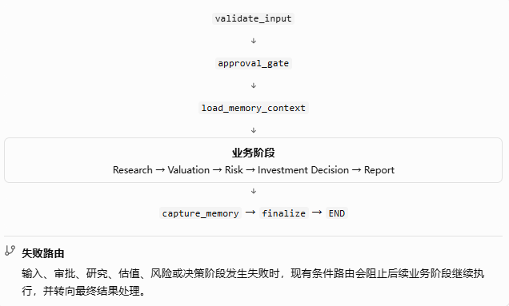
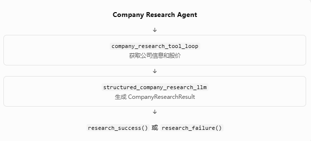
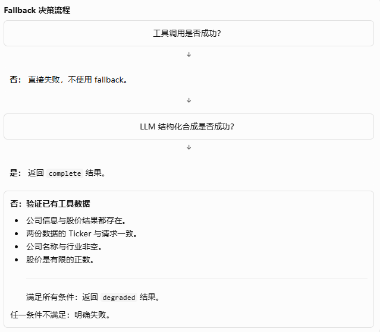

# Phase 12 — Error Recovery

## Lesson 1：Error Taxonomy & Boundaries（错误分类与责任边界）

本课正式开始。第一步不是立即增加重试或 fallback，而是确定系统如何识别失败、由哪一层负责处理，以及失败如何传递到最终结果。如果这些语义没有定义清楚，后续的重试、降级和部分成功就很容易掩盖真正的问题。

本课依据项目修订计划和 Phase 11 之后的源码基线进行。当前检查的基线是 `Investment-Research-Decision-Agent_After_P11.tar`；它不一定包含你后来合并的 Lesson 2、Lesson 3 修改。

### 1. 本课目标

完成本课后，我们应当能够明确回答：

- 哪些错误属于暂时性故障，哪些属于永久性或业务规则错误？
- Provider、Agent/Subgraph、Application Graph 各自应该处理什么？
- 哪些异常可以转为明确的失败状态，哪些必须继续向上传播？
- 失败状态是否保留了足够的诊断信息？
- 工作流失败后，是否会错误地进入下游节点或返回貌似成功的结果？

本课不实现自动重试、fallback 或超时机制。这些分别属于后续课程；这里先确定它们必须遵守的错误语义。

### 2. 当前代码审计：已有能力与缺口

#### 2.1 已有能力

 - **Provider 已经有初步错误分类**

   `app/providers/exceptions.py` 定义了 `TransientProviderError`；`app/providers/config.py` 定义了 `ProviderConfigurationError`。这区分了暂时性 Provider 故障与配置错误，但目前还不是覆盖整个工作流的统一错误模型。

 - **Application 已有显式失败状态**

   `app/application/state.py` 中已有 `stage_errors`、`application_error`，并为研究、估值、风险、决策和报告保留了各自的错误字段。

 - **部分阶段有输出契约校验**

   `app/application/contracts.py` 的 `normalize_stage_output()` 会拒绝不符合约定的结果与错误组合；`validate_ticker_consistency()` 会校验结果对应的股票代码。

 - **关键失败路径有条件路由**

   研究失败会阻止估值继续执行；估值、风险和决策阶段也存在相应的路由检查。

#### 2.2 当前主要缺口

| 缺口                 | 当前情况                                                       | 风险                                 |
|----------------------|----------------------------------------------------------------|--------------------------------------|
| 错误分类不统一       | Provider 有专用异常，Application 主要记录字符串                | 上层无法稳定判断错误性质             |
| 原始异常类型可能丢失 | 多个 Agent/Subgraph 捕获 `Exception` 后返回错误字符串          | 上层很难可靠区分瞬时故障与永久错误   |
| 错误信息结构有限     | `stage_errors` 主要是 `dict[str, str]`                         | 缺少统一的错误代码、分类和处理责任   |
| 捕获边界较宽         | Application 多个阶段使用 `except Exception`                    | 预期业务失败和程序缺陷可能走相同路径 |
| 部分错误没有统一策略 | 有的错误写入 State，有的返回阶段错误字段，有的直接转换为字符串 | 后续重试策略可能难以准确执行         |

这里有一个重要区别：捕获异常并将其转换为显式失败状态，不等于静默吞掉异常。 现有实现已经做了部分失败状态处理；问题在于，统一分类、诊断保真度以及不同异常应如何处理，仍需要进一步规范。

### 3. 错误分类模型

本课新增结构化错误分类，但分类不等于重试决策。例如，某个 Provider 错误可能是暂时性的，但是否真的执行重试，还要考虑操作是否幂等、剩余时间预算以及是否会重复产生副作用。

| 错误类型                 | 重试属性   | 主要责任层           | 处理原则                     |
|--------------------------|------------|----------------------|------------------------------|
| `transient_provider`     | 可重试候选 | Provider 重试策略    | 后续课程实施有限重试         |
| `provider_configuration` | 不可重试   | Provider 配置边界    | 修复配置，不重复请求         |
| `timeout`                | 暂不确定   | 重试与 deadline 策略 | 结合操作语义判断             |
| `stage_contract`         | 不可重试   | Application 阶段边界 | 修复输出契约或程序缺陷       |
| `input_validation`       | 不可重试   | 输入验证边界         | 要求修正输入                 |
| `business_input`         | 不可重试   | 对应业务阶段         | 补充必要数据，不伪造默认值   |
| `stage_reported_failure` | 未知       | 子图与阶段边界       | 只有错误字符串时，不猜测根因 |
| `unexpected`             | 暂不确定   | Application 错误边界 | 不盲目重试，保留诊断信息     |

这里的 `retryable=None` 是有意设计的：信息不足时，系统应明确表示无法判断，而不是默认重试或默认成功。

### 4. Graph topology 与错误传播



需要特别注意两个边界：

- Report 内部子阶段报告错误时，当前设计允许报告阶段汇总这些错误，再经过 `capture_memory` 和 `finalize`。记忆捕获逻辑必须依据报告成功状态决定是否写入，不能把失败报告记录成成功研究。
- `except Exception` 不会捕获现代 Python 中继承自 `BaseException` 的 `asyncio.CancelledError`。本课保留这种行为，不使用 `except BaseException` 把取消信号错误地转成普通失败。真正的异步取消和整个工作流的硬超时仍由后续课程处理。

### 5. 本课交付的代码修改

压缩包中的文件如下：

| 文件                               | 修改内容                                         |
|------------------------------------|--------------------------------------------------|
| `app/application/errors.py`        | 新增错误分类与结构化诊断记录                     |
| `app/application/state.py`         | 增加内部 `error_details` 状态字段                |
| `app/application/graph.py`         | 在失败路径记录分类、责任层及可获得的原始异常类型 |
| `tests/test_application_errors.py` | 新增分类、诊断信息保留及取消传播测试             |
| `PHASE12_LESSON1_NOTES.md`         | 本课的设计说明与验证记录                         |

其中有一个刻意保留的安全边界：结构化 `error_details` 属于内部执行状态，本课没有把原始异常诊断直接加入公开的 `ApplicationOutputState`。用户可见的错误消息与内部诊断信息如何彻底分离，会在后续错误报告契约课程中继续完善。

另外，现有 Agent/Subgraph 中有些地方会把异常转换成字符串。因此，当异常类型在子图内部已经丢失时，Application 只能记录 `stage_reported_failure`，不能凭错误文本还原原始异常类型。后续会继续补齐这种跨层错误传播问题，而不是用脆弱的字符串匹配冒充可靠分类。


## Lesson 2: Retry Policy & Bounded Retry（重试策略与有界重试）

### 1. 当前生产流程审计结果

本课的关键区别是：Application Graph 的业务阶段失败处理，与底层模型请求重试，是两个不同的层次。

#### 1.1 生产流程目前如何处理失败

`app/application/graph.py` 的核心业务链路为：

\#chatgpt-mermaid-\_r_ld\_{font-family:-apple-system-body,ui-sans-serif,-apple-system,system-ui,"Segoe UI",Helvetica,"Apple Color Emoji",Arial,sans-serif,"Segoe UI Emoji","Segoe UI Symbol";font-size:16px;fill:rgb(13, 13, 13);}@keyframes edge-animation-frame{from{stroke-dashoffset:0;}}@keyframes dash{to{stroke-dashoffset:0;}}#chatgpt-mermaid-\_r_ld\_ .edge-animation-slow{stroke-dasharray:9,5!important;stroke-dashoffset:900;animation:dash 50s linear infinite;stroke-linecap:round;}#chatgpt-mermaid-\_r_ld\_ .edge-animation-fast{stroke-dasharray:9,5!important;stroke-dashoffset:900;animation:dash 20s linear infinite;stroke-linecap:round;}#chatgpt-mermaid-\_r_ld\_ .error-icon{fill:rgb(243, 243, 243);}#chatgpt-mermaid-\_r_ld\_ .error-text{fill:rgb(13, 13, 13);stroke:rgb(13, 13, 13);}#chatgpt-mermaid-\_r_ld\_ .edge-thickness-normal{stroke-width:1px;}#chatgpt-mermaid-\_r_ld\_ .edge-thickness-thick{stroke-width:3.5px;}#chatgpt-mermaid-\_r_ld\_ .edge-pattern-solid{stroke-dasharray:0;}#chatgpt-mermaid-\_r_ld\_ .edge-thickness-invisible{stroke-width:0;fill:none;}#chatgpt-mermaid-\_r_ld\_ .edge-pattern-dashed{stroke-dasharray:3;}#chatgpt-mermaid-\_r_ld\_ .edge-pattern-dotted{stroke-dasharray:2;}#chatgpt-mermaid-\_r_ld\_ .marker{fill:rgb(143, 143, 143);stroke:rgb(143, 143, 143);}#chatgpt-mermaid-\_r_ld\_ .marker.cross{stroke:rgb(143, 143, 143);}#chatgpt-mermaid-\_r_ld\_ svg{font-family:-apple-system-body,ui-sans-serif,-apple-system,system-ui,"Segoe UI",Helvetica,"Apple Color Emoji",Arial,sans-serif,"Segoe UI Emoji","Segoe UI Symbol";font-size:16px;}#chatgpt-mermaid-\_r_ld\_ p{margin:0;}#chatgpt-mermaid-\_r_ld\_ .label{font-family:-apple-system-body,ui-sans-serif,-apple-system,system-ui,"Segoe UI",Helvetica,"Apple Color Emoji",Arial,sans-serif,"Segoe UI Emoji","Segoe UI Symbol";color:rgb(13, 13, 13);}#chatgpt-mermaid-\_r_ld\_ .cluster-label text{fill:rgb(13, 13, 13);}#chatgpt-mermaid-\_r_ld\_ .cluster-label span{color:rgb(13, 13, 13);}#chatgpt-mermaid-\_r_ld\_ .cluster-label span p{background-color:transparent;}#chatgpt-mermaid-\_r_ld\_ .label text,#chatgpt-mermaid-\_r_ld\_ span{fill:rgb(13, 13, 13);color:rgb(13, 13, 13);}#chatgpt-mermaid-\_r_ld\_ .node rect,#chatgpt-mermaid-\_r_ld\_ .node circle,#chatgpt-mermaid-\_r_ld\_ .node ellipse,#chatgpt-mermaid-\_r_ld\_ .node polygon,#chatgpt-mermaid-\_r_ld\_ .node path{fill:rgb(222, 234, 251);stroke:rgb(83, 154, 248);stroke-width:1px;}#chatgpt-mermaid-\_r_ld\_ .rough-node .label text,#chatgpt-mermaid-\_r_ld\_ .node .label text,#chatgpt-mermaid-\_r_ld\_ .image-shape .label,#chatgpt-mermaid-\_r_ld\_ .icon-shape .label{text-anchor:middle;}#chatgpt-mermaid-\_r_ld\_ .node .katex path{fill:#000;stroke:#000;stroke-width:1px;}#chatgpt-mermaid-\_r_ld\_ .rough-node .label,#chatgpt-mermaid-\_r_ld\_ .node .label,#chatgpt-mermaid-\_r_ld\_ .image-shape .label,#chatgpt-mermaid-\_r_ld\_ .icon-shape .label{text-align:center;}#chatgpt-mermaid-\_r_ld\_ .node.clickable{cursor:pointer;}#chatgpt-mermaid-\_r_ld\_ .root .anchor path{fill:rgb(143, 143, 143)!important;stroke-width:0;stroke:rgb(143, 143, 143);}#chatgpt-mermaid-\_r_ld\_ .arrowheadPath{fill:rgb(143, 143, 143);}#chatgpt-mermaid-\_r_ld\_ .edgePath .path{stroke:rgb(143, 143, 143);stroke-width:1px;}#chatgpt-mermaid-\_r_ld\_ .flowchart-link{stroke:rgb(143, 143, 143);fill:none;}#chatgpt-mermaid-\_r_ld\_ .edgeLabel{background-color:rgb(252, 252, 252);text-align:center;}#chatgpt-mermaid-\_r_ld\_ .edgeLabel p{background-color:rgb(252, 252, 252);}#chatgpt-mermaid-\_r_ld\_ .edgeLabel rect{opacity:0.5;background-color:rgb(252, 252, 252);fill:rgb(252, 252, 252);}#chatgpt-mermaid-\_r_ld\_ .labelBkg{background-color:rgba(252, 252, 252, 0.5);}#chatgpt-mermaid-\_r_ld\_ .cluster rect{fill:rgb(243, 243, 243);stroke:rgba(0, 0, 0, 0.1);stroke-width:1px;}#chatgpt-mermaid-\_r_ld\_ .cluster text{fill:rgb(13, 13, 13);}#chatgpt-mermaid-\_r_ld\_ .cluster span{color:rgb(13, 13, 13);}#chatgpt-mermaid-\_r_ld\_ div.mermaidTooltip{position:absolute;text-align:center;max-width:200px;padding:2px;font-family:-apple-system-body,ui-sans-serif,-apple-system,system-ui,"Segoe UI",Helvetica,"Apple Color Emoji",Arial,sans-serif,"Segoe UI Emoji","Segoe UI Symbol";font-size:12px;background:rgb(243, 243, 243);border:1px solid rgba(0, 0, 0, 0.1);border-radius:2px;pointer-events:none;z-index:100;}#chatgpt-mermaid-\_r_ld\_ .flowchartTitleText{text-anchor:middle;font-size:18px;fill:rgb(13, 13, 13);}#chatgpt-mermaid-\_r_ld\_ rect.text{fill:none;stroke-width:0;}#chatgpt-mermaid-\_r_ld\_ .icon-shape,#chatgpt-mermaid-\_r_ld\_ .image-shape{background-color:rgb(252, 252, 252);text-align:center;}#chatgpt-mermaid-\_r_ld\_ .icon-shape p,#chatgpt-mermaid-\_r_ld\_ .image-shape p{background-color:rgb(252, 252, 252);padding:2px;}#chatgpt-mermaid-\_r_ld\_ .icon-shape .label rect,#chatgpt-mermaid-\_r_ld\_ .image-shape .label rect{opacity:0.5;background-color:rgb(252, 252, 252);fill:rgb(252, 252, 252);}#chatgpt-mermaid-\_r_ld\_ .label-icon{display:inline-block;height:1em;overflow:visible;vertical-align:-0.125em;}#chatgpt-mermaid-\_r_ld\_ .node .label-icon path{fill:currentColor;stroke:revert;stroke-width:revert;}#chatgpt-mermaid-\_r_ld\_ .node .neo-node{stroke:rgb(83, 154, 248);}#chatgpt-mermaid-\_r_ld\_ [data-look="neo"].node rect,#chatgpt-mermaid-\_r_ld\_ [data-look="neo"].cluster rect,#chatgpt-mermaid-\_r_ld\_ [data-look="neo"].node polygon{stroke:url(#chatgpt-mermaid-\_r_ld\_-gradient);filter:drop-shadow( 1px 2px 2px rgba(185,185,185,1));}#chatgpt-mermaid-\_r_ld\_ [data-look="neo"].swimlane.cluster rect{filter:none;}#chatgpt-mermaid-\_r_ld\_ [data-look="neo"].node path{stroke:url(#chatgpt-mermaid-\_r_ld\_-gradient);stroke-width:1px;}#chatgpt-mermaid-\_r_ld\_ [data-look="neo"].node .outer-path{filter:drop-shadow( 1px 2px 2px rgba(185,185,185,1));}#chatgpt-mermaid-\_r_ld\_ [data-look="neo"].node .neo-line path{stroke:rgb(83, 154, 248);filter:none;}#chatgpt-mermaid-\_r_ld\_ [data-look="neo"].node circle{stroke:url(#chatgpt-mermaid-\_r_ld\_-gradient);filter:drop-shadow( 1px 2px 2px rgba(185,185,185,1));}#chatgpt-mermaid-\_r_ld\_ [data-look="neo"].node circle .state-start{fill:#000000;}#chatgpt-mermaid-\_r_ld\_ [data-look="neo"].icon-shape .icon{fill:url(#chatgpt-mermaid-\_r_ld\_-gradient);filter:drop-shadow( 1px 2px 2px rgba(185,185,185,1));}#chatgpt-mermaid-\_r_ld\_ [data-look="neo"].icon-shape .icon-neo path{stroke:url(#chatgpt-mermaid-\_r_ld\_-gradient);filter:drop-shadow( 1px 2px 2px rgba(185,185,185,1));}#chatgpt-mermaid-\_r_ld\_ .node text{font-size:14px;font-weight:600;letter-spacing:normal;fill:rgb(0, 79, 153);}#chatgpt-mermaid-\_r_ld\_ .edgeLabels text{font-size:13px;font-weight:600;letter-spacing:-0.08px;fill:rgb(0, 79, 153);}#chatgpt-mermaid-\_r_ld\_ .node tspan[font-weight="normal"],#chatgpt-mermaid-\_r_ld\_ .edgeLabels tspan[font-weight="normal"]{font-weight:600;}#chatgpt-mermaid-\_r_ld\_ .edgeLabel .label rect{opacity:1;rx:13px;ry:13px;fill:rgb(245, 250, 255);stroke:rgb(206, 219, 229);stroke-width:1px;}#chatgpt-mermaid-\_r_ld\_ .node rect,#chatgpt-mermaid-\_r_ld\_ .node circle,#chatgpt-mermaid-\_r_ld\_ .node ellipse,#chatgpt-mermaid-\_r_ld\_ .node polygon,#chatgpt-mermaid-\_r_ld\_ .node path{fill:rgb(229, 243, 255);stroke:rgba(0, 0, 0, 0.1);stroke-width:1px;}#chatgpt-mermaid-\_r_ld\_ .node rect{rx:16px;ry:16px;}#chatgpt-mermaid-\_r_ld\_ .node.mermaid-decision .label-container{fill:rgb(245, 250, 255);stroke:rgb(206, 219, 229);stroke-dasharray:2,2;}#chatgpt-mermaid-\_r_ld\_ .edgePaths .flowchart-link{stroke:rgb(143, 143, 143);stroke-width:1px;stroke-linecap:round;stroke-linejoin:round;}#chatgpt-mermaid-\_r_ld\_ .marker{fill:rgb(143, 143, 143);stroke:rgb(143, 143, 143);}#chatgpt-mermaid-\_r_ld\_ :root{--mermaid-font-family:-apple-system-body,ui-sans-serif,-apple-system,system-ui,"Segoe UI",Helvetica,"Apple Color Emoji",Arial,sans-serif,"Segoe UI Emoji","Segoe UI Symbol";}validate_inputapproval_gateload_memory_contextresearchvaluationfinalizeriskinvestment_decisionreportcapture_memoryEND成功失败成功失败成功失败成功失败

目前的 `run_research_stage()`、`run_valuation_stage()`、`run_risk_stage()` 和 `run_decision_stage()` 都存在捕获异常并转换成 Application 失败状态的处理方式。

例如，Research 阶段发生异常后，代码会通过 `_failure_update()` 写入 `stage_errors` 和 `application_error`，然后由 `route_after_research()` 决定是否进入估值阶段。

因此，直接在这些 Application 节点上添加 LangGraph 的异常重试策略，并不能自动解决问题：异常一旦被节点捕获并转换为普通 State 更新，框架就看不到一个需要重试的异常了。

#### 1.2 重试策略应该放在哪一层？

本课先为共享 LLM 客户端建立有界重试。

项目中的研究规划、公司研究、财务研究、市场研究、风险分析和投资决策等 Agent 都通过 `app/llm/client.py` 获取共享的 `llm`。在这个公共入口配置重试，可以避免每个 Agent 重复实现相同策略，也不需要修改 Application Graph 的业务路由。

需要明确的是，本课只覆盖底层 LLM API 请求的有限重试，不代表 Research、Valuation、Risk、Decision 等整个业务阶段都具备重试能力。数据 Provider 和工具调用的重试仍需根据它们各自的异常传播路径分别设计。

### 2. 核心概念：重试次数、异常白名单与耗尽行为

#### 2.1 三次尝试不等于三次重试

本课采用如下策略：

| 配置           | 含义                                     |
|----------------|------------------------------------------|
| 初始请求       | 1 次                                     |
| 最大额外重试   | 2 次                                     |
| 最大总尝试次数 | 3 次                                     |
| 等待策略       | SDK 的指数退避与适用的抖动策略           |
| 达到上限后     | 传播最终异常，由上层现有失败处理机制接管 |

执行过程如下：

 - 1. 第一次请求

    初始调用失败后，SDK 判断错误是否属于可重试范围

 - 2. 第二次请求

    符合条件时重试；再次失败则继续判断

 - 3. 第三次请求

    最后一次允许的尝试；失败后不再重试

#### 2.2 为什么不能重试所有异常？

重试的前提是：再次调用可能解决问题，而且重复调用的成本和副作用可以接受。

本课利用 `ChatOpenAI` 底层 OpenAI SDK 已有的重试机制，处理其支持的瞬时 API 错误，例如连接错误、超时、限流以及部分服务器错误。

以下情况不能因为发生异常就一律重试：

- Pydantic 或业务契约验证失败。
- 程序中的 `ValueError` 等非瞬时错误。
- 研究输出缺少必需数据。
- 用户输入无效。
- 投资估值所需的关键输入缺失。

这些问题需要由相应的验证、业务失败或降级策略处理，而不是通过反复请求模型来掩盖。

#### 2.3 为什么使用 SDK 自带的重试？

当前共享客户端是 `ChatOpenAI` 实例。直接对它调用通用 Runnable 的 `.with_retry()` 会改变对象类型，不能再假定它仍然提供 `ChatOpenAI.with_structured_output()` 这样的模型专用接口。

因此，本课选择在 `ChatOpenAI` 初始化时设置 `max_retries=2`，保留原有模型接口与结构化输出调用方式，并将有限重试集中配置在共享入口。

这是比逐个改造 Agent 更小、更贴近现有架构的改动。

### 3. 本课代码修改

修改范围只有两个文件，不修改 `app/application/graph.py`，也不修改教学遗留的 `app/graph/graph.py`。

`app/llm/client.py`

在共享 LLM 客户端配置有界重试，并保留原有 `ChatOpenAI` 对象及结构化输出接口。

`tests/test_llm_retry_policy.py`

新增独立单元测试，检查重试上限和客户端配置，不调用真实 LLM 服务。

#### 3.1 完整源码：`app/llm/client.py`

```python
"""Shared LLM client with bounded retries for transient provider failures."""

import os

from dotenv import load_dotenv
from langchain_openai import ChatOpenAI

load_dotenv()

# OpenAI SDK semantics: max_retries is the number of retries after the initial
# request. Thus 2 means at most 3 total attempts. The SDK retries selected
# transient transport/API failures, not arbitrary application exceptions.
LLM_MAX_RETRIES = 2


def build_llm() -> ChatOpenAI:
    """Build the shared model client with a bounded provider retry policy."""
    return ChatOpenAI(
        model=os.getenv("LLM_MODEL"),
        api_key=os.getenv("OPENAI_API_KEY"),
        base_url=os.getenv("OPENAI_BASE_URL"),
        temperature=0,
        max_retries=LLM_MAX_RETRIES,
        extra_body={
            "thinking": {
                "type": "disabled"  # 关键：关闭思考模式
            }
        },
    )


llm = build_llm()
```

这里有三个关键点：

1. `max_retries=2` 表示最多额外重试两次，而不是总共调用两次。
2. `llm` 仍然是 `ChatOpenAI` 实例，原有 Agent 无须修改 `llm.with_structured_output(...)` 的使用方式。
3. 请求达到重试上限后，最终异常仍会交给现有 Agent 错误处理逻辑；不会自动伪造一个成功结果。

#### 3.2 完整测试源码：`tests/test_llm_retry_policy.py`

```python
from app.llm import client as llm_client


def test_llm_retry_policy_allows_two_retries_after_initial_attempt():
    # OpenAI SDK's max_retries excludes the initial request.
    assert llm_client.LLM_MAX_RETRIES == 2
    assert llm_client.LLM_MAX_RETRIES + 1 == 3


def test_build_llm_configures_bounded_retries(monkeypatch):
    captured = {}

    class FakeChatOpenAI:
        def __init__(self, **kwargs):
            captured.update(kwargs)

    monkeypatch.setattr(llm_client, "ChatOpenAI", FakeChatOpenAI)

    result = llm_client.build_llm()

    assert isinstance(result, FakeChatOpenAI)
    assert captured["max_retries"] == 2
    assert captured["temperature"] == 0
    assert "model" in captured
    assert "base_url" in captured
```

这两个测试验证的是配置契约，而不是实际 OpenAI 网络请求的重试行为。真实 SDK 重试行为仍需在后续故障注入测试中验证。


## Lesson 3：Timeout & Cancellation Boundaries

本课正式进入代码实现。目标不是简单地给所有函数加一个 `timeout` 参数，而是明确系统在哪些边界可以限制等待时间、哪些边界能够传播取消信号，以及哪些能力目前还不能保证。

本次交付以 Phase 11 源码为基线，结合 Lesson 1 的错误分类实现和 Lesson 2 的重试策略。不重写 Application Graph，不增加通用重试循环，也不把“停止等待”误称为“底层任务已取消”。

### 一、本课目标

完成本课后，我们要具备以下能力：

1. LLM 的单次 HTTP 请求有明确的 timeout 配置。
2. 可以通过环境变量调整 timeout，且非法配置会明确报错。
3. 保留 Lesson 2 的有限重试策略，不引入重复的 Application 级重试。
4. 验证现有 Provider 的请求 timeout 确实传递到了 HTTP 调用层。
5. 验证 Research、Risk、Investment Decision、Report 阶段不会把取消信号转换成普通失败状态。
6. 明确区分请求超时、阶段 deadline、整个工作流 deadline，不夸大当前系统的保证。

### 二、先审计当前实现

#### 1. 当前调用拓扑

```text
Application Graph
        ⬇
Research / Valuation / Risk / Decision / Report
                ⬇
LLM client / Data Provider / Memory
```

#### 2. 审计结果

| 边界             | 原有能力                                                          | 本课处理                                           |
|------------------|-------------------------------------------------------------------|----------------------------------------------------|
| LLM 请求         | Lesson 2 已配置最多 2 次 SDK retry，但没有显式配置请求 timeout    | 增加默认 30 秒的请求 timeout，并支持环境变量覆盖   |
| Alpha Vantage    | HTTP opener 默认接收 10 秒 timeout                                | 保留实现，增加定向测试                             |
| Sina Finance     | HTTP opener 默认接收 10 秒 timeout                                | 保留实现，增加定向测试                             |
| Application 阶段 | 通过同步 `.invoke()` 调用子图，普通异常由 `except Exception` 处理 | 测试取消信号继续传播，不改成普通失败状态           |
| 整个 Graph       | 没有可靠的全流程硬 deadline                                       | 不虚构这一能力，后续在 Lesson 7 进行集成设计与验证 |

这里有一个重要区别：Provider 已有请求 timeout，不代表整个业务阶段最多运行 10 秒。 例如，Alpha Vantage 的请求限流等待发生在 HTTP 请求之前，因此不受 HTTP timeout 限制。

### 三、代码修改

#### 文件清单

| 文件                                           | 处理方式                                        |
|------------------------------------------------|-------------------------------------------------|
| `app/llm/client.py`                            | 替换为完整的新版本，保留 Lesson 2 的 retry 设置 |
| `.env.example`                                 | 替换为完整更新版本，增加 timeout 配置示例       |
| `tests/test_application_timeout_boundaries.py` | 新增 LLM timeout 配置和取消传播测试             |
| `tests/test_provider_timeout_boundaries.py`    | 新增 Provider 请求 timeout 测试                 |

本课没有修改 `app/application/graph.py` 或 `app/application/state.py`：审计发现现有阶段边界的 `except Exception` 不会捕获现代 Python 中继承自 `BaseException` 的 `asyncio.CancelledError`。本课通过测试验证这个现有行为，而不是为了增加代码改动而重复实现。

### 四、核心实现讲解

#### 1. LLM 请求 timeout

`app/llm/client.py` 增加了以下配置：

```
LLM_MAX_RETRIES = 2# 单次 HTTP 请求的 timeout，不是整个 LLM 调用的总 deadline。LLM_REQUEST_TIMEOUT_SECONDS = 30.0
```

构建客户端时，将 timeout 显式传给 `ChatOpenAI`：

```
client_options = {    "model": os.getenv("LLM_MODEL"),    "api_key": os.getenv("OPENAI_API_KEY"),    "base_url": os.getenv("OPENAI_BASE_URL"),    "temperature": 0,    "timeout": _configured_request_timeout(),    "max_retries": LLM_MAX_RETRIES,    "extra_body": {        "thinking": {            "type": "disabled"        }    },}
```

这里保留了 Lesson 2 的重试所有权：由 OpenAI SDK 管理 HTTP 请求级重试，Application Graph 不再增加一层通用 retry。

新增的 `_configured_request_timeout()` 会读取环境变量，并验证配置：

- `30`：有效。
- `12.5`：有效。
- `0` 或负数：报错。
- 非数字字符串：报错。

在 `.env` 中可以配置：

```
LLM_REQUEST_TIMEOUT_SECONDS=30
```

如果不设置，则使用默认值 30 秒。

#### 2. 为什么 30 秒不代表整个 LLM 调用最多 30 秒？

Lesson 2 配置的是最多 2 次 retry，即初次请求加最多 2 次重试。

假设每次 HTTP 请求都耗尽 30 秒 timeout，那么仅请求等待时间就可能接近：

\\[ T\_{\text{requests}} \approx 3 \times 30 = 90\text{ 秒} \\]

实际总时间还可能包括退避、调度和其他开销。

因此，我们当前保证的是每次请求有明确的 timeout 配置，重试次数有限，而不是保证整个逻辑调用一定在 30 秒内结束。

如果未来需要总耗时不超过 45 秒的严格 deadline，就必须把剩余时间预算传播到后续请求与重试中，不能简单地重复使用 30 秒。

#### 3. 为什么不直接给同步 `.invoke()` 套一个 timeout？

例如，用线程执行同步 Graph，再用 `asyncio.wait_for()` 限制等待时间，可能出现这样的情况：

1. 调用方在 30 秒后停止等待。
2. 后台线程仍在执行网络请求或其他同步工作。
3. 调用方已经报告 timeout，但底层任务仍可能继续运行。

这不符合我们对取消语义的严格要求。

因此，本课不引入这种包装，也不声称现有同步 Graph 已经支持强制取消。后续需要结合恢复状态、剩余预算和副作用语义，设计并验证更完整的执行边界。


## Lesson 4：Fallback & Degraded Mode

本课开始进入投资研究 Agent 的回退机制与降级运行机制。

上一课解决的是：外部调用可能超时、无法及时返回时，如何控制执行边界。本课解决的是另一个问题：

> 当一个数据源或处理步骤失败时，系统应该尝试替代方案、在明确限制下继续运行，还是直接终止？

对于投资研究系统，这不是简单的异常处理问题。比如，主要财务数据源不可用时，系统可能仍然能够获取备用数据；但如果关键财务指标缺失，就不能为了让流程顺利结束而假装数据完整，更不能输出看似确定的投资结论。

本课会延续项目既定的教学方式：先明确设计边界，再检查现有实现，随后以最小必要修改完成代码和测试。不会一开始就重写 Application Graph，也不会把本课核心功能推迟到 Lesson 7。

### 一、本课的目标与边界

根据项目总体计划与 Phase 12 交接文档，Lesson 4 的验收重点是：降级结果必须明确标记，关键数据缺失时不得伪装成完整结果，并且 fallback 必须能够独立测试。

本课选择一个范围有限、可以直接验证的场景：

公司信息和股价已经成功获取，但结构化 LLM 合成失败时，能否使用已经取得的真实工具数据构造一个明确标记为降级的结果？

为什么选择这个场景？

- 工具已经取得的数据仍然可用，不应该因为后续 LLM 故障就必然丢弃。
- 公司名称、行业和股价都有真实工具结果作为依据，可以进行确定性校验。
- 不需要切换到 Mock Provider，也不需要引入新的外部数据源。
- 如果必需数据缺失，仍然可以明确失败，而不是填入默认值。

这能让我们验证真正的降级机制，同时避免在本课就引入跨 Provider 自动切换、缓存新鲜度策略或复杂的多分支聚合。

### 二、先理解三个概念

#### 1. Retry — 重试

同一个操作再尝试一次，希望暂时性故障能够自行恢复。

例如：LLM 请求发生暂时性网络错误，按照有限重试策略再次请求。

核心：重新执行原操作。

#### 2. Fallback — 回退

主路径失败后，切换到另一条已经定义好的处理路径。

例如：LLM 无法生成结构化结果，但公司信息和股价工具都已成功返回，可以直接依据这些数据构造结构化结果。

核心：使用另一条有明确依据的处理路径。

#### 3. Degraded Mode — 降级模式

系统可以继续提供有限的结果，但必须明确说明结果不是通过正常路径生成的，以及降级的原因和限制。

例如：结果保留真实的公司名称、行业和股价，但明确标记 `data_status="degraded"`，说明 LLM 合成不可用。

核心：可以继续运行，但不能把降级结果冒充正常结果。

--- 

注意，Fallback 和 Degraded Mode 并不是同义词。Fallback 描述采用了什么替代路径；Degraded Mode 描述最终结果的状态及其限制。

### 三、当前代码审计结论



原实现的问题不是没有异常处理，而是：**LLM 合成失败后，即使此前已经取得了足够的真实工具数据，也只有失败路径，没有经过验证的降级路径。**

另一个审计发现是，原有部分测试 patch 的是构建工具图的工厂函数或另一个变量，而实际执行的是模块级 `company_research_tool_loop` 对象。交付包中将相关测试改为注入实际执行对象，确保测试真正控制被测依赖，而不是仅仅修改一个不会影响执行的引用。

### 四、本课代码修改

修改范围如下。

| 文件                                   | 修改内容                                          |
|----------------------------------------|---------------------------------------------------|
| `app/agents/models.py`                 | 为 `CompanyResearchResult` 增加降级状态和原因字段 |
| `app/agents/company_research.py`       | 增加有条件的、基于工具数据的 fallback             |
| `tests/test_company_research_agent.py` | 修正依赖注入测试目标，增加降级及拒绝降级的测试    |
| `PHASE12_LESSON4_NOTES.md`             | 设计说明、失败路径、运行命令及验收标准            |

#### 1. 新增明确的降级标记

`CompanyResearchResult` 新增两个字段：

```python
data_status: Literal["complete", "degraded"] = "complete"
degradation_reason: str = ""
```

正常结果默认是 `complete`。如果触发降级，系统显式设置 `degraded` 并记录原因。

这两个字段属于应用管理的状态，而不是让 LLM 自己判断结果是否完整。正常路径会由应用重置这两个字段，避免 LLM 输出的元数据覆盖系统状态。

#### 2. 只有满足条件才允许降级



这里最重要的边界是：**LLM 失败不代表可以忽略缺失的数据。**

例如，工具只取得了公司名称，却没有取得股价，即使我们能够拼出一个看似完整的对象，也不能把它作为成功的公司研究结果返回。

#### 3. 降级结果不使用虚构数据

降级结果的核心字段来自已成功返回的工具数据。`summary` 会明确说明这是降级结果，而 `degradation_reason` 说明结构化 LLM 合成失败。

本课没有添加以下行为：

- 不会把 Mock 数据当作真实数据的备用值。
- 不会把缺失的股价设为 `0` 或其他默认数值。
- 不会在 Ticker 不匹配时继续执行。
- 不会在工具调用本身失败时假装 LLM fallback 能弥补缺失的证据。

另外，本课的 fallback 只适用于 LLM 合成失败、但所需工具数据已经成功取得 的场景。它不代表已经实现了完整的数据来源追踪，也不代表数据源本身经过了独立审计。

### 五、Lesson 4 验收条件

#### 验收清单

 - 正常的结构化 LLM 输出返回 complete 状态。
 - LLM 合成失败且工具数据完整、有效时返回 degraded 状态。
 - 降级结果中的公司名称、行业和股价均来自成功的工具输出。
 - 缺少必需工具数据时明确失败，不伪装成成功。
 - Ticker 不一致或股价不是有限正数时拒绝 fallback。
 - Tool loop 本身失败时不尝试 LLM fallback。
 - Company Research Agent 与父图定向测试通过。
 - 受 CompanyResearchResult 变更影响的下游定向回归通过。