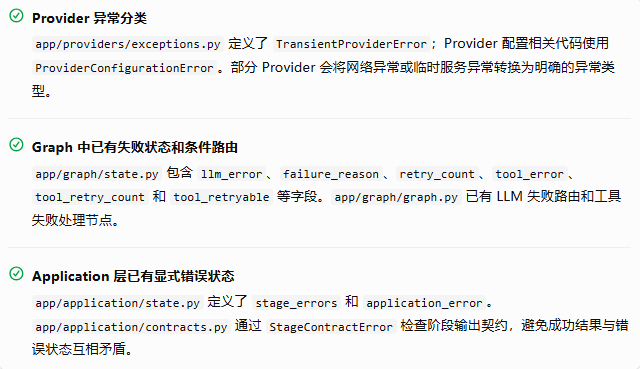
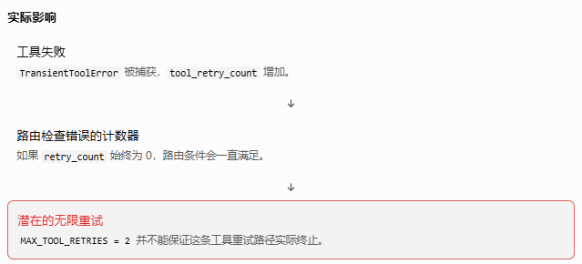
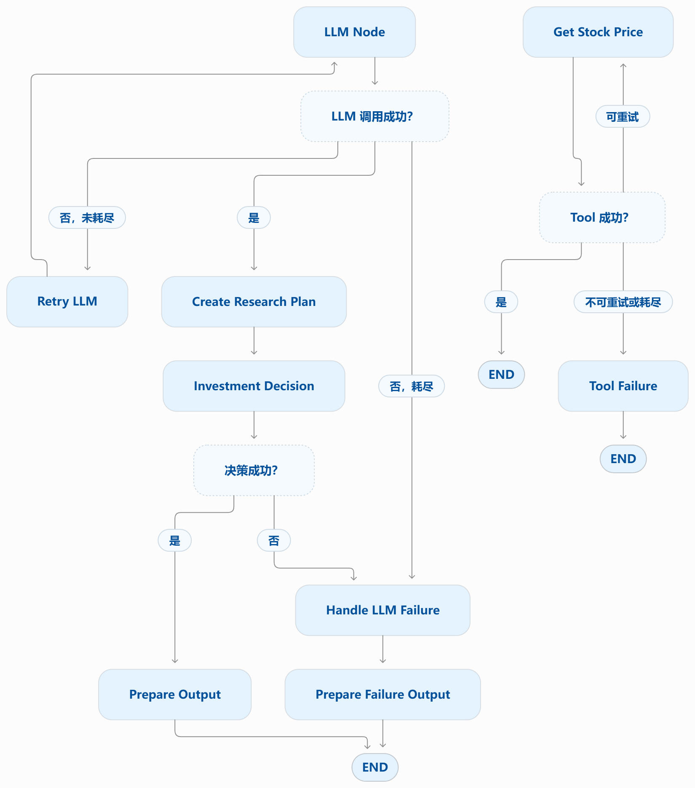
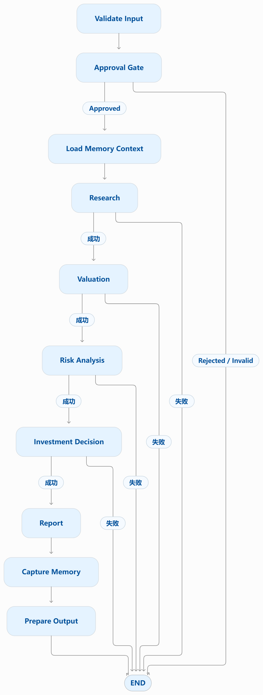

#  Phase 12: Error Recovery

## Lesson 1 — Error Recovery Baseline & Failure Taxonomy

### 1. 本课目标与学习动机

本课首先回答一个工程问题：

当投资研究工作流中的某个环节失败时，系统能否准确识别故障类型，并决定是继续、重试、降级、返回部分结果，还是终止整个任务？

这项能力必须建立在现有实现的审计上，而不是直接引入一个新的错误处理框架。

本课的交付目标是：

1. 梳理现有错误类型、捕获边界和 Graph 路由。
2. 区分已经实现的能力、存在的缺陷和暂时不处理的事项。
3. 找出影响后续有限重试、超时处理和部分成功语义的基础问题。
4. 为 Lesson 2 的 Retry Policy 建立可靠的基线。

### 2. 核心概念：错误分类不能只看异常名称

建议采用三个相互独立的维度分类错误。

| 维度     | 分类                          | 工程含义                                   |
|----------|-------------------------------|--------------------------------------------|
| 发生性质 | Technical / Business          | 技术故障，还是业务规则或输入不满足要求     |
| 可恢复性 | Recoverable / Non-recoverable | 在当前策略和条件下，是否存在合理的恢复路径 |
| 时间特征 | Transient / Permanent         | 是否可能通过稍后重试成功                   |

这三个维度不能混为一谈。

例如：

- Provider 暂时不可用：通常是技术错误、可能可恢复、具有瞬时性。
- 股票代码格式错误：通常是业务输入错误、不可通过原样重试恢复。
- 结构化输出不符合预期：可能是输出格式问题，也可能是业务数据缺失，需要进一步分类。
- 缺少估值必需数据：不应直接视为可以通过重试解决的问题。
- 用户取消任务：属于执行控制事件，不应自动当作普通成功结果，也不应无条件重试。

关键原则：异常发生不代表必须重试；能够捕获异常也不代表已经实现错误恢复。

### 3. 当前源码审计：第一轮发现

我已检查上传的 Phase 11 源码包中与错误恢复直接相关的实现，包括 `app/graph/`、`app/providers/`、`app/application/` 以及相关测试文件。

以下是目前能够从源码直接确认的发现。

#### 3.1 已有基础能力



这些能力说明项目已经具备错误恢复的部分基础，不需要从零开始。但它们并不能证明整个系统已经具备完整、统一的错误恢复策略。

#### 3.2 已发现的高优先级缺陷：工具重试计数器不一致

这是本轮审计中最值得优先关注的问题。

文件：`app/graph/nodes/tool_node.py`

当前工具节点读取并更新的是 `tool_retry_count`：

```python
retry_count = state["tool_retry_count"]

# 发生 TransientToolError 时
return {
    "tool_error": str(exc),
    "tool_retryable": True,
    "tool_retry_count": retry_count + 1,
}
```

但是，同一文件的 `route_after_tool()` 使用的是另一个字段：

```python
if (
    state["tool_retryable"]
    and state["retry_count"] <= MAX_TOOL_RETRIES
):
    return "retry"
```

这里的 `retry_count` 是 LLM 重试所使用的计数器，而不是工具节点递增的 `tool_retry_count`。



这不是单纯的命名问题，而是重试上限可能失效的控制流缺陷。

目前 `tests/test_tool_failure_routing.py` 已经覆盖了成功、可重试失败、重试耗尽和不可重试失败四种路由情形。但这些测试直接传入 `retry_count`，没有验证工具节点递增的 `tool_retry_count` 是否真正控制 Graph 的重试次数。

因此，已有路由单元测试不能证明实际工具重试有上限。

本课的处理决定： 将该问题列为已确认的缺陷，保留给 Lesson 2 的有限重试专题修复，并补充能验证实际执行次数的确定性测试。本课不提前修改重试策略，以免混淆基线审计与下一课的实现目标。

#### 3.3 Application 层的错误处理边界

文件：`app/application/graph.py`

当前 `run_research_stage()` 包含：

```python
except Exception as exc:
    return _failure_update(
        state, stage="research", message=str(exc)
    )
```

这使研究阶段的普通异常能够转换为明确的 Application 失败状态，而不是直接向调用方传播异常。

不过，捕获所有 `Exception` 也存在需要后续审视的边界：

- 不同异常被归一化为字符串，可能丢失重试决策所需的分类信息。
- 调用方看到失败状态时，未必能够区分瞬时故障、输入错误和契约错误。
- 不能仅凭这一段代码认定所有阶段都具有相同的错误语义。
- 还需要确认取消、超时和 LangGraph 中断是否沿着预期路径传播。

这里暂时不建议简单地删除宽泛的异常捕获。Application 层需要建立稳定的失败契约；后续课程应根据具体调用边界，明确哪些异常需要转换、哪些需要向上传播，以及哪些允许重试。

### 4. Graph topology 与失败路径

当前源码至少存在两条值得区分的执行路径：较早的基础 Graph，以及当前的 Application Graph。它们不能被当成同一套错误处理机制。

#### 4.1 基础 Graph：LLM 重试与工具失败

依据 `app/graph/graph.py` 和 `app/graph/tool_graph.py`，可以将相关控制流概括为：



~~说明：这是根据现有源码绘制的逻辑示意，不代表已经通过完整的故障注入测试。~~

这里需要特别注意：

- LLM 路径已有 `MAX_LLM_RETRIES = 2`，并通过 `retry_count` 控制重试路由。
- 工具路径已有 `MAX_TOOL_RETRIES = 2`，但前述计数器不一致问题可能导致重试无法按预期耗尽。
- `tool_graph.py` 通过条件边将失败导向 `tool_failure`；该子图的失败输出仍需与上层调用契约结合审计。

#### 4.2 Application Graph：业务阶段失败

`app/application/graph.py` 中的业务流程是：



这张图描述的是业务阶段的主流程。错误恢复需要进一步确定：某个阶段失败后，是否允许重试；是否存在安全的降级路径；是否允许部分结果；以及失败后是否还可以执行 Memory 写入等后续操作。

不能因为一个阶段返回了 `application_error`，就假定所有后续路径都自动具备正确的终止和副作用保护语义。

### 5. Failure Taxonomy：当前基线清单

以下是 Phase 12 后续课程需要验证的错误矩阵。这里的“待验证”表示目前不能仅凭已检查的代码断言其行为已经完整实现。

| 错误场景               | 当前审计判断                                  | 后续处理方向               |
|------------------------|-----------------------------------------------|----------------------------|
| Provider 瞬时故障      | 已有异常类型                                  | Lesson 2：有限重试         |
| 永久性输入错误         | 部分通过 `ValueError` 表达                    | Lesson 2：确认不可重试边界 |
| LLM 调用异常           | 已有捕获与重试路由                            | Lesson 2：验证耗尽行为     |
| 工具调用异常           | 已有分类与路由，但计数器存在缺陷              | Lesson 2：优先修复         |
| 超时与取消             | 尚未完成系统性审计                            | Lesson 3                   |
| 无效结构化输出         | 有契约校验基础，完整恢复策略待验证            | Lesson 2、4                |
| 关键研究数据缺失       | Application 已有必需输出检查                  | Lesson 4、5                |
| 可选研究分支失败       | 需要确认聚合与降级语义                        | Lesson 5                   |
| Memory 写入失败        | Phase 11 已有非阻断设计记录，仍需针对性回归   | Lesson 6、7                |
| Checkpoint / HITL 恢复 | 已有相关实现，恢复后的重执行风险待验证        | Lesson 7                   |
| 内部错误与对外错误信息 | 已有 Application 错误字段，安全错误契约待完善 | Lesson 8                   |


## Lesson 2: Retry Policy & Bounded Retry（重试策略与有界重试）

### 1. 当前生产流程审计结果

本课的关键区别是：Application Graph 的业务阶段失败处理，与底层模型请求重试，是两个不同的层次。

#### 1.1 生产流程目前如何处理失败

`app/application/graph.py` 的核心业务链路为：

\#chatgpt-mermaid-\_r_ld\_{font-family:-apple-system-body,ui-sans-serif,-apple-system,system-ui,"Segoe UI",Helvetica,"Apple Color Emoji",Arial,sans-serif,"Segoe UI Emoji","Segoe UI Symbol";font-size:16px;fill:rgb(13, 13, 13);}@keyframes edge-animation-frame{from{stroke-dashoffset:0;}}@keyframes dash{to{stroke-dashoffset:0;}}#chatgpt-mermaid-\_r_ld\_ .edge-animation-slow{stroke-dasharray:9,5!important;stroke-dashoffset:900;animation:dash 50s linear infinite;stroke-linecap:round;}#chatgpt-mermaid-\_r_ld\_ .edge-animation-fast{stroke-dasharray:9,5!important;stroke-dashoffset:900;animation:dash 20s linear infinite;stroke-linecap:round;}#chatgpt-mermaid-\_r_ld\_ .error-icon{fill:rgb(243, 243, 243);}#chatgpt-mermaid-\_r_ld\_ .error-text{fill:rgb(13, 13, 13);stroke:rgb(13, 13, 13);}#chatgpt-mermaid-\_r_ld\_ .edge-thickness-normal{stroke-width:1px;}#chatgpt-mermaid-\_r_ld\_ .edge-thickness-thick{stroke-width:3.5px;}#chatgpt-mermaid-\_r_ld\_ .edge-pattern-solid{stroke-dasharray:0;}#chatgpt-mermaid-\_r_ld\_ .edge-thickness-invisible{stroke-width:0;fill:none;}#chatgpt-mermaid-\_r_ld\_ .edge-pattern-dashed{stroke-dasharray:3;}#chatgpt-mermaid-\_r_ld\_ .edge-pattern-dotted{stroke-dasharray:2;}#chatgpt-mermaid-\_r_ld\_ .marker{fill:rgb(143, 143, 143);stroke:rgb(143, 143, 143);}#chatgpt-mermaid-\_r_ld\_ .marker.cross{stroke:rgb(143, 143, 143);}#chatgpt-mermaid-\_r_ld\_ svg{font-family:-apple-system-body,ui-sans-serif,-apple-system,system-ui,"Segoe UI",Helvetica,"Apple Color Emoji",Arial,sans-serif,"Segoe UI Emoji","Segoe UI Symbol";font-size:16px;}#chatgpt-mermaid-\_r_ld\_ p{margin:0;}#chatgpt-mermaid-\_r_ld\_ .label{font-family:-apple-system-body,ui-sans-serif,-apple-system,system-ui,"Segoe UI",Helvetica,"Apple Color Emoji",Arial,sans-serif,"Segoe UI Emoji","Segoe UI Symbol";color:rgb(13, 13, 13);}#chatgpt-mermaid-\_r_ld\_ .cluster-label text{fill:rgb(13, 13, 13);}#chatgpt-mermaid-\_r_ld\_ .cluster-label span{color:rgb(13, 13, 13);}#chatgpt-mermaid-\_r_ld\_ .cluster-label span p{background-color:transparent;}#chatgpt-mermaid-\_r_ld\_ .label text,#chatgpt-mermaid-\_r_ld\_ span{fill:rgb(13, 13, 13);color:rgb(13, 13, 13);}#chatgpt-mermaid-\_r_ld\_ .node rect,#chatgpt-mermaid-\_r_ld\_ .node circle,#chatgpt-mermaid-\_r_ld\_ .node ellipse,#chatgpt-mermaid-\_r_ld\_ .node polygon,#chatgpt-mermaid-\_r_ld\_ .node path{fill:rgb(222, 234, 251);stroke:rgb(83, 154, 248);stroke-width:1px;}#chatgpt-mermaid-\_r_ld\_ .rough-node .label text,#chatgpt-mermaid-\_r_ld\_ .node .label text,#chatgpt-mermaid-\_r_ld\_ .image-shape .label,#chatgpt-mermaid-\_r_ld\_ .icon-shape .label{text-anchor:middle;}#chatgpt-mermaid-\_r_ld\_ .node .katex path{fill:#000;stroke:#000;stroke-width:1px;}#chatgpt-mermaid-\_r_ld\_ .rough-node .label,#chatgpt-mermaid-\_r_ld\_ .node .label,#chatgpt-mermaid-\_r_ld\_ .image-shape .label,#chatgpt-mermaid-\_r_ld\_ .icon-shape .label{text-align:center;}#chatgpt-mermaid-\_r_ld\_ .node.clickable{cursor:pointer;}#chatgpt-mermaid-\_r_ld\_ .root .anchor path{fill:rgb(143, 143, 143)!important;stroke-width:0;stroke:rgb(143, 143, 143);}#chatgpt-mermaid-\_r_ld\_ .arrowheadPath{fill:rgb(143, 143, 143);}#chatgpt-mermaid-\_r_ld\_ .edgePath .path{stroke:rgb(143, 143, 143);stroke-width:1px;}#chatgpt-mermaid-\_r_ld\_ .flowchart-link{stroke:rgb(143, 143, 143);fill:none;}#chatgpt-mermaid-\_r_ld\_ .edgeLabel{background-color:rgb(252, 252, 252);text-align:center;}#chatgpt-mermaid-\_r_ld\_ .edgeLabel p{background-color:rgb(252, 252, 252);}#chatgpt-mermaid-\_r_ld\_ .edgeLabel rect{opacity:0.5;background-color:rgb(252, 252, 252);fill:rgb(252, 252, 252);}#chatgpt-mermaid-\_r_ld\_ .labelBkg{background-color:rgba(252, 252, 252, 0.5);}#chatgpt-mermaid-\_r_ld\_ .cluster rect{fill:rgb(243, 243, 243);stroke:rgba(0, 0, 0, 0.1);stroke-width:1px;}#chatgpt-mermaid-\_r_ld\_ .cluster text{fill:rgb(13, 13, 13);}#chatgpt-mermaid-\_r_ld\_ .cluster span{color:rgb(13, 13, 13);}#chatgpt-mermaid-\_r_ld\_ div.mermaidTooltip{position:absolute;text-align:center;max-width:200px;padding:2px;font-family:-apple-system-body,ui-sans-serif,-apple-system,system-ui,"Segoe UI",Helvetica,"Apple Color Emoji",Arial,sans-serif,"Segoe UI Emoji","Segoe UI Symbol";font-size:12px;background:rgb(243, 243, 243);border:1px solid rgba(0, 0, 0, 0.1);border-radius:2px;pointer-events:none;z-index:100;}#chatgpt-mermaid-\_r_ld\_ .flowchartTitleText{text-anchor:middle;font-size:18px;fill:rgb(13, 13, 13);}#chatgpt-mermaid-\_r_ld\_ rect.text{fill:none;stroke-width:0;}#chatgpt-mermaid-\_r_ld\_ .icon-shape,#chatgpt-mermaid-\_r_ld\_ .image-shape{background-color:rgb(252, 252, 252);text-align:center;}#chatgpt-mermaid-\_r_ld\_ .icon-shape p,#chatgpt-mermaid-\_r_ld\_ .image-shape p{background-color:rgb(252, 252, 252);padding:2px;}#chatgpt-mermaid-\_r_ld\_ .icon-shape .label rect,#chatgpt-mermaid-\_r_ld\_ .image-shape .label rect{opacity:0.5;background-color:rgb(252, 252, 252);fill:rgb(252, 252, 252);}#chatgpt-mermaid-\_r_ld\_ .label-icon{display:inline-block;height:1em;overflow:visible;vertical-align:-0.125em;}#chatgpt-mermaid-\_r_ld\_ .node .label-icon path{fill:currentColor;stroke:revert;stroke-width:revert;}#chatgpt-mermaid-\_r_ld\_ .node .neo-node{stroke:rgb(83, 154, 248);}#chatgpt-mermaid-\_r_ld\_ [data-look="neo"].node rect,#chatgpt-mermaid-\_r_ld\_ [data-look="neo"].cluster rect,#chatgpt-mermaid-\_r_ld\_ [data-look="neo"].node polygon{stroke:url(#chatgpt-mermaid-\_r_ld\_-gradient);filter:drop-shadow( 1px 2px 2px rgba(185,185,185,1));}#chatgpt-mermaid-\_r_ld\_ [data-look="neo"].swimlane.cluster rect{filter:none;}#chatgpt-mermaid-\_r_ld\_ [data-look="neo"].node path{stroke:url(#chatgpt-mermaid-\_r_ld\_-gradient);stroke-width:1px;}#chatgpt-mermaid-\_r_ld\_ [data-look="neo"].node .outer-path{filter:drop-shadow( 1px 2px 2px rgba(185,185,185,1));}#chatgpt-mermaid-\_r_ld\_ [data-look="neo"].node .neo-line path{stroke:rgb(83, 154, 248);filter:none;}#chatgpt-mermaid-\_r_ld\_ [data-look="neo"].node circle{stroke:url(#chatgpt-mermaid-\_r_ld\_-gradient);filter:drop-shadow( 1px 2px 2px rgba(185,185,185,1));}#chatgpt-mermaid-\_r_ld\_ [data-look="neo"].node circle .state-start{fill:#000000;}#chatgpt-mermaid-\_r_ld\_ [data-look="neo"].icon-shape .icon{fill:url(#chatgpt-mermaid-\_r_ld\_-gradient);filter:drop-shadow( 1px 2px 2px rgba(185,185,185,1));}#chatgpt-mermaid-\_r_ld\_ [data-look="neo"].icon-shape .icon-neo path{stroke:url(#chatgpt-mermaid-\_r_ld\_-gradient);filter:drop-shadow( 1px 2px 2px rgba(185,185,185,1));}#chatgpt-mermaid-\_r_ld\_ .node text{font-size:14px;font-weight:600;letter-spacing:normal;fill:rgb(0, 79, 153);}#chatgpt-mermaid-\_r_ld\_ .edgeLabels text{font-size:13px;font-weight:600;letter-spacing:-0.08px;fill:rgb(0, 79, 153);}#chatgpt-mermaid-\_r_ld\_ .node tspan[font-weight="normal"],#chatgpt-mermaid-\_r_ld\_ .edgeLabels tspan[font-weight="normal"]{font-weight:600;}#chatgpt-mermaid-\_r_ld\_ .edgeLabel .label rect{opacity:1;rx:13px;ry:13px;fill:rgb(245, 250, 255);stroke:rgb(206, 219, 229);stroke-width:1px;}#chatgpt-mermaid-\_r_ld\_ .node rect,#chatgpt-mermaid-\_r_ld\_ .node circle,#chatgpt-mermaid-\_r_ld\_ .node ellipse,#chatgpt-mermaid-\_r_ld\_ .node polygon,#chatgpt-mermaid-\_r_ld\_ .node path{fill:rgb(229, 243, 255);stroke:rgba(0, 0, 0, 0.1);stroke-width:1px;}#chatgpt-mermaid-\_r_ld\_ .node rect{rx:16px;ry:16px;}#chatgpt-mermaid-\_r_ld\_ .node.mermaid-decision .label-container{fill:rgb(245, 250, 255);stroke:rgb(206, 219, 229);stroke-dasharray:2,2;}#chatgpt-mermaid-\_r_ld\_ .edgePaths .flowchart-link{stroke:rgb(143, 143, 143);stroke-width:1px;stroke-linecap:round;stroke-linejoin:round;}#chatgpt-mermaid-\_r_ld\_ .marker{fill:rgb(143, 143, 143);stroke:rgb(143, 143, 143);}#chatgpt-mermaid-\_r_ld\_ :root{--mermaid-font-family:-apple-system-body,ui-sans-serif,-apple-system,system-ui,"Segoe UI",Helvetica,"Apple Color Emoji",Arial,sans-serif,"Segoe UI Emoji","Segoe UI Symbol";}validate_inputapproval_gateload_memory_contextresearchvaluationfinalizeriskinvestment_decisionreportcapture_memoryEND成功失败成功失败成功失败成功失败

目前的 `run_research_stage()`、`run_valuation_stage()`、`run_risk_stage()` 和 `run_decision_stage()` 都存在捕获异常并转换成 Application 失败状态的处理方式。

例如，Research 阶段发生异常后，代码会通过 `_failure_update()` 写入 `stage_errors` 和 `application_error`，然后由 `route_after_research()` 决定是否进入估值阶段。

因此，直接在这些 Application 节点上添加 LangGraph 的异常重试策略，并不能自动解决问题：异常一旦被节点捕获并转换为普通 State 更新，框架就看不到一个需要重试的异常了。

#### 1.2 重试策略应该放在哪一层？

本课先为共享 LLM 客户端建立有界重试。

项目中的研究规划、公司研究、财务研究、市场研究、风险分析和投资决策等 Agent 都通过 `app/llm/client.py` 获取共享的 `llm`。在这个公共入口配置重试，可以避免每个 Agent 重复实现相同策略，也不需要修改 Application Graph 的业务路由。

需要明确的是，本课只覆盖底层 LLM API 请求的有限重试，不代表 Research、Valuation、Risk、Decision 等整个业务阶段都具备重试能力。数据 Provider 和工具调用的重试仍需根据它们各自的异常传播路径分别设计。

### 2. 核心概念：重试次数、异常白名单与耗尽行为

#### 2.1 三次尝试不等于三次重试

本课采用如下策略：

| 配置           | 含义                                     |
|----------------|------------------------------------------|
| 初始请求       | 1 次                                     |
| 最大额外重试   | 2 次                                     |
| 最大总尝试次数 | 3 次                                     |
| 等待策略       | SDK 的指数退避与适用的抖动策略           |
| 达到上限后     | 传播最终异常，由上层现有失败处理机制接管 |

执行过程如下：

 - 1. 第一次请求

    初始调用失败后，SDK 判断错误是否属于可重试范围

 - 2. 第二次请求

    符合条件时重试；再次失败则继续判断

 - 3. 第三次请求

    最后一次允许的尝试；失败后不再重试

#### 2.2 为什么不能重试所有异常？

重试的前提是：再次调用可能解决问题，而且重复调用的成本和副作用可以接受。

本课利用 `ChatOpenAI` 底层 OpenAI SDK 已有的重试机制，处理其支持的瞬时 API 错误，例如连接错误、超时、限流以及部分服务器错误。

以下情况不能因为发生异常就一律重试：

- Pydantic 或业务契约验证失败。
- 程序中的 `ValueError` 等非瞬时错误。
- 研究输出缺少必需数据。
- 用户输入无效。
- 投资估值所需的关键输入缺失。

这些问题需要由相应的验证、业务失败或降级策略处理，而不是通过反复请求模型来掩盖。

#### 2.3 为什么使用 SDK 自带的重试？

当前共享客户端是 `ChatOpenAI` 实例。直接对它调用通用 Runnable 的 `.with_retry()` 会改变对象类型，不能再假定它仍然提供 `ChatOpenAI.with_structured_output()` 这样的模型专用接口。

因此，本课选择在 `ChatOpenAI` 初始化时设置 `max_retries=2`，保留原有模型接口与结构化输出调用方式，并将有限重试集中配置在共享入口。

这是比逐个改造 Agent 更小、更贴近现有架构的改动。

### 3. 本课代码修改

修改范围只有两个文件，不修改 `app/application/graph.py`，也不修改教学遗留的 `app/graph/graph.py`。

`app/llm/client.py`

在共享 LLM 客户端配置有界重试，并保留原有 `ChatOpenAI` 对象及结构化输出接口。

`tests/test_llm_retry_policy.py`

新增独立单元测试，检查重试上限和客户端配置，不调用真实 LLM 服务。

#### 3.1 完整源码：`app/llm/client.py`

```python
"""Shared LLM client with bounded retries for transient provider failures."""

import os

from dotenv import load_dotenv
from langchain_openai import ChatOpenAI

load_dotenv()

# OpenAI SDK semantics: max_retries is the number of retries after the initial
# request. Thus 2 means at most 3 total attempts. The SDK retries selected
# transient transport/API failures, not arbitrary application exceptions.
LLM_MAX_RETRIES = 2


def build_llm() -> ChatOpenAI:
    """Build the shared model client with a bounded provider retry policy."""
    return ChatOpenAI(
        model=os.getenv("LLM_MODEL"),
        api_key=os.getenv("OPENAI_API_KEY"),
        base_url=os.getenv("OPENAI_BASE_URL"),
        temperature=0,
        max_retries=LLM_MAX_RETRIES,
        extra_body={
            "thinking": {
                "type": "disabled"  # 关键：关闭思考模式
            }
        },
    )


llm = build_llm()
```

这里有三个关键点：

1. `max_retries=2` 表示最多额外重试两次，而不是总共调用两次。
2. `llm` 仍然是 `ChatOpenAI` 实例，原有 Agent 无须修改 `llm.with_structured_output(...)` 的使用方式。
3. 请求达到重试上限后，最终异常仍会交给现有 Agent 错误处理逻辑；不会自动伪造一个成功结果。

#### 3.2 完整测试源码：`tests/test_llm_retry_policy.py`

```python
from app.llm import client as llm_client


def test_llm_retry_policy_allows_two_retries_after_initial_attempt():
    # OpenAI SDK's max_retries excludes the initial request.
    assert llm_client.LLM_MAX_RETRIES == 2
    assert llm_client.LLM_MAX_RETRIES + 1 == 3


def test_build_llm_configures_bounded_retries(monkeypatch):
    captured = {}

    class FakeChatOpenAI:
        def __init__(self, **kwargs):
            captured.update(kwargs)

    monkeypatch.setattr(llm_client, "ChatOpenAI", FakeChatOpenAI)

    result = llm_client.build_llm()

    assert isinstance(result, FakeChatOpenAI)
    assert captured["max_retries"] == 2
    assert captured["temperature"] == 0
    assert "model" in captured
    assert "base_url" in captured
```

这两个测试验证的是配置契约，而不是实际 OpenAI 网络请求的重试行为。真实 SDK 重试行为仍需在后续故障注入测试中验证。