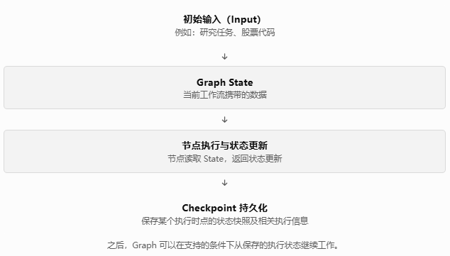
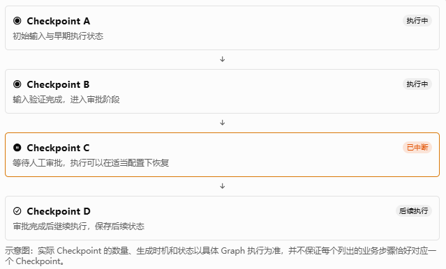
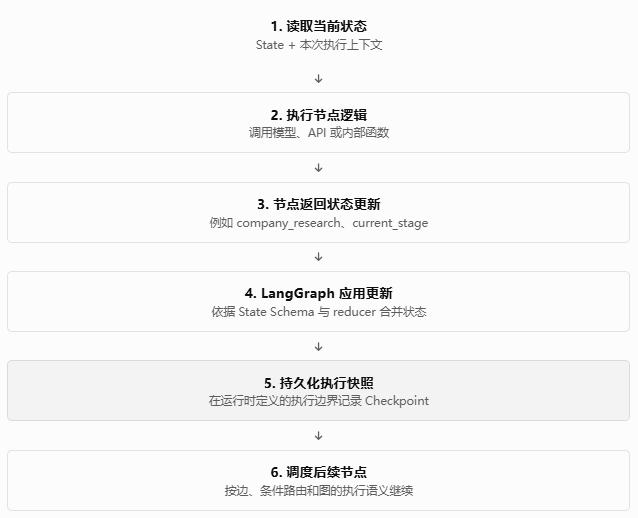
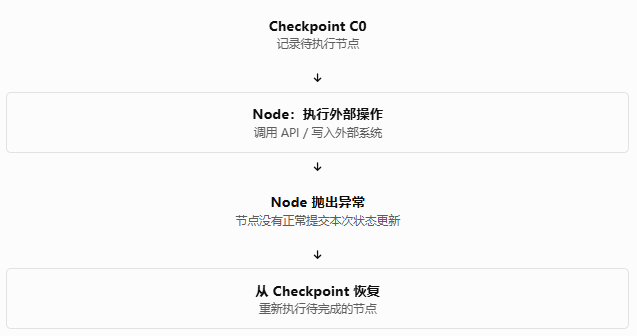

# Phase 9 — Checkpoint / Persistence

## Lesson 1 — Checkpoint / Thread / Persistence Concepts

这一课**暂时不写代码**。

这是有意的。

Phase 9 和前面最大的区别之一，就是如果没有先把下面几个概念分清楚：

```text
Thread
Run
State
Checkpoint
Checkpointer
Memory
```

后面非常容易写出“看起来能恢复，实际上没有真正恢复”的代码。

---

### 1. 为什么现在需要 Persistence？

先回到我们当前的 Agent。

现在的执行逻辑本质上是：

```text
User Request
      ↓
Graph
      ↓
State
      ↓
Nodes
      ↓
State
      ↓
...
      ↓
Final Output
```

例如：

```text
User:
分析 NVIDIA 的投资价值
```

Graph 开始执行：

```text
initialize_state
      ↓
company_research
      ↓
llm_node
      ↓
create_research_plan
      ↓
investment_decision
      ↓
prepare_output
      ↓
END
```

如果 Python Process 在：

```text
company_research
      ↓
llm_node
```

之间突然退出：

```text
Python Process
       X
      STOP
```

那么当前 Graph 的 State 也就随进程消失了。

下一次重新启动：

```text
Python Process
      ↓
new graph
      ↓
invoke(...)
```

默认只能重新开始。

这对于一个真正的 Application 是不够的。

---

### 2. Thread 是什么？

这是 Phase 9 最重要的概念之一。

可以先把：

```text
Thread
```

理解为：

> **一个持续存在的 Graph execution context。**

例如：

```text
thread_id = "research-nvda-001"
```

它不是简单的：

```text
HTTP Request ID
```

也不是：

```text
某一次 node execution ID
```

而是：

```text
一个持续的研究执行上下文
```

因此可以形成：

```text
Thread: research-nvda-001

    Run 1
       ↓
    Run 2
       ↓
    Run 3
```

也就是说，同一个 Thread 可以承载这个研究上下文的连续执行。

交接文档中也明确要求我们最终保持：

```text
Thread
 ├── Run 1
 ├── Run 2
 └── Run 3
```

而不是把 `thread_id` 简化成每次 API Request ID。

---

### 3. Run 是什么？

可以把：

```text
Run
```

理解为：

> **一次具体的 Graph execution。**

例如：

```text
Thread A
   │
   ├── Run 1
   │
   ├── Run 2
   │
   └── Run 3
```

这意味着：

```text
Thread
```

是较长期的 execution context，

而：

```text
Run
```

是其中一次具体执行。

但是这里需要一个很重要的 LangGraph 语义意识：

> **不要把 Run、Thread、Checkpoint 当成三个简单的数据库表，然后机械地认为它们是一一对应的。**

尤其是 Checkpoint。

---

### 4. State 是什么？

我们当前已经非常熟悉 State。

例如当前主 Graph 的：

```python
class GraphState(TypedDict):
```

里面包含：

```text
user_query
ticker

research_plan

company_research
financial_research
market_research
industry_research

valuation_summary
current_price
target_price

risk_factors

recommendation
investment_horizon
investment_thesis

research_summary
investment_decision

llm_error
failure_reason
retry_count

tool_error
tool_retry_count
tool_retryable
```

这就是 Graph execution 的状态数据。

所以可以简单理解：

```text
Graph
  ↓
State
```

State 回答的是：

> **“这个 Graph 当前执行到了什么状态？”**

例如：

```text
ticker = NVDA

company_research = ...

current_price = ...

research_summary = ...

investment_decision = ...

retry_count = 1
```

这些都是当前 execution context 的状态。

---

### 5. Checkpoint 是什么？

这是最关键的地方。

Checkpoint 可以理解为：

> **Graph execution 在某个执行节点/步骤上的持久化状态快照。**

也就是说：

```text
State
   ↓
Checkpoint
```

Checkpoint 的目的不是创建另一套业务 State。

而是：

```text
当前 Graph Execution State
        ↓
持久化
        ↓
以后可以恢复
```

例如：

```text
Run
 │
 ▼
Node A
 │
 ▼
Checkpoint
 │
 ▼
Node B
 │
 ▼
Checkpoint
 │
 ▼
Node C
```

所以：

```text
Checkpoint
```

的核心价值是：

> **让 Graph 不再完全依赖当前 Python Process 的内存。**

---

### 6. Checkpoint ≠ Memory

这个区别必须在 Phase 9 一开始就钉死。

我们项目后面还有：

```text
Phase 11 — Long-term Memory
```

所以现在绝对不能把两者混起来。

#### Checkpoint

回答：

> **当前这个 Graph Execution 到哪里了？**

例如：

```text
Thread: research-nvda-001

State:
    ticker = NVDA
    company_research = ...
    current_price = ...
    retry_count = 1
```

这是当前 execution context。

---

#### Long-term Memory

回答：

> **这个 Application / User / System 在过去积累了什么长期信息？**

例如未来可能是：

```text
User Preferences
Research History
Previous Research Context
```

这些属于 Phase 11。

交接文档已经明确要求：

```text
Checkpoint
    ≠
Long-term Memory
```

Checkpoint 是当前 Graph Execution State，而 Memory 是跨 Thread / 跨执行的长期信息。

---

### 7. 用我们的投资 Agent 举例

假设用户：

```text
分析 NVDA，判断未来投资价值。
```

创建：

```text
thread_id = research-nvda-001
```

然后开始执行。

---

#### 第一个阶段

```text
Thread
  ↓
Run 1
  ↓
initialize_state
  ↓
company_research
```

此时 State 可能已经变成：

```text
ticker = NVDA
company_research_result = {...}
current_price = 180.50
```

然后形成一个 checkpoint：

```text
Checkpoint A
```

---

#### 第二个阶段

继续：

```text
Checkpoint A
      ↓
llm_node
      ↓
research_summary
```

形成：

```text
Checkpoint B
```

---

#### 第三个阶段

继续：

```text
Checkpoint B
      ↓
investment_decision
```

形成：

```text
Checkpoint C
```

最终：

```text
Final State
```

---

### 8. 为什么 Application Restart 后还能恢复？

这就是 Checkpointer 的价值。

没有 Persistence：

```text
Python Process
      ↓
Graph
      ↓
State in RAM
      ↓
Process dies
      ↓
State lost
```

有 Persistence：

```text
Python Process
      ↓
Graph
      ↓
State
      ↓
Checkpointer
      ↓
Persistence Backend
```

然后：

```text
Python Process STOP
```

之后重新启动：

```text
New Python Process
      ↓
New Graph Instance
      ↓
Same Persistence Backend
      ↓
Same thread_id
      ↓
Load checkpoint
      ↓
Resume
```

这才是真正的 Persistence。

交接文档把这个定义得非常严格：

```text
旧 Application
    ↓
停止

新 Application
    ↓
读取持久化数据
    ↓
恢复旧 Thread
```

不能只是同一个 Python Process 连续调用两次 `invoke()`。

---

### 9. Checkpointer 是什么？

现在我们可以定义：

```text
Checkpointer
```

是：

> **负责 checkpoint 的保存、读取以及与 Graph execution 生命周期连接的 persistence infrastructure。**

于是架构关系应该是：

```text
             LangGraph
                 │
                 ▼
              State
                 │
                 ▼
            Checkpointer
                 │
                 ▼
       Persistence Backend
```

注意这个结构非常重要。

我们**不希望**：

```text
Agent Node
   ↓
SQLite
```

或者：

```text
Investment Decision Node
   ↓
PostgreSQL
```

这种业务节点直接操作 Persistence。

而应该：

```text
Business Logic
       │
       ▼
     Graph
       │
       ▼
 Checkpointer
       │
       ▼
 Persistence
```

这就是 Phase 9 后面 Lesson 5 要进一步建立的 Engineering Boundary。

---

### 10. Thread Isolation

这是另一个非常重要的生产级要求。

假设：

```text
Thread A
ticker = NVDA
```

和：

```text
Thread B
ticker = AAPL
```

那么必须：

```text
Thread A
    ↓
State A
    ↓
Checkpoint A
```

以及：

```text
Thread B
    ↓
State B
    ↓
Checkpoint B
```

绝不能：

```text
Thread A
    ↓
State A

Thread B
    ↓
读取 State A
```

否则我们会得到非常严重的金融应用数据污染：

```text
User A:
研究 NVDA

User B:
研究 AAPL

        ↓

AAPL Thread
读取了 NVDA 的 checkpoint
```

这是绝对不可接受的。

所以 Phase 9 不只是：

> “把 State 存下来。”

还必须证明：

> **不同 Thread 的 State 是严格隔离的。**

交接文档也把 Thread Isolation 单独列成 Lesson 3，而不是把它当成 Checkpointer 的附带行为。

---

### 11. 现在形成完整模型

到这里，我们可以把 Phase 9 的核心概念串起来：

```text
                    Thread
                       │
                       ▼
                      Run
                       │
                       ▼
                     State
                       │
                       ▼
                  Checkpoint
                       │
                       ▼
                 Checkpointer
                       │
                       ▼
             Persistence Backend
```

然后：

```text
Application Stop
       ↓
Persistence remains
       ↓
Application Restart
       ↓
Same Thread
       ↓
Load Checkpoint
       ↓
Resume
       ↓
Continue Execution
```

---

### 12. 这和 Phase 10 的 HITL 有什么区别？

这个边界现在也必须明确。

Phase 9：

```text
Graph
 ↓
Checkpoint
 ↓
Stop
 ↓
Restart
 ↓
Resume
```

Phase 10：

```text
Graph
 ↓
interrupt()
 ↓
Human
 ├── Approve
 └── Reject
 ↓
Resume
```

虽然两者都涉及：

```text
暂停
恢复
```

但**原因完全不同**。

#### Phase 9

因为：

> Application execution 需要持久化和恢复。

#### Phase 10

因为：

> Workflow 主动等待 Human Decision。

所以 Phase 9 可以学习：

```text
stop / resume
```

但不能因此开始设计：

```text
Approval
Reject
Human Decision
```

否则就是提前进入 Phase 10。交接文档对此也有明确边界。

---

### 13. Lesson 1 到这里暂时不修改代码

这是有意的。

我们当前已经知道：

```text
当前：
builder
   ↓
compile()
   ↓
Graph
```

未来要变成：

```text
builder
   ↓
compile(
    checkpointer=...
)
   ↓
Persistent Graph
```

但是**现在不要急着直接改成这样**。

因为 Lesson 2 我们首先需要根据你当前实际 LangGraph 版本确定：

```text
具体 Checkpointer API
具体 config 结构
thread_id 的传递方式
checkpoint 查询方式
checkpoint identity
```

交接文档也明确规定：具体 LangGraph API 应以项目当前实际安装版本为准，而不是提前固定一个可能随版本变化的写法。

---

### Lesson 1 Acceptance

因此现在这一课的验收不是代码测试，而是概念验收。

你现在应该能够明确区分：

| 概念                    | 核心问题                                 |
|-------------------------|------------------------------------------|
| **Thread**              | 哪一个持续的 execution context？         |
| **Run**                 | 一次具体的 Graph execution 是什么？      |
| **State**               | 当前 Graph execution 的状态是什么？      |
| **Checkpoint**          | State 在执行过程中的持久化快照是什么？   |
| **Checkpointer**        | 谁负责 checkpoint 的保存/恢复？          |
| **Persistence Backend** | checkpoint 实际保存在哪里？              |
| **Memory**              | 跨 execution / Thread 的长期信息是什么？ |

以及最重要的两条：

```text
Checkpoint ≠ Long-term Memory
```

和：

```text
Thread A ≠ Thread B
```

---

### Lesson 1 Acceptance Criteria

按照我们既定交接标准：

```text
[✓] 能解释 Thread / Run / State / Checkpoint
[✓] 能解释 Checkpointer 职责
[✓] 能区分 Checkpoint 与 Memory
[✓] 能解释 Resume
[✓] 能解释 Thread Isolation

[✓] 不修改业务 Domain Model
[✓] 不实现 HITL
[✓] 不实现 Long-term Memory
```
---


## Lesson 2：把 Checkpointer 接入主 Application Graph

这一课开始真正修改代码。

目标非常明确：

> **让当前项目的主 Application Graph 具备 Checkpoint 能力，并证明不同 `thread_id` 之间能够隔离 State。**

本课**不做**：

* 不修改 `GraphState`
* 不增加 `thread_id` 字段
* 不实现 HITL
* 不实现 Long-term Memory
* 不实现 Error Recovery
* 不实现数据库持久化
* 不验证跨进程 Restart → Resume

原因是我们要严格控制 Phase 9 的演进顺序。LangGraph 的官方 Persistence 模型也是：在 `compile()` 时配置 Checkpointer，然后通过 `configurable.thread_id` 选择 Thread；最新 State 可以通过 `get_state()` 获取。([GitHub][1])

---

### 1. Lesson 2 的工程目标

Lesson 1 我们解决的是：

> **Checkpointer 到底是什么？Thread 到底是什么？**

Lesson 2 开始解决：

> **我们的 Agent Graph 到底怎样接入 Checkpointer？**

最终结构从：

```text
Input
  │
  ▼
Application Graph
  │
  ▼
State
  │
  ▼
Output
```

变成：

```text
                    ┌──────────────────────┐
                    │     Checkpointer     │
                    │   InMemorySaver      │
                    └──────────┬───────────┘
                               │
                               │ checkpoint
                               ▼
Input ──► Application Graph ──► State ──► Output
              │
              │
              └──── thread_id ────► Thread
```

这里最重要的是：

**`thread_id` 不属于 `GraphState`。**

它属于：

```python
config
```

也就是说：

```python
config = {
    "configurable": {
        "thread_id": "..."
    }
}
```

而不是：

```python
state = {
    "thread_id": "..."
}
```

这是非常重要的架构边界。

LangGraph 官方也是把 `thread_id` 定义为 Checkpointer 用来定位 Thread 的主键，而不是 Graph State 的业务字段。([GitHub][2])

---

### 2. 为什么 Lesson 2 使用 `InMemorySaver`

本项目当前使用：

```text
LangGraph 1.2.12
```

因此使用：

```python
from langgraph.checkpoint.memory import InMemorySaver
```

官方 API 中，`InMemorySaver` 就是内存型 Checkpointer；它可以用于测试和调试。([LangChain 参考文档][3])

但是必须非常明确：

```text
InMemorySaver
        │
        ├── 可以验证 Checkpointer API
        ├── 可以验证 Thread
        ├── 可以验证 State Snapshot
        ├── 可以验证 Thread Isolation
        │
        └── 不能跨进程持久化
```

也就是说：

```text
Process A
    │
    ├── Thread A
    ├── Checkpoint A
    │
    ▼
Process STOP
    │
    X
    │
Process B
    │
    └── InMemorySaver 中已经没有 A
```

官方文档也明确说明，`InMemorySaver` 存储在 RAM 中，进程重启后 checkpoint 会丢失。([GitHub][1])

所以：

> **Lesson 2 不是最终 Persistence。**

我们现在只是先把：

```text
Graph
  +
Checkpointer
  +
Thread
```

这条 Runtime 链路打通。

真正的：

```text
STOP
  ↓
RESTART
  ↓
same thread_id
  ↓
load checkpoint
  ↓
resume
```

要在后面的 Persistence Lesson 中完成。

---

### 3. 本项目的 Persistence Boundary

这是这一课另一个非常重要的架构决定。

目前项目里有很多 Graph：

```text
Main Application Graph
        │
        ├── Research Graph
        ├── Tool Graph
        ├── Tool Loop
        ├── Report Graph
        └── Agent Subgraphs
```

我们现在**不**做：

```python
every_subgraph.compile(
    checkpointer=...
)
```

而是首先确定：

```text
                 ┌─────────────────────┐
                 │ Main Application    │
                 │ Graph               │
                 │                     │
                 │  Checkpointer       │
                 └──────────┬──────────┘
                            │
                 ┌──────────┴──────────┐
                 │                     │
              Subgraph              Subgraph
```

也就是说：

> **Phase 9 第一阶段的 Persistence Boundary 是 Main Application Graph。**

这是有意的。

否则很容易出现：

```text
Main Graph
    ↓
Research Graph
    ↓
Tool Graph
    ↓
Report Graph
```

每一个 Graph 都拥有自己的 checkpoint 生命周期，最终 Thread / checkpoint namespace / resume 关系会变得非常复杂。

当前阶段我们先把：

```text
Application-level execution durability
```

建立起来。

---

### 4. Graph Topology 不发生变化

这一点也非常重要。

Lesson 2 **不会增加任何 Node**。

现在：

```text
START
  │
  ▼
initialize_state
  │
  ▼
company_research
  │
  ├──────────────► company_research_failure
  │
  ▼
llm_node
  │
  ├── retry ─────► retry_llm
  │                  │
  │                  └────► llm_node
  │
  ├──────────────► handle_llm_failure
  │
  ▼
create_research_plan
  │
  ▼
investment_decision_node
  │
  ├──────────────► handle_llm_failure
  │
  ▼
prepare_output
  │
  ▼
END
```

仍然完全不变。

变化只有：

```text
Before:

builder.compile()


After:

builder
   │
   ▼
compile(checkpointer=InMemorySaver())
   │
   ▼
graph
```

所以这不是业务逻辑变化。

它是：

> **Graph Runtime Infrastructure 的增强。**

---

### 5. 修改 `app/graph/graph.py`

当前文件最后是：

```python
graph = builder.compile()
```

我们只需要增加 Checkpointer。

#### 5.1 增加 import

在 `app/graph/graph.py` 的 import 区域加入：

```python
from langgraph.checkpoint.memory import InMemorySaver
```

例如原本：

```python
from langgraph.graph import END, START, StateGraph

from app.graph.state import GraphState, InputState, OutputState
```

修改成：

```python
from langgraph.checkpoint.memory import InMemorySaver
from langgraph.graph import END, START, StateGraph

from app.graph.state import GraphState, InputState, OutputState
```

---

#### 5.2 修改 Graph Compile

原来：

```python
graph = builder.compile()
```

改成：

```python
checkpointer = InMemorySaver()

graph = builder.compile(
    checkpointer=checkpointer,
)
```

也就是：

```python
builder
    │
    │ compile()
    ▼
graph
```

变成：

```python
builder
    │
    │ compile(checkpointer=checkpointer)
    ▼
graph
    │
    ▼
InMemorySaver
```

#### 最终这一部分应该是

```python
checkpointer = InMemorySaver()

graph = builder.compile(
    checkpointer=checkpointer,
)
```

---

### 6. 为什么 `checkpointer` 放在 Graph Compile 层

这是一个非常值得理解的设计。

错误思路是：

```python
def initialize_state(state):
    save_checkpoint(state)
```

然后：

```python
def llm_node(state):
    save_checkpoint(state)
```

再：

```python
def investment_decision_node(state):
    save_checkpoint(state)
```

这样做的问题是：

> Checkpoint 变成业务 Node 自己负责的事情。

这会导致：

```text
Business Logic
     +
Persistence Logic
```

强耦合。

而 LangGraph 的设计是：

```text
Node
 │
 └── only business/state transformation


Graph Runtime
 │
 └── checkpoint lifecycle


Checkpointer
 │
 └── persistence
```

因此：

```python
builder.compile(
    checkpointer=checkpointer
)
```

才是正确的边界。

官方文档的 Quickstart 也是在 `compile()` 时配置 Checkpointer。([GitHub][1])

---

### 7. `thread_id` 应该在哪里出现？

Graph 本身：

```python
graph
```

不需要知道：

```text
user123
```

或者：

```text
research-session-001
```

这些 Thread 信息。

真正执行时：

```python
config = {
    "configurable": {
        "thread_id": "research-thread-001",
    }
}
```

然后：

```python
graph.invoke(
    input_data,
    config,
)
```

因此架构变成：

```text
Application
     │
     │ input
     │
     ├─────────────────────┐
     │                     │
     ▼                     ▼
Graph                 Runtime Config
                           │
                           ▼
                      thread_id
                           │
                           ▼
                      Checkpointer
```

这意味着：

> **Thread 是 Runtime Context，而不是 Domain State。**

因此本课再次强调：

#### 不修改 `GraphState`

不要添加：

```python
thread_id: str
```

不要添加：

```python
checkpoint_id: str
```

不要添加：

```python
resume_state: ...
```

也不要添加：

```python
memory: ...
```

`state.py` 本课保持不变。

---

### 8. Lesson 2 的测试策略

这里需要特别认真。

如果我们直接：

```python
graph.invoke(...)
```

那么当前 Application Graph 会进入：

```text
Research
LLM
Tools
Valuation
Risk
Decision
```

这会把 Checkpointer 测试和整个业务执行链绑定起来。

这不是我们这一课想验证的东西。

我们现在需要验证三个层次：

#### Test A — Main Graph 已经接入 Checkpointer

验证：

```text
graph
  ↓
checkpointer
```

确实存在。

#### Test B — Checkpoint 能按照 Thread 保存

建立一个非常小的测试 Graph：

```text
START
  ↓
increment
  ↓
END
```

然后：

```text
thread-A
```

执行。

验证：

```python
graph.get_state(config)
```

能够拿到 checkpoint。

官方 API 提供的就是 `get_state(config)`，它返回当前 Thread 对应的 `StateSnapshot`。([GitHub][2])

#### Test C — Thread Isolation

执行：

```text
thread-A → value = 10
thread-B → value = 20
```

然后：

```text
get_state(thread-A)
get_state(thread-B)
```

必须得到：

```text
A → 10
B → 20
```

而不是：

```text
A → 20
```

这才真正证明：

> `thread_id` 是 Checkpoint 的隔离边界。

---

### 9. 新增测试文件

新建：

```text
tests/test_checkpoint.py
```

完整内容：

```python
from typing import TypedDict

from langgraph.checkpoint.memory import InMemorySaver
from langgraph.graph import END, START, StateGraph

from app.graph.graph import graph


class CounterState(TypedDict):
    value: int


def build_test_graph():
    builder = StateGraph(CounterState)

    def increment(state: CounterState):
        return {
            "value": state["value"] + 1,
        }

    builder.add_node("increment", increment)

    builder.add_edge(START, "increment")
    builder.add_edge("increment", END)

    checkpointer = InMemorySaver()

    return builder.compile(
        checkpointer=checkpointer,
    )


def test_main_application_graph_has_checkpointer():
    assert graph.checkpointer is not None


def test_checkpointer_persists_state_for_a_thread():
    test_graph = build_test_graph()

    config = {
        "configurable": {
            "thread_id": "checkpoint-test-thread",
        }
    }

    result = test_graph.invoke(
        {"value": 0},
        config,
    )

    assert result["value"] == 1

    snapshot = test_graph.get_state(config)

    assert snapshot.values["value"] == 1
    assert snapshot.config["configurable"]["thread_id"] == (
        "checkpoint-test-thread"
    )


def test_threads_are_isolated():
    test_graph = build_test_graph()

    thread_a = {
        "configurable": {
            "thread_id": "thread-a",
        }
    }

    thread_b = {
        "configurable": {
            "thread_id": "thread-b",
        }
    }

    result_a = test_graph.invoke(
        {"value": 10},
        thread_a,
    )

    result_b = test_graph.invoke(
        {"value": 20},
        thread_b,
    )

    assert result_a["value"] == 11
    assert result_b["value"] == 21

    snapshot_a = test_graph.get_state(thread_a)
    snapshot_b = test_graph.get_state(thread_b)

    assert snapshot_a.values["value"] == 11
    assert snapshot_b.values["value"] == 21

    assert (
        snapshot_a.config["configurable"]["thread_id"]
        == "thread-a"
    )

    assert (
        snapshot_b.config["configurable"]["thread_id"]
        == "thread-b"
    )
```

---

### 10. 为什么测试 Graph 可以是假的？

这是一个非常重要的测试思想。

这里：

```python
CounterState
```

以及：

```python
increment()
```

不是项目业务逻辑。

它们只是：

> **Infrastructure Test Fixture**

我们测试的是：

```text
LangGraph
    +
Checkpointer
    +
thread_id
    +
State Snapshot
```

而不是：

```text
Investment Research
```

因此测试 Graph 越简单越好。

---

### 11. 第一个测试到底证明什么？

```python
def test_main_application_graph_has_checkpointer():
    assert graph.checkpointer is not None
```

它验证的是：

```text
app.graph.graph.graph
            │
            ▼
      Compiled Graph
            │
            ▼
       Checkpointer
```

已经存在。

这是一项非常基础但有价值的 Architecture Test。

它可以防止未来有人不小心把：

```python
graph = builder.compile(
    checkpointer=checkpointer,
)
```

改回：

```python
graph = builder.compile()
```

而业务测试可能仍然全部通过。

---

### 12. 第二个测试：Checkpoint 真正产生

核心代码：

```python
result = test_graph.invoke(
    {"value": 0},
    config,
)
```

然后：

```python
snapshot = test_graph.get_state(config)
```

最后：

```python
assert snapshot.values["value"] == 1
```

这里的链路是：

```text
invoke()
   │
   ▼
increment
   │
   ▼
value = 1
   │
   ▼
Checkpointer
   │
   ▼
Thread = checkpoint-test-thread
   │
   ▼
get_state()
   │
   ▼
StateSnapshot
```

所以我们已经证明：

```text
Graph State
     ↓
Checkpoint
     ↓
Thread
     ↓
StateSnapshot
```

整个链路是成立的。

---

### 13. 第三个测试：Thread Isolation

这是本课最重要的测试。

先：

```python
thread_a = {
    "configurable": {
        "thread_id": "thread-a",
    }
}
```

再：

```python
thread_b = {
    "configurable": {
        "thread_id": "thread-b",
    }
}
```

执行：

```python
test_graph.invoke(
    {"value": 10},
    thread_a,
)
```

得到：

```text
thread-a → 11
```

然后：

```python
test_graph.invoke(
    {"value": 20},
    thread_b,
)
```

得到：

```text
thread-b → 21
```

然后分别读取：

```python
snapshot_a = test_graph.get_state(thread_a)
snapshot_b = test_graph.get_state(thread_b)
```

要求：

```text
snapshot_a → 11
snapshot_b → 21
```

而不能出现：

```text
snapshot_a → 21
```

或者：

```text
snapshot_b → 11
```

这就是 Thread Isolation。

---

### 14. 一个非常容易犯的错误

不要写成：

```python
config = {
    "thread_id": "thread-a"
}
```

而应该：

```python
config = {
    "configurable": {
        "thread_id": "thread-a"
    }
}
```

因为 LangGraph Runtime Configuration 中，`thread_id` 位于：

```text
config
└── configurable
    └── thread_id
```

官方文档明确使用这一结构。([GitHub][1])

---

### 15. 本课暂时不测试什么？

这里必须画一条线。

我们现在**不会**测试：

```text
Process 1
   │
   ▼
invoke
   │
   ▼
STOP
   │
   X
   │
Process 2
   │
   ▼
same thread_id
   │
   ▼
resume
```

因为：

```python
InMemorySaver()
```

本身就在：

```text
Process Memory
```

里面。

Process 结束以后：

```text
InMemorySaver
      ↓
    消失
```

官方文档对此有明确说明。([GitHub][1])

所以：

> **如果这一课的测试能够证明跨进程恢复，反而说明测试设计有问题。**

真正的跨 Restart Persistence 会在后面的 Lesson 中使用持久化 Checkpointer。

---

### 16. Lesson 2 完成后的架构

现在项目变成：

```text
                       Application
                            │
                            ▼
                   ┌─────────────────┐
                   │ Main Graph      │
                   │                 │
                   │ initialize      │
                   │ research        │
                   │ LLM             │
                   │ planning        │
                   │ decision        │
                   │ output          │
                   └────────┬────────┘
                            │
                            │ State
                            ▼
                   ┌─────────────────┐
                   │  Checkpointer   │
                   │                 │
                   │ InMemorySaver   │
                   └────────┬────────┘
                            │
                 ┌──────────┴──────────┐
                 │                     │
                 ▼                     ▼
             Thread A              Thread B
                 │                     │
             Checkpoints           Checkpoints
```

而 Runtime Config：

```text
config
└── configurable
    └── thread_id
```

与：

```text
GraphState
```

保持完全分离。

---

### 17. Lesson 2 的验收标准

本课必须满足以下条件。

#### A. Checkpointer Integration

```text
[✓] app/graph/graph.py 引入 InMemorySaver
[✓] Main Application Graph 使用 checkpointer 编译
[✓] Graph Topology 没有改变
```

---

#### B. State Boundary

```text
[✓] GraphState 没有增加 thread_id
[✓] GraphState 没有增加 checkpoint_id
[✓] GraphState 没有增加 memory
[✓] Domain Model 没有因为 Persistence 改变
```

---

#### C. Thread Runtime

```text
[✓] thread_id 位于 config["configurable"]
[✓] graph.invoke() 可以携带 thread_id
[✓] graph.get_state() 可以读取 Thread Snapshot
```

---

#### D. Thread Isolation

```text
[✓] Thread A 可以保存自己的 State
[✓] Thread B 可以保存自己的 State
[✓] A 不会读取到 B 的 State
[✓] B 不会读取到 A 的 State
```

---

#### E. Testing

```text
[✓] Main Graph Checkpointer 存在性测试
[✓] Checkpoint State Snapshot 测试
[✓] Thread Isolation 测试
```

---

#### F. Phase Boundary

```text
[✓] 没有实现 HITL
[✓] 没有实现 Long-term Memory
[✓] 没有实现 Error Recovery
[✓] 没有实现 Observability
[✓] 没有实现 Evaluation
[✓] 没有实现 FastAPI
[✓] 没有实现跨进程 Persistence
```

---

### 18. 本课最重要的三个理解

#### 第一：Checkpointer 不是 Node

错误：

```text
Node → save_checkpoint()
```

正确：

```text
Graph Runtime
      │
      ▼
Checkpointer
```

---

#### 第二：Thread 不属于 State

错误：

```python
class GraphState:
    thread_id: str
```

正确：

```python
config = {
    "configurable": {
        "thread_id": "..."
    }
}
```

---

#### 第三：InMemorySaver ≠ 最终生产 Persistence

当前：

```text
Graph
  ↓
InMemorySaver
  ↓
Thread
  ↓
Checkpoint
```

只是把 Runtime Contract 建立起来。

最终工业级架构需要：

```text
Graph
  ↓
Checkpointer
  ↓
Persistent Backend
  ↓
Database / durable storage
  ↓
Application Restart
  ↓
same thread_id
  ↓
load checkpoint
  ↓
Resume
```

而且官方明确建议 `InMemorySaver` 仅用于调试/测试，生产环境应使用持久化 Checkpointer。([LangChain 参考文档][3])

---


## Lesson 3：从 InMemorySaver 到真正的持久化 Checkpoint

Lesson 2 已经证明：

```text
Graph
  ↓
Checkpointer
  ↓
thread_id
  ↓
StateSnapshot
```

这一课继续向前走一步：

> **把 Checkpoint 从进程内存搬到磁盘，使它能够跨 Application Restart 存活。**

这才是 Phase 9 真正意义上的 **Persistence**。

---

### 1. Lesson 3 的目标

本课完成后，我们要得到：

```text
Application Process A
        │
        ▼
Main Application Graph
        │
        ▼
SqliteSaver
        │
        ▼
checkpoints.sqlite
        │
        X
     Process STOP
        │
        ▼
Application Process B
        │
        ▼
重新创建 Graph
        │
        ▼
重新打开同一个 SQLite
        │
        ▼
same thread_id
        │
        ▼
读取之前的 Checkpoint
```

也就是说，本课第一次验证：

```text
STOP
  ↓
RESTART
  ↓
SAME THREAD
  ↓
STATE STILL EXISTS
```

这和 Lesson 2 的：

```text
InMemorySaver
```

是本质不同的。

LangGraph 官方当前将 `InMemorySaver` 定位为调试/测试用途，而 `SqliteSaver` 是本地文件持久化实现；更进一步的生产环境通常使用 PostgreSQL 等持久化后端。([GitHub][1])

---

### 2. 为什么这一课选择 SQLite

当前项目是：

```text
Python
+
LangGraph
+
本地 Agent Application
```

我们现在需要的是一个：

* 真正落盘
* 不需要启动额外数据库服务
* 能验证 Restart
* API 简单
* 测试方便

的 Persistence Backend。

SQLite 正好适合这个阶段。

架构：

```text
                Checkpointer
                     │
                     ▼
                SqliteSaver
                     │
                     ▼
             ┌────────────────┐
             │ SQLite File    │
             │                │
             │ checkpoints    │
             │ writes         │
             └────────────────┘
```

LangGraph 官方提供独立的：

```text
langgraph-checkpoint-sqlite
```

包来提供 `SqliteSaver`。它支持基于 SQLite 的 checkpoint 持久化；官方文档将其定位为本地开发、测试和轻量级部署场景。([GitHub][2])

---

### 3. 一个重要的架构认识

到 Lesson 2 为止：

```text
Application
    │
    ▼
Graph
    │
    ▼
InMemorySaver
    │
    ▼
RAM
```

现在：

```text
Application
    │
    ▼
Graph
    │
    ▼
SqliteSaver
    │
    ▼
SQLite
    │
    ▼
Disk
```

因此真正发生变化的是：

```text
Persistence Backend
```

而不是：

```text
GraphState
```

也不是：

```text
Node
```

更不是：

```text
Graph Topology
```

---

### 4. 本课依然不修改 Domain Model

再次强调：

`app/graph/state.py`

**不修改。**

不要加入：

```python
thread_id: str
```

不要加入：

```python
checkpoint_id: str
```

不要加入：

```python
checkpoint: ...
```

不要加入：

```python
memory: ...
```

Persistence 仍然属于：

```text
Runtime Infrastructure
```

而不是：

```text
Domain State
```

---

### 5. 依赖变化

Lesson 2 使用的：

```python
from langgraph.checkpoint.memory import InMemorySaver
```

属于 LangGraph Checkpoint 基础包。

SQLite 则是独立扩展包：

```text
langgraph-checkpoint-sqlite
```

官方安装方式是：

```bash
uv add langgraph-checkpoint-sqlite
```

([GitHub][2])

因此项目的依赖从：

```toml
dependencies = [
    "langgraph",
    "pydantic>=2.0",
]
```

增加：

```toml
"langgraph-checkpoint-sqlite",
```

最终：

```toml
dependencies = [
    "langgraph",
    "langgraph-checkpoint-sqlite",
    "pydantic>=2.0",
]
```

如果你的项目使用的是 `uv`，推荐直接：

```powershell
uv add langgraph-checkpoint-sqlite
```

而不是手工编辑 lock file。

---

### 6. Persistence Backend 的位置

这里我们需要做一个小但重要的架构调整。

Lesson 2 是：

```python
checkpointer = InMemorySaver()

graph = builder.compile(
    checkpointer=checkpointer,
)
```

这在验证概念时没有问题。

但是现在我们有了真正的外部资源：

```text
SQLite connection
```

继续把所有东西塞进：

```text
app/graph/graph.py
```

会逐渐让 Graph Definition 和 Persistence Infrastructure 耦合。

因此这一课新增：

```text
app/graph/checkpointer.py
```

注意：

> 这不是为了“增加目录层次感”，而是因为 Persistence Backend 已经成为一个独立的 runtime infrastructure concern。

我们没有新建：

```text
app/infrastructure/persistence/
app/core/database/
app/services/checkpoint/
```

这一大堆目录。

当前项目规模下：

```text
app/graph/checkpointer.py
```

已经足够。

---

### 7. 新增 `app/graph/checkpointer.py`

完整内容：

```python
from pathlib import Path
import sqlite3

from langgraph.checkpoint.sqlite import SqliteSaver


PROJECT_ROOT = Path(__file__).resolve().parents[2]
DATA_DIR = PROJECT_ROOT / "data"
CHECKPOINT_DB_PATH = DATA_DIR / "checkpoints.sqlite"


def create_checkpointer() -> SqliteSaver:
    DATA_DIR.mkdir(parents=True, exist_ok=True)

    connection = sqlite3.connect(
        CHECKPOINT_DB_PATH,
        check_same_thread=False,
    )

    return SqliteSaver(connection)
```

这里有几个关键点。

---

### 8. 为什么使用 `Path`

不要写：

```python
sqlite3.connect(
    "D:\\PycharmProject\\xxx\\checkpoints.sqlite"
)
```

因为这会把开发机器路径写死。

我们使用：

```python
PROJECT_ROOT = Path(__file__).resolve().parents[2]
```

因此：

```text
app/
  graph/
    checkpointer.py
```

向上：

```text
parents[0] → graph
parents[1] → app
parents[2] → project root
```

然后：

```python
DATA_DIR = PROJECT_ROOT / "data"
```

得到：

```text
project/
├── app/
├── tests/
├── pyproject.toml
└── data/
    └── checkpoints.sqlite
```

---

### 9. 为什么 `data/` 不应该提交到 Git

SQLite 文件是：

```text
Runtime Data
```

不是：

```text
Source Code
```

因此应该加入 `.gitignore`：

```gitignore
data/
```

如果项目当前已经存在 `.gitignore`，加入：

```gitignore
data/
```

如果没有，则新建：

```text
.gitignore
```

完整内容至少包含：

```gitignore
.venv/
__pycache__/
.pytest_cache/
*.pyc

data/
```

如果你原来的 `.gitignore` 已经包含前面的内容，则**只增加**：

```gitignore
data/
```

不要覆盖已有规则。

---

### 10. 为什么 `check_same_thread=False`

我们使用：

```python
sqlite3.connect(
    CHECKPOINT_DB_PATH,
    check_same_thread=False,
)
```

这里不是因为我们现在已经实现了多线程 Agent。

而是因为 `SqliteSaver` 的实现本身对 SQLite connection 有线程安全处理；官方示例也使用 `check_same_thread=False`。([GitHub][3])

不过必须注意：

> SQLite 本身不是我们最终的生产级高并发 Persistence Backend。

官方当前的说明也明确指出 `SqliteSaver` 更适合 lightweight synchronous use cases，并不适合扩展到多线程/高并发生产场景。([GitHub][3])

所以：

```text
SQLite
```

在本项目中的定位是：

```text
Phase 9
Development / Local Persistence
```

而不是最终：

```text
Production Distributed Persistence
```

后续真正进入生产化阶段时，再切换 PostgreSQL 等后端。

---

### 11. 修改 `app/graph/graph.py`

原来 Lesson 2：

```python
from langgraph.checkpoint.memory import InMemorySaver
```

删除。

增加：

```python
from app.graph.checkpointer import create_checkpointer
```

然后原来的：

```python
checkpointer = InMemorySaver()

graph = builder.compile(
    checkpointer=checkpointer,
)
```

修改为：

```python
checkpointer = create_checkpointer()

graph = builder.compile(
    checkpointer=checkpointer,
)
```

所以 `graph.py` 的 Persistence 部分最终是：

```python
from app.graph.checkpointer import create_checkpointer
```

以及：

```python
checkpointer = create_checkpointer()

graph = builder.compile(
    checkpointer=checkpointer,
)
```

---

### 12. 当前 Main Graph 的架构

现在：

```text
app/graph/graph.py
        │
        │ create_checkpointer()
        ▼
app/graph/checkpointer.py
        │
        ▼
SqliteSaver
        │
        ▼
data/checkpoints.sqlite
```

Graph Definition 本身仍然只负责：

```text
Node
Edge
Conditional Edge
Compile
```

Persistence Backend 负责：

```text
Checkpoint Storage
```

这是一个比 Lesson 2 更清晰的边界。

---

### 13. Graph Topology 仍然完全不变

依旧是：

```text
START
  │
  ▼
initialize_state
  │
  ▼
company_research
  │
  ├──────────────► company_research_failure
  │
  ▼
llm_node
  │
  ├── retry ─────► retry_llm
  │                  │
  │                  └────► llm_node
  │
  ├──────────────► handle_llm_failure
  │
  ▼
create_research_plan
  │
  ▼
investment_decision_node
  │
  ├──────────────► handle_llm_failure
  │
  ▼
prepare_output
  │
  ▼
END
```

唯一变化：

```text
InMemorySaver
      ↓
SqliteSaver
```

所以这仍然不是业务逻辑改造。

---

### 14. 一个重要问题：SQLite 什么时候创建？

我们的代码：

```python
connection = sqlite3.connect(
    CHECKPOINT_DB_PATH,
    check_same_thread=False,
)
```

会创建：

```text
data/checkpoints.sqlite
```

但 checkpoint 表并不是简单依赖 SQLite 文件本身。

`SqliteSaver` 会在第一次需要时建立自己的数据库结构。官方实现中包含 `checkpoints` 和 `writes` 表，并且 `setup()` 会负责创建它们。([GitHub][3])

因此我们不需要自己写：

```sql
CREATE TABLE checkpoints ...
```

更不能自己设计一套表结构替代 LangGraph 的 Checkpointer。

否则就会变成：

```text
Our custom persistence layer
          +
LangGraph checkpoint model
```

两套模型，很容易失控。

---

### 15. Lesson 3 的关键验证：Restart

这一课真正重要的测试不是：

```python
graph.get_state(config)
```

因为 Lesson 2 已经证明这个能力。

这一课必须证明：

```text
Graph Instance A
       │
       ▼
SQLite
       │
       X
   destroy A
       │
       ▼
Graph Instance B
       │
       ▼
same SQLite
       │
       ▼
same thread_id
       │
       ▼
old State
```

也就是说：

> **我们不复用同一个 Graph Instance。**

这是关键。

---

### 16. 测试 Graph Builder

在：

```text
tests/test_checkpoint.py
```

中，我们需要一个可以反复创建的 Graph。

可以把之前的：

```python
build_test_graph()
```

保留，但增加 SQLite 版本。

完整的测试文件建议改成：

```python
import sqlite3

from langgraph.checkpoint.sqlite import SqliteSaver
from langgraph.graph import END, START, StateGraph
from typing import TypedDict

from app.graph.graph import graph


class CounterState(TypedDict):
    value: int


def build_test_graph(checkpointer):
    builder = StateGraph(CounterState)

    def increment(state: CounterState):
        return {
            "value": state["value"] + 1,
        }

    builder.add_node("increment", increment)

    builder.add_edge(START, "increment")
    builder.add_edge("increment", END)

    return builder.compile(
        checkpointer=checkpointer,
    )


def test_main_application_graph_has_checkpointer():
    assert graph.checkpointer is not None


def test_sqlite_checkpointer_persists_state(tmp_path):
    database_path = tmp_path / "checkpoints.sqlite"

    connection = sqlite3.connect(
        database_path,
        check_same_thread=False,
    )

    checkpointer = SqliteSaver(connection)

    test_graph = build_test_graph(checkpointer)

    config = {
        "configurable": {
            "thread_id": "sqlite-test-thread",
        }
    }

    result = test_graph.invoke(
        {"value": 0},
        config,
    )

    assert result["value"] == 1

    snapshot = test_graph.get_state(config)

    assert snapshot.values["value"] == 1


def test_sqlite_checkpoint_survives_graph_recreation(tmp_path):
    database_path = tmp_path / "restart-test.sqlite"

    config = {
        "configurable": {
            "thread_id": "restart-test-thread",
        }
    }

    connection_1 = sqlite3.connect(
        database_path,
        check_same_thread=False,
    )

    checkpointer_1 = SqliteSaver(connection_1)

    graph_1 = build_test_graph(checkpointer_1)

    result_1 = graph_1.invoke(
        {"value": 10},
        config,
    )

    assert result_1["value"] == 11

    connection_1.close()

    connection_2 = sqlite3.connect(
        database_path,
        check_same_thread=False,
    )

    checkpointer_2 = SqliteSaver(connection_2)

    graph_2 = build_test_graph(checkpointer_2)

    snapshot = graph_2.get_state(config)

    assert snapshot.values["value"] == 11

    connection_2.close()


def test_sqlite_threads_are_isolated(tmp_path):
    database_path = tmp_path / "thread-isolation.sqlite"

    connection = sqlite3.connect(
        database_path,
        check_same_thread=False,
    )

    checkpointer = SqliteSaver(connection)

    test_graph = build_test_graph(checkpointer)

    thread_a = {
        "configurable": {
            "thread_id": "sqlite-thread-a",
        }
    }

    thread_b = {
        "configurable": {
            "thread_id": "sqlite-thread-b",
        }
    }

    result_a = test_graph.invoke(
        {"value": 10},
        thread_a,
    )

    result_b = test_graph.invoke(
        {"value": 20},
        thread_b,
    )

    assert result_a["value"] == 11
    assert result_b["value"] == 21

    snapshot_a = test_graph.get_state(thread_a)
    snapshot_b = test_graph.get_state(thread_b)

    assert snapshot_a.values["value"] == 11
    assert snapshot_b.values["value"] == 21

    connection.close()
```

---

### 17. 这里为什么使用 `tmp_path`

测试绝对不要直接写：

```text
data/checkpoints.sqlite
```

否则测试运行以后：

```text
tests
  ↓
修改真实运行数据
```

会产生污染。

pytest 提供：

```python
tmp_path
```

因此：

```python
database_path = tmp_path / "restart-test.sqlite"
```

会得到一个测试专用临时数据库。

测试结束后由 pytest 管理临时目录。

因此：

```text
Production Runtime
        ↓
data/checkpoints.sqlite


Tests
        ↓
temporary sqlite file
```

完全隔离。

---

### 18. Restart Test 为什么特别重要

看这个测试：

```python
connection_1 = sqlite3.connect(
    database_path,
    check_same_thread=False,
)
```

然后：

```python
graph_1 = build_test_graph(checkpointer_1)
```

执行：

```python
result_1 = graph_1.invoke(
    {"value": 10},
    config,
)
```

得到：

```text
11
```

Checkpoint 写入：

```text
restart-test.sqlite
```

然后：

```python
connection_1.close()
```

这一步非常重要。

它模拟：

```text
Application STOP
```

然后重新：

```python
connection_2 = sqlite3.connect(
    database_path,
    check_same_thread=False,
)
```

重新：

```python
checkpointer_2 = SqliteSaver(connection_2)
```

重新：

```python
graph_2 = build_test_graph(checkpointer_2)
```

此时：

```text
graph_1
```

已经不存在。

我们使用的是：

```text
graph_2
```

但是：

```python
config = {
    "configurable": {
        "thread_id": "restart-test-thread",
    }
}
```

保持完全相同。

于是：

```python
snapshot = graph_2.get_state(config)
```

应该仍然得到：

```text
value = 11
```

这就是本项目第一次真正意义上的：

```text
Persistence
```

---

### 19. 注意：这里还不是 Resume

这里要特别避免一个概念混淆。

我们现在证明：

```text
Restart
  ↓
same thread_id
  ↓
load old checkpoint
```

但是我们还没有实现：

```text
Resume execution from checkpoint
```

因此：

```text
Persistence
```

和：

```text
Resume
```

仍然是两个概念。

本课首先证明：

> **Checkpoint 在 Application Restart 后仍然存在。**

后续再专门处理：

> **如何从特定 checkpoint 恢复 Graph execution。**

这也是为什么 Phase 9 不能被简单理解成“加一个数据库”。

---

### 20. 一个非常重要的 SQLite 测试边界

测试里：

```python
connection_1.close()
```

然后重新：

```python
connection_2
```

非常关键。

如果我们只是：

```python
graph_1.invoke(...)
graph_1.get_state(...)
```

那么仍然可能只是：

```text
同一个 Process
同一个 Connection
同一个 Graph
```

无法证明真正的持久化。

所以 Lesson 3 的验收测试必须包含：

```text
Connection 1
    ↓
write
    ↓
close
    ↓
Connection 2
    ↓
read
```

这才是真正的 Disk Persistence Test。

---

### 21. 安全问题：Checkpoint 是可反序列化数据

这里开始进入一个之前 InMemorySaver 不明显、但生产化必须关注的问题。

Checkpoint 存储的不只是简单：

```text
{"value": 1}
```

LangGraph 的 Checkpoint Serialization 涉及对象序列化。

当前官方文档特别提醒，Checkpoint 反序列化需要考虑不可信数据库内容，并提供：

```text
LANGGRAPH_STRICT_MSGPACK=true
```

以及显式允许的 module list 等安全控制。([GitHub][2])

因此本项目后续进入 Production Persistence 时，还需要专门处理：

```text
Serialization Security
```

但是：

> **本课暂时不把它扩展成一个新的安全子系统。**

现在先建立正确 Persistence Boundary。

---

### 22. 为什么现在不直接上 PostgreSQL？

这是一个非常容易产生的疑问。

既然我们的最终目标是：

```text
Industrial-grade Agent
```

为什么不直接：

```text
PostgreSQL
```

答案是：

#### 因为这一课的目标不是验证生产数据库。

我们要先验证：

```text
Graph
  ↓
Checkpointer
  ↓
Persistent Backend
  ↓
Restart
  ↓
same Thread
  ↓
old State
```

SQLite 足够完成这个验证。

如果直接引入 PostgreSQL：

```text
Agent
  ↓
LangGraph
  ↓
Postgres
  ↓
Docker
  ↓
Connection Pool
  ↓
Migration
  ↓
Environment Config
```

会把本课真正要学习的：

```text
Checkpoint Persistence Semantics
```

淹没在基础设施配置中。

而且官方当前也把 SQLite 定位为 local/lightweight 场景，把 PostgreSQL 定位为生产 workload。([LangChain 参考文档][4])

所以路线应该是：

```text
Lesson 2
InMemorySaver
     ↓
Lesson 3
SqliteSaver
     ↓
后续生产化阶段
Postgres / durable production backend
```

而不是：

```text
Lesson 2
InMemorySaver
     ↓
直接跳到复杂生产部署
```

---

### 23. 本课完成后的完整架构

现在我们拥有：

```text
                     Application
                          │
                          ▼
                 Main Application Graph
                          │
                          │
                          ▼
                    Checkpointer
                          │
                          ▼
                    SqliteSaver
                          │
                          ▼
                ┌────────────────────┐
                │ checkpoints.sqlite │
                └─────────┬──────────┘
                          │
               ┌──────────┴──────────┐
               │                     │
               ▼                     ▼
          Thread A               Thread B
               │                     │
          Checkpoints           Checkpoints
```

而 Application Restart：

```text
             PROCESS A
                 │
                 ▼
          SqliteSaver #1
                 │
                 ▼
          checkpoints.sqlite
                 │
                 X
             PROCESS STOP
                 │
                 ▼
             PROCESS B
                 │
                 ▼
          SqliteSaver #2
                 │
                 ▼
          checkpoints.sqlite
                 │
                 ▼
          same thread_id
                 │
                 ▼
          previous checkpoint
```

这条链路已经成立。

---

### 25. 本课运行顺序

首先安装依赖：

```powershell
uv add langgraph-checkpoint-sqlite
```

然后运行：

```powershell
pytest tests/test_checkpoint.py -v
```

预期至少：

```text
4 passed
```

然后：

```powershell
pytest -v
```

---

### 26. 手工验证真正的 SQLite Persistence

为了让你真正看到：

```text
Process A
```

和：

```text
Process B
```

之间的区别，建议额外做一次手工实验。

可以建立一个临时测试脚本：

```text
tests/manual_checkpoint_write.py
```

内容：

```python
import sqlite3

from langgraph.checkpoint.sqlite import SqliteSaver
from langgraph.graph import END, START, StateGraph
from typing import TypedDict


class State(TypedDict):
    value: int


def increment(state: State):
    return {
        "value": state["value"] + 1,
    }


builder = StateGraph(State)

builder.add_node("increment", increment)

builder.add_edge(START, "increment")
builder.add_edge("increment", END)


connection = sqlite3.connect(
    "restart-demo.sqlite",
    check_same_thread=False,
)

checkpointer = SqliteSaver(connection)

graph = builder.compile(
    checkpointer=checkpointer,
)

config = {
    "configurable": {
        "thread_id": "demo-thread",
    }
}

result = graph.invoke(
    {"value": 100},
    config,
)

print(result)

connection.close()
```

执行：

```powershell
python tests/manual_checkpoint_write.py
```

应该得到：

```text
{'value': 101}
```

然后这个 Python Process 结束。

现在再建立：

```text
tests/manual_checkpoint_read.py
```

内容：

```python
import sqlite3

from langgraph.checkpoint.sqlite import SqliteSaver
from langgraph.graph import END, START, StateGraph
from typing import TypedDict


class State(TypedDict):
    value: int


def increment(state: State):
    return {
        "value": state["value"] + 1,
    }


builder = StateGraph(State)

builder.add_node("increment", increment)

builder.add_edge(START, "increment")
builder.add_edge("increment", END)

connection = sqlite3.connect(
    "restart-demo.sqlite",
    check_same_thread=False,
)

checkpointer = SqliteSaver(connection)

graph = builder.compile(
    checkpointer=checkpointer,
)

config = {
    "configurable": {
        "thread_id": "demo-thread",
    }
}

snapshot = graph.get_state(config)

print(snapshot.values)

connection.close()
```

运行：

```powershell
python tests/manual_checkpoint_read.py
```

应该看到：

```text
{'value': 101}
```

注意这里：

```text
write process
      ↓
STOP
      ↓
read process
```

已经是真正的两个 Python Process。

所以：

```text
InMemorySaver
```

无法完成这个实验。

而：

```text
SqliteSaver
```

可以。

---

### 27. 这一课的验收标准

Lesson 3 只有在下面条件全部成立时才算完成。

#### Persistence Backend

```text
[✓] 引入 langgraph-checkpoint-sqlite
[✓] 使用 SqliteSaver
[✓] SQLite 数据库落盘
[✓] 不再使用 InMemorySaver 作为 Main Graph 的 Checkpointer
```

#### Architecture

```text
[✓] 新增 app/graph/checkpointer.py
[✓] Graph Definition 与 Persistence Backend 分离
[✓] Graph Topology 不改变
[✓] GraphState 不改变
[✓] thread_id 不进入 GraphState
```

#### Persistence

```text
[✓] Checkpoint 写入 SQLite
[✓] 可以通过 get_state() 读取
[✓] 关闭原 SQLite connection
[✓] 创建新的 SQLite connection
[✓] 创建新的 Graph Instance
[✓] 使用同一个 thread_id
[✓] 能读取之前的 State
```

#### Thread Isolation

```text
[✓] Thread A 与 Thread B 使用同一个 SQLite
[✓] 两者 Checkpoint 相互隔离
```

#### Scope

```text
[✓] 没有 HITL
[✓] 没有 Long-term Memory
[✓] 没有 Error Recovery
[✓] 没有 Observability
[✓] 没有 FastAPI
```

---

### 28. Lesson 3 最核心的理解

现在请把 Phase 9 的前三步连起来：

```text
Lesson 1
────────────────────────────
理解：

Thread
Run
State
Checkpoint
Checkpointer
Persistence
Resume
Isolation
```

↓

```text
Lesson 2
────────────────────────────
InMemorySaver

Graph
  ↓
Checkpointer
  ↓
Thread
  ↓
Checkpoint
```

↓

```text
Lesson 3
────────────────────────────
SqliteSaver

Graph
  ↓
Checkpointer
  ↓
SQLite
  ↓
Disk
```

于是第一次得到：

```text
Process A
    │
    ▼
Checkpoint
    │
    ▼
SQLite
    │
    X
Process STOP
    │
    ▼
Process B
    │
    ▼
same thread_id
    │
    ▼
Checkpoint
```

这一步是整个 Phase 9 非常关键的里程碑。

---


# Phase 9 深化

本阶段为Phase 10之后对Phase 9 的深化部分，可能涉及到Phase 10的代码。

## P9-D1：Checkpoint 的数据模型

本课目标是理解 LangGraph 的持久化机制到底保存了什么，以及 `State`、`Checkpoint`、`thread_id` 和 `checkpoint_id` 之间是什么关系。

按照你的要求，本课尽量一次讲完整：原理 → 数据模型 → 与当前项目的关系 → 实验代码 → 观察方法 → 验收条件。本课先做教学与实验，不修改正式 Agent 的架构，也不提前实现后续 Phase 的工程功能。

### 一、先建立正确的心智模型

先看一个简化的 LangGraph 执行流程：



这里需要纠正一个常见的简化理解：Checkpoint 不只是把 `State` 字典写入数据库。

在 LangGraph 中，持久化机制会保存图执行所需的状态快照及相关元数据。完整的内部结构比一个业务状态字典复杂；不同版本在内部细节上可能存在差异，因此我们会用当前环境中的实际数据来验证，而不是死记字段名称。

### 二、必须区分的五个概念

### 1. State：当前工作流的数据

`State` 是 Graph 执行期间节点共同读写的数据模型。

例如，投资 Agent 的状态可能包含：

```python
{
    "stock_code": "AAPL",
    "research_task": "分析公司的竞争优势",
    "current_stage": "research",
    "approval_status": "approved",
}
```

这是概念示例，并非承诺当前项目的实际 State 恰好只有这些字段。

State 解决的问题是：

> 当前这次工作流执行携带什么业务数据？

它本身不等于持久化机制。即使一个 Graph 定义了 State，如果编译时没有配置 Checkpointer，也不能据此认为它已经具备跨调用的持久化能力。

### 2. Checkpoint：某个执行时点的快照

Checkpoint 是 LangGraph 持久化机制保存的执行状态快照。

它不仅可能包含当时的业务 State，还会携带恢复执行所需的相关信息，例如执行元数据和与图执行有关的内部状态。

Checkpoint 解决的问题是：

> 在某个执行时点，Graph 保存了什么状态，以及如何关联到那次执行？

Checkpoint 不等于完整的业务事件日志，也不等于一份完整的研究报告归档。若未来需要审计所有业务事件、保存报告版本或管理金融数据来源，通常还需要独立的业务数据设计。

### 3. `thread_id`：执行线程的逻辑标识

当你调用：

```python
config = {
    "configurable": {
        "thread_id": "research-aapl-001"
    }
}
```

`thread_id` 用来标识一条持久化执行线程。LangGraph 会使用它定位相应的状态和执行历史。

可以先把它理解为：

> 我要继续查看或推进哪一条工作流执行线程？

相同的 `thread_id` 可以关联同一条执行线程的多个 Checkpoint。

但 `thread_id` 并不自动代表用户身份、权限或租户隔离。任何生产应用都不能只因为请求携带了某个 `thread_id`，就认为该请求者有权访问它。

### 4. `checkpoint_id`：某个具体的 Checkpoint

一个线程可能在执行过程中产生多个 Checkpoint。

例如：

| Thread              | Checkpoint | 对应执行时点（示意） |
|---------------------|------------|----------------------|
| `research-aapl-001` | `cp-001`   | 初始状态附近         |
| `research-aapl-001` | `cp-002`   | 输入验证完成后       |
| `research-aapl-001` | `cp-003`   | 人工审批中断时       |
| `research-aapl-001` | `cp-004`   | 审批通过、继续执行后 |

上表中的 `cp-001` 等是示意标识，不是 LangGraph 实际生成的 ID。

`checkpoint_id` 用来区分某个线程中的具体状态快照。在 LangGraph 的执行配置中，除了 `thread_id`，还可以通过 `checkpoint_id` 指向特定的历史 Checkpoint。它在历史状态检查和从指定状态继续执行等操作中尤其重要。

### 5. Checkpointer：负责持久化和读取的组件

Checkpointer 是负责保存、读取和管理这些执行快照的机制。

在当前项目中，已知的设计是通过 SQLite Checkpointer 持久化状态，并在编译 Graph 时提供 Checkpointer。

这几个概念的关系可以总结为：

 - **State**

当前工作流携带的数据。

`业务状态与节点间的数据传递。`

 - **Checkpoint**

某个执行时点保存的状态快照及相关信息。

`用于检查执行状态，并支持持久化恢复。`

 - **thread_id**

逻辑执行线程的标识。

`定位一条持久化执行历史。`

 - **checkpoint_id**

某个具体的状态快照标识。

`区分同一线程中的不同保存时点。`

 - **Checkpointer**

负责持久化及读取执行状态快照的机制。

`SQLite 是当前项目采用的存储实现。`

### 三、深入理解：一个 Thread 为什么会有多个 Checkpoint？

这是本课最重要的部分之一。

假设投资 Agent 的执行过程如下：

1. 接收用户的研究任务。
2. 验证输入。
3. 到达人工审批节点。
4. 通过 `interrupt()` 暂停，等待人工决定。
5. 用户提交批准决定。
6. Graph 恢复执行，完成研究并生成报告。

如果启用了 Checkpointer，执行过程中可以产生多个 Checkpoint。它们并不是五个独立的 Thread，而是同一条 Thread 在不同执行时点保存的状态。



有三个需要记住的细节。

**第一，业务步骤不一定与 Checkpoint 一一对应。** LangGraph 的 Checkpoint 保存与执行过程中的 super-step 等机制相关。不要假设每个节点一定单独生成一个 Checkpoint。

**第二，Checkpoint 是执行状态快照，不是业务事件的完整流水账。** 如果你想知道“谁在几点批准了什么、批准理由是什么、任务版本是什么”，应确保这些业务信息有适当的记录方式。

**第三，恢复执行不是简单地读取一个字典然后重新调用整个 Graph。** LangGraph 会结合保存的执行状态及相关元数据决定如何继续工作。这也是为什么后面要专门学习执行语义和节点重入。

### 四、结合当前投资 Agent 做实验

我们先不改正式 Graph 的结构，直接利用现有的 `scripts/demo_approval.py`，观察实际产生的状态快照。

#### Step 1：找到现有脚本的关键位置

当前脚本中已经有类似下面的逻辑：

```python
graph = create_application_graph()
config = build_thread_config(thread_id)

# 第一次执行：触发人工审批中断
result = graph.invoke(initial_state, config=config)

# 人工输入审批决定后恢复
result = graph.invoke(
    Command(resume=approval_payload),
    config=config,
)
```

这里使用的是项目已有的正式 Application Graph、SQLite Checkpointer 和同一个 `thread_id`。变量名称以你的脚本实际内容为准。

#### Step 2：添加状态快照观察函数

在 `scripts/demo_approval.py` 的 imports 后面，添加以下辅助函数。它只读取状态，不修改 Graph 的业务逻辑。

```python
def inspect_checkpoint(graph, config, label: str) -> None:
    """打印当前 Thread 的最新状态快照和部分历史记录。"""
    print(f"\n{'=' * 20} {label} {'=' * 20}")

    snapshot = graph.get_state(config)

    print("\n[Latest Snapshot]")
    print("values:")
    print(snapshot.values)

    print("\nnext:")
    print(snapshot.next)

    print("\nconfig:")
    print(snapshot.config)

    print("\nmetadata:")
    print(snapshot.metadata)

    print("\ncreated_at:")
    print(snapshot.created_at)

    configurable = snapshot.config.get("configurable", {})
    print("\nthread_id:")
    print(configurable.get("thread_id"))

    print("\ncheckpoint_id:")
    print(configurable.get("checkpoint_id"))

    print("\n[Checkpoint History]")
    for index, history_snapshot in enumerate(
        graph.get_state_history(config)
    ):
        history_config = history_snapshot.config.get(
            "configurable", {}
        )

        print(
            f"{index}: "
            f"thread_id={history_config.get('thread_id')}, "
            f"checkpoint_id={history_config.get('checkpoint_id')}, "
            f"created_at={history_snapshot.created_at}, "
            f"next={history_snapshot.next}"
        )
```

`get_state()` 用于读取当前线程对应的状态快照，`get_state_history()` 用于遍历该线程的历史快照。这些是 LangGraph 的公开接口；快照中的具体字段以及历史条数应以当前版本的实际结果为准。

#### Step 3：在中断后观察

在第一次 `graph.invoke(initial_state, config=config)` 之后，添加：

```python
inspect_checkpoint(
    graph,
    config,
    "After initial invocation / approval interrupt",
)
```

位置很重要：必须在第一次执行返回之后、恢复执行之前。

运行脚本，输入股票代码和研究任务，让 Graph 到达人工审批中断。观察输出。

你应该重点查看：

- `values`：当前保存的业务状态是什么？
- `next`：Graph 预计接下来执行什么？
- `config` 中的 `thread_id` 和 `checkpoint_id` 是什么？
- `metadata` 和 `created_at` 提供了哪些信息？
- 历史记录中是否存在多个快照？

`next` 不应被误解为所有后续业务节点的完整计划；它反映的是快照对应的执行状态。

#### Step 4：恢复后再次观察

在恢复执行的 `graph.invoke(Command(resume=approval_payload), config=config)` 之后，再添加：

```python
inspect_checkpoint(
    graph,
    config,
    "After approval resume",
)
```

再次运行脚本并批准任务，比较中断前后的输出。

请特别注意：恢复后，最新的 `checkpoint_id` 通常会随着执行推进而变化，但具体是否新增快照、快照数量以及 `next` 的内容，都应以实际运行结果为准。

#### Step 5：回答实验问题

完成后，请用实际观察结果回答以下问题：

1. 中断时的 `values` 包含哪些业务字段？`approval_status` 是什么？
2. 中断时的 `next` 返回了什么？它说明了什么？
3. 恢复后 `thread_id` 是否保持一致？`checkpoint_id` 是否保持一致？
4. `get_state_history()` 返回的快照有什么差异？历史快照是否都代表一个已经完整结束的业务步骤？
5. 如果只保留最后一份 `values` 字典，却丢失了相关执行元数据，是否足以完整表达 LangGraph 的恢复状态？为什么？

不需要把全部快照内容粘贴给我。如果输出中包含完整研究数据或其他敏感信息，只提供相关字段和简化后的结果即可。

### 五、如何理解 Checkpoint 与普通业务数据库的区别？

这部分值得单独记住，因为它直接关系到未来如何设计真正的 Agent。

| 对比维度                           | LangGraph Checkpoint        | 业务数据库记录                   |
|------------------------------------|-----------------------------|----------------------------------|
| 核心目的                           | 保存和恢复 Graph 的执行状态 | 管理业务实体和业务数据           |
| 典型内容                           | 状态快照、执行相关元数据    | 研究任务、报告、审批记录、证据等 |
| 主要使用方                         | Graph 执行与恢复机制        | 业务服务、查询和报表             |
| 是否天然等于审计日志               | 否                          | 取决于业务设计                   |
| 是否自动保证外部副作用恰好执行一次 | 否                          | 也不能仅凭使用数据库就保证       |
| 是否应作为唯一业务数据存储         | 不能直接这样假设            | 取决于业务架构                   |

例如，未来可以有独立的 `research_tasks`、`approval_records`、`research_reports` 和 `evidence_records` 等业务实体，而 Checkpoint 负责记录 Graph 如何推进执行。

这不是要求你现在创建这些表，而是帮助你建立架构边界：工作流的可恢复状态与业务领域数据是相关但不同的设计问题。

### 六、本课总结

完成 P9-D1 后，你应该能够准确解释：

- `State` 是工作流携带的数据；Checkpoint 是某个执行时点保存的状态快照及相关信息。
- `thread_id` 标识一条持久化执行线程；`checkpoint_id` 区分其中的具体快照。
- Checkpointer 是持久化和读取执行状态的机制，SQLite 是当前项目采用的实现。
- 一个 Thread 可以对应多个 Checkpoint，Checkpoint 不一定与单个业务节点一一对应。
- Checkpoint 不是完整的业务审计日志，也不保证外部副作用恰好执行一次。
- LangGraph 的恢复依赖保存的执行状态与相关元数据，而不只是读取一个 State 字典。

### 本课验收条件

- 能解释上述五个核心概念及其区别。
- 能运行 `inspect_checkpoint()` 并观察中断时的状态。
- 能比较恢复前后的 `thread_id`、`checkpoint_id`、`values` 和 `next`。
- 能解释历史快照的用途及其与业务步骤的关系。
- 能说明 Checkpoint 与业务数据存储的边界。

现在请完成 Step 2–5 的实验，并反馈实际观察结果。 如果 `snapshot.metadata`、`next` 或历史记录与你预期不同，以实际结果为准；我们会先解释差异，再决定是否进入 P9-D2。

## P9-D2：节点执行、状态更新与 Checkpoint 的保存时机

### 一、本课目标与验收条件

完成本课后，你应能回答以下问题：

1. 节点修改了状态，是否意味着 Checkpoint 已经保存？
2. 节点执行中途报错，与节点成功返回后报错，有什么区别？
3. 为什么 `graph.invoke()` 返回的最终状态不能完整反映整个执行过程？
4. 如何利用 `get_state()` 和 `get_state_history()` 观察节点执行前后的状态？
5. 为什么持久化 Checkpoint 并不意味着外部 API 调用、数据库写入等副作用一定只执行一次？

本课以只读实验和可控的教学 Graph 为主，不修改正式 Application Graph 的业务逻辑，也不提前实现后续的错误恢复机制。

### 二、先建立正确的执行模型

在 LangGraph 中，一个普通节点可以理解为一个接收当前状态、返回状态更新的函数。

```python
def research_node(state):
    result = call_research_api(state["ticker"])

    return {
        "company_research": result,
        "current_stage": "research",
    }
```

上面只是用于讲解的伪代码，不需要直接放进你的项目。

典型的执行过程可以抽象为：



这张图是概念模型，不应将它理解成所有 Graph 在任何版本下都严格执行的逐条内部调用顺序。LangGraph 采用基于 superstep 的执行模型，节点可能并行运行；Checkpoint 的保存边界与具体执行模式有关。

尤其要记住：节点内部的 Python 变量变化，不等于 LangGraph State 更新；节点返回的更新，也不等于外部副作用与 Checkpoint 被原子地一起提交。

### 三、LangGraph 的关键机制：Superstep

这是本课最重要的概念。

LangGraph 采用类似 Pregel 的执行模型，把工作流组织成一个个 superstep（执行轮次）。一个 superstep 中可以有一个或多个节点执行；在有并行分支的 Graph 中，多个节点可能处于同一轮次。

假设 Graph 是：

```
START
  |
  v
validate
  |
  v
research
  |
  v
risk
  |
  v
END
```

在这个简单的串行 Graph 中，可以把执行过程粗略理解为：

| 执行阶段          | 主要工作         | Checkpoint 的观察意义  |
| ------------- | ------------ | ----------------- |
| 初始化           | 建立初始状态与执行上下文 | 可以观察初始执行位置        |
| 执行 `validate` | 验证输入并返回更新    | 节点更新被运行时处理        |
| 执行 `research` | 生成研究结果并返回更新  | 成功完成后可观察新的状态快照    |
| 执行 `risk`     | 分析风险并返回更新    | 状态与待执行位置继续推进      |
| 结束            | 没有后续节点       | 最终快照的 `next` 通常为空 |

这里需要严谨地区分两件事：

- 节点返回状态更新：节点把更新交给 LangGraph。
- Checkpoint 持久化：运行时在相应的执行边界保存可恢复的执行快照。

不能简单地断言“每个节点返回一次，就必然对应一个独立的 Checkpoint”。并行节点、失败节点、interrupt、运行时内部步骤以及具体版本都会影响可观察到的快照序列。

这也解释了你之前看到的：

```
metadata = {    "source": "loop",    "step": 1,    "parents": {},}
```

`step` 是运行时提供的执行元数据。它不是你的 `current_stage`，也不应直接解释成“业务流程的第几个阶段”。同理，`source` 和 `parents` 也属于执行元数据，而不是业务状态字段。

### 四、节点成功、节点失败，分别意味着什么？

我们用研究节点作为例子。

#### 情况 A：节点成功返回

```python
def research_node(state):
    result = {"summary": "research completed"}

    return {
        "company_research": result,
        "current_stage": "research",
    }
```

在节点正常返回后，LangGraph 可以处理这些更新，并在后续执行边界保存包含已提交状态的 Checkpoint。

需要注意，这里的“已提交状态”指 LangGraph 工作流状态，不代表节点调用的所有外部系统也与它进行了原子提交。

#### 情况 B：节点在返回前抛出异常

```python
def research_node(state):
    call_research_api(state["ticker"])

    raise RuntimeError("research failed")
```

这个节点没有正常返回状态更新。因此，不能期待它通过 `return` 提交的字段出现——因为它根本没有执行到返回。

但还有一个更关键的问题：`call_research_api()` 可能已经成功向外部服务发送请求，甚至产生了计费或其他副作用。

也就是说：

- LangGraph State 中没有研究结果；
- 节点可能已经执行了部分外部操作；
- Checkpoint 不能自动撤销该外部操作。

如果异常没有被节点、业务逻辑或运行时的适当错误处理机制处理，异常可能向调用方传播。只有当 Graph 的执行与错误处理逻辑明确决定继续或收尾时，才会进入相应的后续路径。

#### 情况 C：节点捕获错误，并正常返回错误状态

这更接近你当前项目的研究流程：

```python
def research_node(state):
    try:
        result = call_research_api(state["ticker"])

        return {
            "company_research": result,
            "current_stage": "research",
        }

    except Exception as exc:
        error = str(exc)

        return {
            "research_errors": {"research": error},
            "current_stage": "research",
            "application_error": f"research failed: {error}",
        }
```

这同样是教学伪代码，不是要求你替换正式实现。

这里的关键是：节点捕获异常后，返回的是一个正常的状态更新。对 LangGraph 而言，这与节点直接抛出未处理异常有本质区别。

你的正式项目还包含 `finalize` 路径，因此研究错误可以被记录并交给收尾逻辑处理。也正因为如此，你的演示中最终出现了：

```
snapshot.next == ()
```

这表示 Graph 已经结束，并不表示研究成功。

#### 三种情况的对比

| 场景          | 节点正常返回更新？ | 可能有外部副作用？ | 是否必然结束整个 Graph？   |
| ----------- | --------- | --------- | ----------------- |
| 成功返回        | 是         | 是         | 否                 |
| 未处理异常       | 否         | 是         | 不一定；取决于错误处理和运行时行为 |
| 捕获错误并返回错误状态 | 是         | 是         | 否；可继续进入错误处理或收尾节点  |

再补充一个高级细节：在并行 superstep 中，一个节点失败，不意味着同一轮里其他节点一定完全没有执行。LangGraph 的持久化实现可能保留成功节点的 pending writes，以便恢复时避免无意义地重做部分工作。具体行为应以当前使用的 LangGraph 版本及其错误恢复语义为准。

因此，不能只通过最终的 State，推断某个节点是否执行过、外部请求是否发生过，或者失败前是否有其他节点成功。

### 五、动手实验：观察成功节点和失败节点的 Checkpoint 边界

为了不让正式 Agent 的 API 错误干扰本课，我们单独建立一个最小教学 Graph。它不修改现有业务代码，也不实现正式的错误恢复机制。

本实验用内存 Checkpointer 即可，因为我们关注的是一次执行中的状态变化，而不是进程重启后的持久化能力。

新建文件：`scripts/lesson_p9_d2_checkpoint_timing.py`

#### 观察重点

第一次执行时，预期 `node_a` 成功完成，而 `node_b` 抛出异常。请观察：

1. 异常发生后，`graph.get_state(config)` 是否能够读取已保存的状态。
2. 此时 `snapshot.values` 是否包含 `value=1`。
3. 此时 `snapshot.next` 指向哪个节点。
4. `get_state_history(config)` 是否能观察到执行历史。
5. 第二次调用后，`execution_counts` 如何变化。

对于这个串行教学 Graph，预期的关键现象是：`node_a` 成功完成后，其状态更新可以作为后续恢复的基础；`node_b` 的第一次执行失败，不会提交它正常返回时才会产生的状态更新。恢复时，LangGraph 可以从已保存的执行位置继续，而不是必然从整个 Graph 的起点重新开始。

具体的历史快照数量和元数据，以你安装的 LangGraph 版本及实际输出为准。

重要边界： 这里的 `execution_counts` 只是 Python 内存中的计数器，用来帮助理解执行行为。它不是真正的生产级副作用记录，也不代表重启进程后仍然存在。

### 六、把实验结果映射回你的投资研究 Agent

你的正式 Graph 中，可以把研究流程简化为：

```
approval_gate
      |
      v
research
      |
      v
valuation
      |
      v
risk
      |
      v
investment_decision
      |
      v
report
```

在这个过程中，需要分别考虑三类数据：

| 数据类型  | 例子                                 | Checkpoint 的作用                    |
| ----- | ---------------------------------- | --------------------------------- |
| 工作流状态 | `company_research`、`current_stage` | 保存可恢复的工作流状态                       |
| 执行位置  | `snapshot.next`、`checkpoint_id`    | 帮助定位执行进度                          |
| 外部副作用 | API 请求、数据库写入、报告文件上传                | 不会因 Checkpoint 存在就自动实现事务回滚或恰好一次执行 |

例如，研究 API 已经返回了结果，但在结果成功写入业务数据库之前进程崩溃，和数据库已经写入成功、但 LangGraph 尚未保存后续 Checkpoint，是两个不同的故障窗口。

这就是为什么生产级 Agent 不能只依赖 Checkpoint 来保证业务一致性。后续课程会继续讨论错误恢复、幂等性和外部副作用控制；本课暂时不提前实现它们。

### 七、本课验收清单

 - 能解释 superstep 与节点执行的关系

 - 能区分节点返回状态更新与 Checkpoint 持久化

 - 能区分节点未处理异常与捕获异常后返回错误状态

 - 能根据 snapshot.values 和 snapshot.next 分析失败后的执行位置

 - 能解释 Checkpoint 为什么不能保证外部副作用只执行一次

## P9-D3：Resume、Replay 与历史状态

本课聚焦一个核心问题：LangGraph 保存了历史 Checkpoint 之后，我们能否回到过去、从过去继续执行，或者重新执行某一段工作流？这三种操作有什么区别？

对于投资研究 Agent，这不是单纯的 API 用法问题。未来研究任务可能执行几十分钟，经历人工审批、多个 LLM 调用和外部数据查询。我们需要明确区分恢复任务、查看历史状态和重新执行历史步骤，否则可能重复调用模型、重复产生费用，甚至重复触发外部副作用。

本课沿用现有项目结构，以独立教学实验为主，不修改正式 Application Graph，也不提前实现后续的错误恢复、幂等性或业务审计机制。

### 一、先区分三个概念

1\. Resume：恢复执行

从已持久化的线程状态继续工作流，例如人工审批后通过 `Command(resume=...)` 继续执行。

典型场景：研究任务等待审批后继续运行。

2\. History：查看历史状态

使用 `get_state()` 或 `get_state_history()` 读取当前状态或历史快照，不主动重新执行业务节点。

典型场景：检查研究任务在审批前后发生了什么。

3\. Replay：从历史位置重新执行

指定历史 Checkpoint 作为执行起点，再运行后续工作流。它与单纯读取历史不同，也不等同于从当前暂停点恢复。

典型场景：从某个历史状态重新运行后续研究流程，观察新结果。

这里需要注意一个术语边界：LangGraph 的历史快照是工作流状态与执行位置的记录；从历史 Checkpoint 发起执行通常涉及 `checkpoint_id` 和 `graph.invoke()`。所谓 replay，不意味着系统会自动还原所有外部世界，也不保证历史 LLM 输出、市场数据或 API 响应再次执行时完全一致。

### 二、三个 API 各自负责什么？

| API / 参数                          | 作用                      | 是否执行业务节点 |
| --------------------------------- | ----------------------- | -------- |
| `graph.get_state(config)`         | 读取指定线程的当前快照             | 否        |
| `graph.get_state_history(config)` | 读取指定线程的历史快照             | 否        |
| `configurable.checkpoint_id`      | 指定某个历史 Checkpoint       | 本身不执行    |
| `graph.invoke(None, config)`      | 在适当的恢复上下文中继续执行          | 可能       |
| `graph.invoke(input, config)`     | 以输入发起或继续执行，具体取决于线程状态和配置 | 可能       |

`graph.invoke()` 的具体行为取决于你传入的输入、`thread_id`、`checkpoint_id`、当前线程状态，以及是否处于 interrupt 恢复流程。因此，不要把“传入 `None`”“传入新的初始状态”和“传入 `Command(resume=...)`”当成同一种操作。

对于人工中断，恢复时使用 `Command(resume=...)`，这是你在 P9-D1 已经验证过的模式。

### 三、实验设计：让节点执行次数自己说话

我们不直接对正式投资研究 Graph 做 Replay。原因很简单：正式 Graph 包含 LLM 和研究 API，重新执行历史步骤可能再次产生费用，而且可能获得不同的数据或结果。

我们新建一个独立的教学 Graph，使用内存 Checkpointer 和计数器观察哪些节点会再次执行。实验依据 LangGraph 官方文档中的历史快照与 Replay 机制：历史快照按时间倒序返回；使用指定历史快照的 `config` 调用 Graph，可以从该历史位置重新执行后续节点。 【turn255701search1】

#### 实验要回答的问题

假设 Graph 是：

```
START
  |
  v
research
  |
  v
valuation
  |
  v
report
  |
  v
END
```

第一次执行完成后，我们选出一个 `next=("valuation",)` 的历史快照，并从该快照发起 Replay。

我们希望验证：

- `research` 是否再次执行？
- `valuation` 和 `report` 是否再次执行？
- Replay 前后的 `thread_id` 是否相同？
- Replay 是否产生新的 Checkpoint？
- 历史快照的内容是否被覆盖？

这里的节点执行计数器用于观察 Python 函数实际执行次数。它不代表 LangGraph 内部所有任务状态，也不是生产环境的审计机制。

### 四、创建实验脚本

新建文件：

`scripts/lesson_p9_d3_replay.py`

### 五、如何判断实验结果？

假设程序正常执行，首次运行的计数器应该是：

```
{    "research": 1,    "valuation": 1,    "report": 1,}
```

脚本选择的历史快照满足：

```
snapshot.next == ("valuation",)
```

此时的 `values` 应当已经包含 `research` 的结果，但还没有本次执行产生的 `valuation` 和 `report` 结果。

Replay 后，预期计数器变为：

```
{    "research": 1,    "valuation": 2,    "report": 2,}
```

这是本实验最关键的观察点：

- `research` 不会再次执行，因为目标 Checkpoint 已经保存了它之前的结果。
- `valuation` 会再次执行，因为它是该 Checkpoint 的下一步。
- `report` 会再次执行，因为它位于 Replay 起点之后。

这是针对本实验的预期，不要把它泛化成“所有恢复操作都会重新执行后续节点”。正常的故障恢复和从历史 Checkpoint 发起的 Replay，目的和执行语义不同。 【turn255701search2】

如果结果与预期不同，请以真实输出为准，尤其要检查选中的快照的 `next` 和 `values`。

### 六、为什么 Replay 不等于 Resume？

这是本课最重要的工程区别。

| 比较维度            | Resume            | Replay                      |
| --------------- | ----------------- | --------------------------- |
| 起点              | 当前需要恢复的执行位置       | 指定的历史 Checkpoint            |
| 典型用途            | 中断后继续、从保存状态恢复     | 调试历史执行、重新运行后续步骤             |
| 是否重新执行历史起点之后的节点 | 取决于恢复上下文及已保存的节点写入 | 会重新执行历史 Checkpoint 之后待执行的节点 |
| LLM/API 调用      | 不应简单假设全部重做        | 被重新执行的节点可能再次调用它们            |
| 外部副作用风险         | 仍需考虑故障窗口与幂等性      | 尤其需要考虑重复调用和重复写入             |

例如，你之前的人工审批恢复：

```
graph.invoke(    Command(resume=approval_payload),    config=config,)
```

这是对中断点的恢复。

而本课的 Replay：

```
graph.invoke(    None,    config=target.config,)
```

则是从某个历史快照开始重新执行后续步骤。

两者在代码形式上都可能调用 `graph.invoke()`，但它们依赖的执行上下文不同。

不要把 Replay 当成生产环境中安全的“重试按钮”。 如果节点会创建研究任务、写入数据库、发送通知或提交交易指令，重新执行可能重复产生外部副作用。Checkpoint 本身不提供外部系统的事务回滚，也不保证恰好一次执行。

### 七、进一步理解：历史分支（Fork）

Replay 还有一个重要的相邻概念：Fork。

- Replay：从历史 Checkpoint 重新运行后续步骤。
- Fork：以历史 Checkpoint 为基础修改状态，再探索不同的后续执行路径。

LangGraph 提供 `update_state()` 来创建带有状态更新的新 Checkpoint，而不是覆盖原始历史快照；具体下一步执行哪个节点，还可能受 `as_node` 等参数影响。 【turn255701search1】

例如，假设某个研究流程在估值之前保存了 Checkpoint：

```
historical_snapshot = graph.get_state(target_config)
```

如果希望探索另一套估值假设，可以在专门的实验 Graph 中基于该历史状态创建一个分支，再运行后续流程。

但对当前投资研究 Agent，我们暂时不直接修改 `valuation_assumptions` 或调用 `update_state()`。在后续课程中，我们需要先明确业务状态修改的授权、审计与副作用边界，再决定如何把 Fork 用于投资假设的情景分析。

### 八、P9-D3 验收清单

能够区分 Resume、History 和 Replay

成功运行独立实验，并观察节点执行次数

能够解释为什么 research 没有重新执行，而 valuation 和 report 再次执行

理解 checkpoint_id 用于定位历史快照，thread_id 用于标识逻辑执行线程

能够说明 Replay 可能重复触发 LLM/API 调用及外部副作用

理解 Fork 与 Replay 的区别，但不提前修改正式 Agent

## P9-D4：Thread、Checkpoint 与会话隔离

本课继续使用独立教学实验，不修改正式的 Investment Research Decision Agent。我们会通过实际运行，验证多个 `thread_id` 如何隔离状态、如何分别查询历史，以及为什么这种隔离仍然不能代替应用层的权限控制。

### 一、本课学习目标

完成本课后，你应能清楚区分以下三个概念。

| 概念              | 作用           | 本课示例                 |
| --------------- | ------------ | -------------------- |
| `thread_id`     | 标识一条逻辑执行线程   | `research-session-A` |
| `checkpoint_id` | 标识某个具体的状态快照  | LangGraph 生成的 ID     |
| Graph State     | 保存执行过程中的业务数据 | `ticker="AAPL"`      |

关键关系是：一个 Thread 可以包含多个 Checkpoint；每个 Checkpoint 对应一个特定执行时点的状态。

本课还会验证一个重要边界：两个 Thread 的状态相互独立，并不意味着系统已经具备用户身份认证、访问授权或数据访问控制。

### 二、实验设计

我们建立一个最小 Graph：

输入请求

`research` 节点

读取当前状态，更新研究结果和执行次数

Checkpoint 保存与状态查询

#### Thread A

AAPL

执行两次

#### Thread B

MSFT

执行一次

实验使用 `InMemorySaver`，这样无需访问 SQLite 数据库，也不会改变正式项目的 Checkpoint 文件。

执行安排：

1. Thread A 首次研究 AAPL。
2. Thread B 首次研究 MSFT。
3. Thread A 使用相同的 `thread_id` 再提交一次后续请求。
4. 分别读取两个 Thread 的最新状态与历史记录。
5. 检查 Thread A 的后续执行是否影响 Thread B。

### 三、创建实验脚本

在项目根目录下新建：

`scripts/lesson_p9_d4_thread_isolation.py`

### 四、运行实验

在 PyCharm Terminal 中，确认当前目录为项目根目录，然后运行：

```
python scripts/lesson_p9_d4_thread_isolation.py
```

如果你在 Windows 命令行中直接使用虚拟环境的 Python，也可以运行：

```
.venv\Scripts\python.exe scripts\lesson_p9_d4_thread_isolation.py
```

### 五、如何判断结果正确？

#### 1. 两个 Thread 的最终状态

Thread A 最终应包含：

```
{    "ticker": "AAPL",    "research_request": "follow-up",    "research": "AAPL research for follow-up",    "execution_count": 2,}
```

Thread B 最终应包含：

```
{    "ticker": "MSFT",    "research_request": "initial",    "research": "MSFT research for initial",    "execution_count": 1,}
```

这证明在 Thread A 中继续执行，没有覆盖 Thread B 的研究结果。

#### 2. 历史记录

你应能看到：

- Thread A 有多个历史快照，对应首次研究和后续研究等执行时点。
- Thread B 有自己的历史快照。
- 两边的 `thread_id` 不同。
- 每个快照都有自己的 `checkpoint_id`。

注意：历史记录中可能包含多个执行步骤的 Checkpoint，所以不要预先假定每次 `invoke()` 只会产生一个 Checkpoint。应以实际输出为准。

#### 3. 自动验收

程序最后应输出：

```
PASS: Thread A retains its own state.
PASS: Thread B retains its own state.
PASS: Thread A continuation did not change Thread B.

All P9-D4 isolation assertions passed.
```

如果任意断言失败，请保留完整报错与相关状态输出，不要先自行修改实验逻辑。

### 六、需要掌握的工程边界

这里有一个很容易在真实系统中被忽略的问题：

`thread_id` 不是用户身份，也不是访问权限凭证。

假设 API 接口允许调用者直接传入任意 `thread_id`。即使 LangGraph 能够正确隔离不同 Thread，如果应用程序没有验证调用者是否有权访问指定 Thread，仍然可能产生越权访问。

因此，在后续 FastAPI 阶段，业务服务需要负责建立类似以下关系：

`经过认证的用户 → 授权检查 → 对应的 thread_id → LangGraph 调用`

此外，本课的 `InMemorySaver` 只适用于当前 Python 进程的教学实验，不提供跨进程重启的持久化保证。正式项目已有 SQLite Checkpointer，我们不会在本课替换它。

## P9-D5：SQLite 资源生命周期与存储边界

## P9-D6：Checkpoint 与业务副作用

本课是 Phase 9 深化阶段的最后一课。前面我们已经验证了 Checkpoint 的保存时机、历史恢复、Replay、`thread_id` 隔离，以及 SQLite 连接重建后的状态恢复。本课要把这些知识与真正的 Agent 工程问题连接起来：

为什么 LangGraph 能恢复执行状态，却仍然可能重复调用外部 API、重复写入数据库，甚至重复执行投资相关操作？

对于 Investment Research Decision Agent，这不是边缘问题。研究节点可能调用收费的数据服务，报告节点可能写入外部存储，未来的执行节点还可能触发真实业务操作。我们需要明确 Checkpoint 的能力边界，并用可重复的实验验证副作用的风险。

### 一、本课学习目标

完成本课后，你应该能够：

1. 区分 LangGraph 状态更新与外部副作用。
2. 解释节点失败后为什么可能重试，以及哪些节点会重新执行。
3. 用实验复现“副作用已经发生，但 Checkpoint 没有记录成功结果”的情况。
4. 理解为什么 `invoke()` 恢复、历史 Replay 和业务重试都可能导致副作用重复。
5. 理解幂等性（Idempotency）、去重键（Idempotency Key）与业务事务边界的作用。

本课先用独立教学脚本进行实验，不修改正式 Application Graph，也不调用真实投资数据 API、不写入正式业务数据库。

### 二、先建立正确的执行模型

考虑一个简单的工作流：



关键在于：外部系统和 LangGraph Checkpointer 是两个独立的状态管理边界。

假设节点执行以下操作：

1. 向外部系统提交一笔操作。
2. 外部系统成功完成操作。
3. 节点在更新 LangGraph 状态之前抛出异常。

那么就可能出现：

- 外部操作已经成功。
- LangGraph 没有保存该节点正常完成后的状态。
- 恢复执行时，该节点再次运行。
- 外部操作因此重复发生。

这就是典型的副作用与状态提交之间的原子性缺口。

### 三、动手实验：复现副作用重复

我们创建一个完全独立的脚本，模拟一次外部操作。第一次调用时，模拟的外部操作成功执行，但节点随后故意抛出异常；恢复时再次调用同一节点。

新建文件：

`scripts/lesson_p9_d6_side_effects.py`

#### 实验一：预期观察结果

第一种场景中，外部操作先发生，节点再抛出异常。

你应该看到类似的输出：

```
[node attempt 1] External effect executed: operation-001
First execution failed: Simulated failure after external effect
Checkpoint next after failure: ('perform_operation',)
External effects so far: ['operation-001']

[node attempt 2] External effect executed: operation-001
External effects after resume: ['operation-001', 'operation-001']
PASS: Duplicate side effect reproduced.
```

这里最重要的是：`external_effects` 已经发生变化，但 Checkpoint 仍然指向待执行的节点。

注意，`external_effects` 是我们在脚本中创建的模拟外部系统数据，并不是 LangGraph 的状态。正因为它独立于 Graph 状态，才能直观地展示两者之间的不一致。

#### 实验二：预期观察结果

第二种场景增加了一个模拟的幂等性检查。即使节点恢复后再次请求同一操作，外部操作边界也会识别重复的 `operation_key`。

关键输出应类似：

```
[external service] Effect executed: operation-002
First execution failed: Simulated failure after external effect
Checkpoint next after failure: ('perform_operation',)

[external service] Duplicate key ignored: operation-002
External effects after resume: ['operation-002']
PASS: The simulated idempotency guard prevented duplication.
```

注意：这里的 `processed_keys` 只是进程内的集合，目的是演示原理，并不是生产级幂等实现。真正的服务需要持久化去重记录，并妥善处理并发请求、进程崩溃和业务操作的原子性。

### 四、结合实验理解三个工程概念

#### 1. 幂等性（Idempotency）

幂等操作的核心性质是：对同一个逻辑操作重复请求，不会产生额外的业务效果。

例如，同一个业务请求重复提交两次，外部服务应返回或恢复第一次操作的结果，而不是再创建一条交易记录。

常见实现方式是使用业务唯一键：

```
operation_key = "investment-report:request-123"
```

对于真正的业务操作，这个键应该由稳定的业务身份决定，而不是每次节点执行时随机生成。

#### 2. 幂等键不等于 Checkpoint ID

这两个标识服务于不同目的。

| 标识              | 用途                   |
| --------------- | -------------------- |
| `thread_id`     | 定位 LangGraph 的逻辑执行线程 |
| `checkpoint_id` | 定位一个具体的执行状态快照        |
| `operation_key` | 标识一个需要避免重复执行的业务操作    |

如果每次重试都生成新的 `operation_key`，即使实现了去重机制，也无法识别这其实是同一个业务操作。

同样，不能简单地将 `checkpoint_id` 直接用作所有外部操作的幂等键，因为一次业务操作可能跨越多个 Checkpoint，而一次 Graph 执行也可能包含多个不同的外部操作。

#### 3. 幂等性不能自动解决所有事务问题

考虑这样的顺序：

1. 外部服务成功执行操作。
2. 服务在写入去重记录之前崩溃。

如果操作结果与去重记录不是原子提交，恢复后仍然可能重复执行。

生产级实现需要根据外部系统能力选择方案，例如：

- 直接使用目标 API 原生支持的幂等键。
- 在数据库事务中协调业务写入与幂等记录。
- 使用可靠消息机制与 Outbox 模式管理跨系统事件。
- 对无法保证幂等的操作设计明确的查询、对账与人工处理流程。

这些机制的适用条件不同，不能仅仅因为使用了 LangGraph Checkpointer 就认为问题已经解决。

### 五、本课验收条件

 - 第一种场景：第一次执行发生异常，但模拟外部操作已经执行一次。

 - 第一次失败后，snapshot.next 仍然指向 perform_operation。

 - 恢复同一个 thread 后，第一种场景的外部操作累计执行两次。

 - 第二种场景：恢复时识别重复的 operation_key，实际模拟副作用只发生一次。

 - 两个场景都正常结束，并输出对应的 PASS 信息。

 - 能够解释为什么 Checkpoint 不能单独保证外部副作用恰好执行一次。